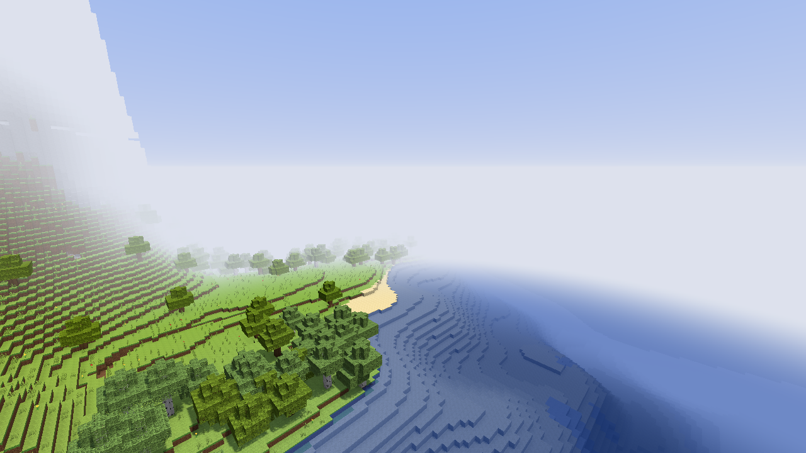
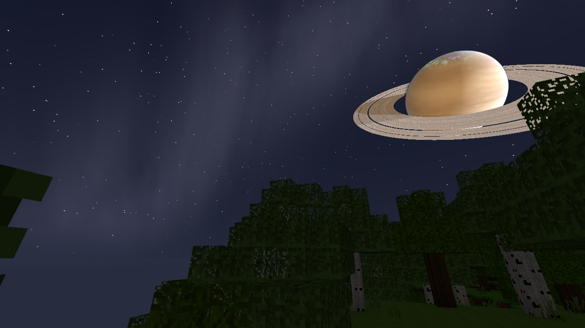
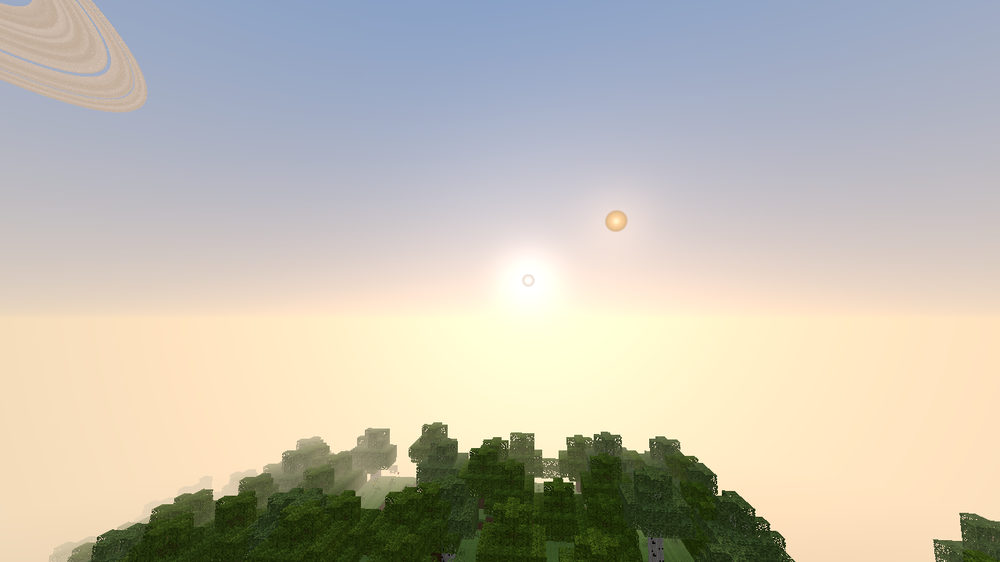
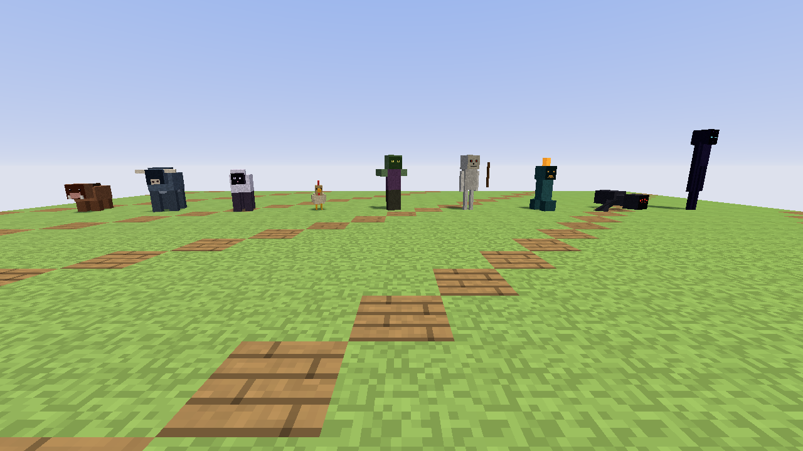

# Saturncraft

A single-player, browser-based voxel survival sandbox written from scratch in
JavaScript + WebGL ([three.js](https://threejs.org)). It reproduces the
observable mechanics of the classic block-survival genre's reference game
(version 1.21) — block behaviour, physics, survival, mobs, drops, spawn rules,
crafting progression — but on a moon with **three suns** and a **ringed gas
giant** hanging in the sky.

Every name, texture, model, sound and UI element is original and generated
procedurally at runtime: there are no image or audio files in the project.
Documented numbers (hardness, tool multipliers, drop chances, spawn weights,
light levels, damage, hunger values, movement speeds) come from the reference
game's public community wiki. In this document **"vanilla"** means that
reference game.

| Day under two suns | Night with the gas giant |
|---|---|
|  |  |
| **Twin sunset (Hearth + Ember)** | **The mob roster** |
|  |  |

## Quick start

**Play online:** https://landerverpoest-code.github.io/saturncraft/ (deployed
by `.github/workflows/pages.yml` on every push to `main`).

```bash
npm install
npm run dev        # http://localhost:5173
npm test           # unit tests (vitest)
npm run build      # production build in dist/
```

Requires a WebGL2 browser (any current Chrome, Edge, Firefox or Safari).
Click the canvas to capture the mouse. The world is saved to IndexedDB every
minute and on *Save & Quit*; *Continue World* on the title screen resumes it.

**World management** (title screen): the world list shows each world's screenshot (taken on every save), name, seed, play time, last played and size, with rename, copy, export, backups and delete (with confirmation). *Export* downloads one compressed `.saturnworld` file; *Import world* validates it (checksum, format version, size and chunk limits, nothing in it is ever executed) and adds it under a unique name. The last 3 snapshots of each world are kept automatically (about one per 15 minutes) and can be restored from the list; a world that fails its integrity check offers *Repair* (damaged chunks are dropped and regenerate from the seed, the original is kept as a backup) or a backup restore. A banner warns when browser storage is nearly full, and a failed autosave says so in game. *More world options* when creating a world: seed text, game mode, difficulty, cheats on/off, seasons (starting season, days per season), day/night cycle, hostile mobs, world events. (A flat world type is not offered: the terrain generator has no flat mode.) Saves carry a schema version and are migrated on load; `tests/fixtures/saves` holds one fixture per format.

Handy URL parameters for development: `?autostart=1&seed=123&rd=8`
(`&continue=1` to resume the save). `window.__game` exposes the running game
in the console.

## Controls

| Action | Keys / mouse |
|---|---|
| Move | `W` `A` `S` `D` (or arrow keys) |
| Jump / swim up | `Space` |
| Sneak (stops at ledges) | `Shift` |
| Crawl (a 0.6-high pose; you also crawl by walking into a gap one block high) | hold `C` |
| Sprint | `Ctrl` or `R`, or double-tap `W` |
| Look | Mouse |
| Mine / attack | Left mouse button (hold to mine) |
| Place block / use item / eat / draw bow | Right mouse button (hold to eat or draw) |
| Open workbench / furnace / chest, open doors, sleep in a bed | Right-click the block (sneak to place against it instead) |
| Till soil | Right-click grass or dirt with a hoe |
| Put on armour | Right-click with it, or `Shift`+click it in the inventory |
| Pick block into hand | Middle mouse button |
| Select hotbar slot | `1`–`9` or mouse wheel |
| Inventory (2×2 crafting); item catalogue in creative mode | `E` |
| Chat / commands (`/help` lists them) | `T`, or `/` to start a command |
| Fly (creative mode) | Double-tap `Space`; `Space` up, `Shift` down |
| Drop item (stack with `Ctrl`) | `Q` |
| Pause menu / close screen | `Esc` |
| Debug overlay (fps, position, light, suns) | `F3` |
| Camera: first person / behind / in front | `F5` |
| Help screen (searchable how-to topics) | `F1` (or pause menu > **Help**) |
| Hide HUD | `F2` |
| Rebind any of the above, play with a gamepad | pause menu > **Controls** (see below) |
| Play on a phone or tablet | on-screen controls turn on by themselves (pause menu > **Touch controls**) |
| Boat: board / steer / get out / break | Right-click it / `W` `S` `A` `D` / `Shift` / three hits |

Inventory screens: left-click picks up / places a stack, right-click splits a
stack or places one item, `Shift`+click moves a stack between sections,
`Shift`+click on a crafting result crafts as many as possible. The recipe book
beside every crafting grid lists the recipes (green = craftable with what you carry);
clicking one lays its ingredients into the grid (`Shift`+click: as many sets as possible).

Commands: `/gamemode survival|creative` (`/gm 0|1`), `/time set day|night|noon|midnight|<ticks>`,
`/time add <ticks>`, `/weather clear|rain|thunder`, `/tp x y z` (`~` = relative), `/give <item> [count]`
(e.g. `/give diamond_sword`, `/give oak planks 64`), `/summon <mob>` (Saturncraft names or the role,
e.g. `zombie`), `/caravan` (call a Roving Peddler), `/xp <n> [levels]`, `/kill`, `/heal`, `/clear`, `/spawnpoint`, `/seed`.

## Multiplayer

Play with up to **8 friends** in one world, peer-to-peer over WebRTC — there is
no game server, so it works on the static GitHub Pages build. The free public
[PeerJS](https://peerjs.com) signalling server only introduces the browsers;
after that all traffic goes directly between them.

**Host:** start or continue a world, press **Esc** and choose **Open to Friends
(host)**. The pause menu then shows a short room code (e.g. `K7QX2M`) and a join
link (`…/?join=K7QX2M`) with a copy button. Your world keeps running while the
pause menu is open; the host's world is the one that is saved (including
everything guests build).

**Join:** on the title screen enter the code next to **Join a Friend** (or just
open the join link). Your name comes from the **Your name** field (remembered in
the browser, `Player-1234` by default). The world downloads, the terrain is
generated locally from the host's seed, and you appear next to the host.

Every player can do everything; the host's game decides what happens.

| | How |
|---|---|
| World | seed + every edited chunk on join (the save format's RLE chunks); then block edits both ways. The host validates guest edits (reach), applies them with their consequences (supports, fluids) and rebroadcasts every change in its world — fluids, fire, crops, explosions — to everyone. The host keeps the chunks around every guest loaded, so crops grow, leaves decay, sand falls and mobs spawn there too. |
| Players | position, look, held item, sneaking, crawling, swinging, sleeping, riding at 10 Hz; drawn with the third-person player model and a name tag |
| Mobs | simulated by the host around every player; they chase the nearest player. Guests see 10 Hz copies and their hits (melee, arrows) are applied by the host. Guests feed and breed animals, shear and dye fleecers, tame Howlers, Vixlings, Cragbucks, Hoppers, Bristlebacks and Frostbears (the guest becomes the owner: the pet follows, defends and sits for that player only) and trade with settlers (the host counts the uses; a guest who is a Village Champion pays the lower price). Leads and Name Tags work for guests too: the host leashes (the animal follows that guest), ties to and unties from fence posts and names the mob, and every player sees the name labels and the ropes to whoever holds them (a player or a fence knot); a guest who leaves lets their leads fall |
| Deep Hush & raids | the host's sensors hear guests too (footsteps and landings worked out from their positions, blocks they place and break from their edits, eating, doors, levers, chests and dropped items from a distance-checked message), every player has their own warning level, a shriek's Darkness reaches guests, and guests see a Hushkeeper rise out of / sink into the ground. Guests near a raided village see the raid bar (sent once a second) and become Village Champions if they are in the village when it is won |
| Armour stands | owned by the host; a guest's item leaves their hand when they click and the host's answer to that request hands back what came off the stand (or the item itself if refused), so a slow or lost answer can never duplicate it |
| Items, orbs, arrows, boats, falling blocks | shared entities owned by the host: block drops, death drops, thrown items (Q), arrows and boats of any player appear for everyone; picking up asks the host, which hands each item to exactly one player. Boats can be ridden by anyone (the rider steers) |
| Chests & furnaces | owned by the host: opening one on a guest shows the host's contents, every click is checked against the host's copy (if someone else took the stack first, the click is undone), furnaces smelt on the host, and several players can use the same chest at once. Dungeon loot is rolled once, by the host |
| PvP | on by default (**PvP: On/Off** in the host's pause menu); the victim's own game applies the damage with its armour; death drops become shared items, guests respawn at their own bed |
| Sleeping | the night is skipped once every player is in bed |
| Commands | `/time`, `/weather`, `/gamerule`, `/summon` and `/dimension` typed by a guest are run by the host for the whole world (**Guest commands: On/Off**, default On); player commands (`/give`, `/tp`, `/gamemode`…) act on the guest |
| Dimensions | the group travels together: when the host (or a guest, by stepping through a portal or with `/dimension`) goes to the Cinderdeep or the Hollow, everyone follows and arrives next to the host |
| Time & weather | from the host, once a second |
| Chat | `T`, messages go to everyone with the sender's name; join / leave notices |
| Guest inventories | kept in the host's save by player name, restored on rejoin |
| Player list | hold **Tab**: everyone with their team colour, game mode (Survival / Creative / Adventure / Spectator) and ping (measured by each guest, shown for all); `/list` prints the same |
| Private messages | `/msg <player> <text>` (also `/w`, `/tell`), `/r <text>` answers the last one; only the two of them see it |
| Teams | `/team create <name> [color]`, `/team join <name>`, `/team leave`, `/team list`, `/team color <color>`, `/team disband`, `/team ff <on\|off>`, `/tc <text>` for team chat. Members have coloured names (name tags, markers, chat, the Tab list). **Friendly fire is off by default**: team mates cannot hurt each other with melee, arrows or PvP until the team's owner (or an op) runs `/team ff on`. Teams are kept in the host's save |
| Ping beacons | press **B** (or `/ping`) to drop a beacon on the block you look at: a glowing column and diamond in the world, shown on every team mate's HUD (pinned to the screen edge with an arrow and the distance when off screen) for 20 s. One per player, once a second, up to 250 blocks away; without a team it goes to everybody |
| Emotes | press **V** for the wheel, or `/emote <wave\|point\|sit>`: the other players see the pose on your model (a seat lasts until you walk off); your own body shows it in the third-person views (F5) |
| Spectating | dead guests get a **Spectate a Friend** button on the death screen; creative players (and the host) use `/spectate [player]`. The camera follows the friend's position and view, the mouse wheel picks the next one, **Shift** (or `/spectate off`) lets go and returns to the previous game mode |
| Kick, ban, ops | host and ops: `/kick <player> [reason]`, `/ban <player> [reason]` (online or offline), `/pardon <player>`, `/banlist`; the host alone runs `/op`, `/deop`, `/oplist` (ops cannot remove the host or each other). The pause menu has a **Kick** button per guest. Ops, bans, teams and guest identities are saved with the world. Bans go by name *and* by a random token each browser keeps (`localStorage`), so a new name from the same browser stays banned; a different browser, or cleared site data, gets round it |
| Names and identity | each browser sends a random token with its join; the host remembers which token first used a name, so a second browser cannot take over an op's, a team mate's or a guest's name (it joins as `Name-2`) |
| Join code | the pause menu shows the room code and join link with **Copy Link** and **Copy Code** buttons; guests see (and can copy) the code too, to pass it on |

Compatibility: the social features add optional fields (`hello.tok`, `welcome.soc` / `.teams`) and new message
types that older builds ignore, so `PROTOCOL_VERSION` stays 2 and old and new builds still join each other (the new
commands tell a guest when the host is too old). Tests: `tests/social.test.js` (includes a loopback host and guest, the
transport behind `?net=local`).

Disconnects: a guest who leaves is removed for everyone. If a guest's link to the host drops (timeout, closed
connection) the screen says so and **reconnects by itself** after a few seconds (or at once with **Reconnect now**):
the page reloads and rejoins the same room, up to 5 times, and the guest comes back where they stood with their
own inventory, health and experience (their game keeps a copy from the moment the link went; the host's copy,
which also keeps their last position, is the fallback, and a guest who died is restored from the host's record
because their things lie on the ground). The host replaces the old half-dead link of the same guest at once. A kick,
a ban, a different game version, a full world or the host closing the world end at the title screen with the reason.
If the host quits, guests see a message and go back to the title screen.
Single-player is unchanged when no session is open (the networking code in
`src/net/` is only loaded when hosting or joining).

Limits:

* All players are always in the same dimension (no split parties across dimensions).
* Raids start only from the host's Dark Omen: a Captain killed by a guest lays the omen on the host.
* A lead a guest holds is saved like the host's: after a reload the animal is back on the host's lead.
* The Void Wyrm boss bar is only shown to the host; guests fight the same boss.
* The host's tab should stay open (background tabs keep simulating, throttled);
  everything depends on the host's machine and connection.

For development, `?net=local` swaps WebRTC for a `BroadcastChannel` loopback
between two tabs of the same browser, and `?peerhost=…&peerport=…&peerpath=…&peersecure=0`
selects a self-hosted PeerJS server.

## Project layout

```
src/
  main.js                  title screen, settings, start/continue
  game.js                  20 TPS fixed-step loop, interpolated rendering, furnaces, autosave
  world/                   ── voxel world ──
    blocks.js items.js     block & item registries (hardness, tools, food, fuel…)
    generator.js           noise terrain, biomes, caves, ores, trees (runs in workers)
    worker.js              Web Worker: generation + initial light, section meshing
    world.js lighting.js   chunk storage, block edits, flood-fill sky/block light
    mesher.js              face-culled section mesher with smooth light + AO
    fluids.js              water / lava flow; gravity blocks live in world.js
    mining.js              break times and block drops
    enchantments.js        enchantments: table offers, anvil combining, effects
    textures.js            procedural pixel art for every block face
    save.js                saving a game (RLE-compressed chunks, per-chunk pack cache); saveFormat.js schema, migration, validation, export file; storage.js IndexedDB / memory store; worldManager.js list, backups, repair, import / export; newWorld.js creation options
    monuments.js sponge.js Tide Citadels (ocean monuments) and Soakmoss (sponge); monumentTextures.js
    maps.js landmarks.js   held maps, landmark marks, surveyed Explorer Chart maps (landmarkKinds.js)
  physics/                 constants.js (vanilla values), body.js (AABB, step-up, fluids)
  player/                  player.js, survival.js (hunger), inventory.js, crafting.js, interaction.js
  mobs/                    mobTypes.js, mob.js (AI), models.js, pathfinding.js,
                           spawnRules.js, spawner.js, drops.js, oceanMobs.js (Deepeyes),
                           companions.js (tame Vixlings / Cragbucks / Hoppers / Bristlebacks / Frostbears), babies.js (hostile babies),
                           youngAnimals.js (breeding of Buzzlings / Packhorns / Gillnewts / Dolphins / Frostbears)
  entities/                items, falling blocks, arrows, explosions
  sky/                     suns.js (pure orbital model), sky.js (lights, shadows, colours),
                           skyShader.js (atmosphere, suns, planet), gasGiant.js (ring mesh + particles)
  render/                  chunkRenderer.js, terrainMaterial.js, overlays.js, particles.js, enchantBooks.js
  ui/                      hud.js, screens.js, icons.js, input.js, style.css
  audio/                   audio.js (procedural Web Audio effects)
  net/                     multiplayer: protocol.js (wire format), transport.js (PeerJS / loopback),
                           editSync.js (block edits), session.js (host & client), remotePlayer.js,
                           entityMirror.js (guest copies of the host's entities),
                           social.js (teams, whispers, beacons, emotes, Tab list, ops / bans, reconnect rules)
tests/                     vitest suites (95 tests)
```

## The world

* **Chunks** are 16×16 columns, 384 blocks tall (y = −64 … 319), sea level 63.
* **Block ids** are 16 bits: the original blocks use 1–255, item ids use 256–1023, and newer blocks start at 1024 (`EXT_BASE` in `src/world/blocks.js`, numbered in the order they are listed, so only ever append). Old saves with 8-bit chunks still load.
  Generation and initial lighting run in a pool of Web Workers; light is then
  stitched across chunk borders on the main thread.
* **Meshing** is face-culled per 16³ section (in workers), with vanilla-style
  smooth lighting and ambient occlusion, then merged into two draw calls per
  chunk (opaque + translucent). Player edits are re-meshed synchronously so
  there is no flicker. Textures live in a mip-mapped texture array.
* **Terrain**: continentalness / erosion / ridge noise splines for height,
  3-D density noise for overhangs, temperature and humidity for 11 biomes
  (ocean, frozen ocean, beach, plains, forest, birch forest, taiga, snowy
  plains, desert, stony peaks, snowy peaks), smooth grass/foliage tinting,
  bare rock on steep slopes.
* **Caves**: "cheese" caverns and "spaghetti" tunnels from interpolated 3-D
  noise; lava fills cave air below y = −55; deepstone below y = 0 with a
  dithered transition; bedrock floor.
* **Ores** use the vanilla per-chunk feature table (counts, uniform/triangle
  height distributions, vein sizes, air-exposure discard) — e.g. diamonds peak
  near y = −59, iron has its mountain band, beryl only in mountains.
* **Blocks** break with vanilla hardness, tool multipliers, harvest tiers,
  the ×5 penalties for mining in water or while airborne, and the 5-tick delay
  between breaks. While mining, ten crack stages spread over the block
  (multiplied into its texture, so they follow its lighting), chips fly off
  the hit face and the arm chops continuously. Sand and gravel fall; plants, torches and cacti pop off when
  unsupported. Water spreads 7 blocks every 5 ticks, lava 3 blocks every 30
  ticks, with downhill seeking, infinite sources and lava/water hardening
  (obsidian / cobblestone / stone).

## Physics

The player and every mob run the vanilla movement integration at 20 ticks per
second: acceleration → swept AABB collision (Y first, then the larger
horizontal axis) → gravity 0.08 and drag 0.98 → friction (block slipperiness ×
0.91 on ground, 0.91 in air). Rendering interpolates between ticks.

| Quantity | Value | Measured in tests |
|---|---|---|
| Walk / sprint / sneak speed | 0.1 attribute, ×1.3, ×0.3 | 4.317 / 5.612 / 1.295 m/s |
| Jump | 0.42 b/t initial velocity | apex 1.2522 blocks, 12 ticks airtime |
| Sprint-jump boost | +0.2 in facing direction | |
| Terminal velocity | | 3.92 b/t |
| Step-up height | 0.6 | |
| Player box / eye | 0.6 × 1.8, eye 1.62 (sneak 1.5 / 1.27, crawl 0.6 / 0.4) | |
| Crawl speed | ×0.3 (as sneaking), no sprint or jump | |
| Fall damage | ⌈distance − 3⌉ | 10-block fall = 7 |
| Water / lava | 0.02 accel, ×0.8 / ×0.5 drag, buoyant jumping | |

Survival: 20 health, 20 food, 5 initial saturation; exhaustion from sprinting,
jumping, swimming, attacking, mining and taking damage; regeneration every 80
ticks at ≥ 18 food or every 10 ticks with saturation at full food; starvation
down to half a heart (Normal difficulty). Drowning after 15 s of air (2 damage
per second), lava 4 damage + 15 s of fire, fire 1 damage per second, cactus
contact damage, the 10-tick invulnerability window with damage replacement,
knockback, the attack-cooldown damage curve and critical hits.

## Three suns

The sky has three suns, each defined by its own orbital period, starting phase,
rise azimuth, orbital tilt, declination offset, colour temperature, intensity
and apparent size (`src/sky/suns.js`):

| Sun | Period (ticks) | Phase | Rises at | Tilt | Colour | Intensity |
|---|---|---|---|---|---|---|
| **Hearth** | 24 000 | 0.02 | 90° (east) | 20° | 5600 K, yellow-white | 1.00 |
| **Pale Warden** | 37 200 | 0.60 | 62° | 38° | 11 000 K, blue-white | 0.55 |
| **Ember** | 15 400 | 0.33 | 128° | 52° | 2700 K, red-orange (large disc) | 0.45 |

* **Day** = at least one sun above the horizon; **twilight** = exactly one sun
  up; **night** = all three below. Because the periods are incommensurable the
  pattern never repeats exactly: nights last roughly 1–7 minutes and occupy
  ~15 % of the time.
* **Combined light**: each sun contributes `intensity × smoothstep(elevation)`;
  the combination `1 − Π(1 − fᵢ)` drives the 0…11 sky-darkening value, exactly
  where vanilla uses its single sun. Effective sky light = raw sky light −
  darkening, so a lone Ember or Pale Warden gives a dim (light 9–10) "twilight
  day" where surface monsters still cannot spawn, while a fully dark sky gives
  light 4 like a vanilla night.
* **Mobs use the combined light**: hostile spawning uses the vanilla light test
  with the combined darkening, undead burn only when the combined sunlight
  counts as "day" (darkening < 4) and the brightness at their head exceeds 0.5,
  spiders turn neutral in bright combined light, voidwalkers flee daylight.
* **Rendering**: each sun has its own disc, glare and horizon scattering; where
  suns appear together their glows add and the scene light colour is the
  intensity-weighted blend of the visible suns. Each sun owns one
  shadow-casting directional light (three shadow maps in total); shadow maps
  are refreshed round-robin (brightest sun every 3rd frame, the others every
  6th) and lights below the horizon are switched off.

## Ringed gas giant

The world is a tidally locked moon, so the gas giant hangs almost fixed in the
southern sky with a slow libration.

* Ray-traced sphere in the sky shader with a **banded, animated atmosphere**
  (fbm noise with latitude-dependent differential rotation, polar hoods and a
  drifting storm oval), **soft limb glow** and a **subtle aurora** on the polar
  night side.
* **Rings** are a real mesh (`RingGeometry`) with a procedural density shader
  — broad bands, fine ringlets, a division gap — where **each radius rotates at
  its own Keplerian speed** (ω ∝ r^−1.5), plus 6 000 orbiting ice particles that
  follow the same law. Rings are **translucent** (back-lit side dimmer),
  show **specular glints**, receive the **planet's shadow** and cast their own
  shadow onto the cloud tops; the planet occludes the far side of the rings.
* **Lighting follows the actual sun directions**, so the planet shows phases,
  can be lit by suns that are below your horizon, and fades into the daytime sky.

## Survival content

### Mobs

| Mob | Vanilla role | Health | Speed | Size | Notes |
|---|---|---|---|---|---|
| Bristleback | pig | 10 | 0.25 | 0.9×0.9 | |
| Mooxen | cow | 10 | 0.20 | 0.9×1.4 | |
| Fleecer | sheep | 8 | 0.23 | 0.9×1.3 | |
| Cluckling | chicken | 4 | 0.25 | 0.4×0.7 | slow fall, lays eggs every 5–10 min |
| Shambler | zombie | 20 | 0.23 | 0.6×1.95 | melee 3, armour 2, burns in sunlight |
| Rattler | skeleton | 20 | 0.25 | 0.6×1.99 | bow every 40 ticks, strafes, burns in sunlight |
| Fizzler | creeper | 20 | 0.25 | 0.6×1.7 | 30-tick fuse within 3 blocks, power-3 explosion |
| Skitterer | spider | 16 | 0.30 | 1.4×0.9 | climbs walls, leaps, neutral in bright light |
| Hexwife | witch | 26 | 0.25 | 0.6×1.95 | throws splash elixirs every 60 ticks within 10 blocks, drinks her own, 15 % magic damage |
| Dune Shambler | husk | 20 | 0.23 | 0.6×1.95 | melee 3 + Hunger, armour 2, no sun burn |
| Sodden Shambler | drowned | 20 | 0.23 | 0.6×1.95 | swims after targets in the water, burns in sunlight |
| Rime Rattler | stray | 20 | 0.25 | 0.6×1.99 | Rattler whose arrows cause 30 s of Slowness |
| Voidwalker | enderman | 40 | 0.30 (+0.15 angry) | 0.6×2.9 | angered by eye contact, teleports, hurt by water, dodges arrows |
| Deepeye | guardian | 30 | swims | 0.85×0.85 | 2 s beam (6), thorns 2 while still, Tide Citadels only |
| Elder Deepeye | elder guardian | 80 | swims | 1.99×1.99 | 1.5 s beam (8), Mining Fatigue III every minute, 3 per citadel |
| Dune Strider | camel | 32 | 0.18 | 1.7×2.4 | saddled it seats two, steps up 1.5 blocks, charged dash (2.75 s cooldown), breeds with cactus |
| Hoverling | allay | 20 | flies | 0.35×0.6 | gathers dropped items matching the one you give it and brings them back |
| Gustling | breeze | 20 | flies | 0.5×0.9 | circles 5 blocks off at head height, winds up for 12 ticks and hurls a Gust (1 damage, flings you away), turns arrows aside, Proving Vaults only |
| Thistlehorn | deer | 14 | 0.22 | 0.9×1.6 | grazing herd animal of Highland Meadows and savannas, the whole herd bolts when one is hurt, breeds with beetroot or sweet berries, ridable once tamed with them, harnessed and saddled |
| Dustmole | meerkat | 6 | 0.16 | 0.5×0.45 | lives under desert and badlands sand (cannot be aimed at), digs out to look at a quiet player, digs back from one who rushes it |
| Gloamlynx | lynx | 14 | 0.30 | 0.7×0.9 | shy predator of taiga and snow that stalks at dusk and by night, freezes when watched, never attacks, bolts from light and daybreak |
| Tarnling | tadpole | 3 | swims | 0.4×0.3 | pond dweller; an empty Bucket scoops it up, the full bucket lets it go again |

Mob movement uses the same physics with vanilla's mob acceleration (speed²),
A* pathfinding over walkable cells, panic when hurt (passives), melee reach
`(2·width)² + target width`, the skeleton's bow logic and the fuse/swell logic.

**Drops** (no Looting): Bristleback 1–3 pork chops; Mooxen 0–2 leather + 1–3
beef; Fleecer 1 wool + 1–2 mutton; Cluckling 0–2 feathers + 1 raw fowl (meat
drops cooked if the mob was burning); Shambler 0–2 rotten flesh + 2.5 % rare
drop on player kills; Rattler 0–2 arrows + 0–2 bones; Fizzler 0–2 blast powder;
Skitterer 0–2 string + 1/3 chance of an eye on player kills; Voidwalker 0–1
void pearl; Hexwife 1–3 rolls of 0–2 glass vials, glowshard dust, blast powder,
cinnabar dust, skitterer eyes, sugar or sticks (sticks twice as likely); Gustling 1–2 Gale Rods on player kills; Dune
Shambler as the Shambler; Sodden Shambler 0–2 rotten flesh + 11 % copper ingot
on player kills; Rime Rattler as the Rattler.

**Spawning** follows the vanilla natural-spawn algorithm: each tick one attempt
per chunk within 8 chunks at a random height below the heightmap; packs of up
to 3 groups × up to 4 tries with ±5 jitter; at least 24 blocks from the
player; mob caps of 70 hostile / 10 passive scaled by chunk count / 289;
passive attempts only every 400 ticks plus 10 % chance of a herd when a chunk is
first generated; biome spawn weights (monsters: Skitterer 100, Shambler 100,
Rattler 100, Fizzler 100, Voidwalker 10, Hexwife 5; deserts Shambler 20 / Dune
Shambler 80, snowy plains Rattler 20 / Rime Rattler 80, oceans + Sodden Shambler 5; animals in grassy biomes: Fleecer 12,
Bristleback 10, Cluckling 10, Mooxen 8). Monsters need block light 0, raw
sky light ≤ rand(32) and combined light ≤ rand(0…7); animals need grass and
light > 8. Hostiles despawn instantly beyond 128 blocks and with 1/800 chance
per tick beyond 32 blocks after 30 s without interaction; animals persist (also
across chunk unloads and saves).

* **Dune Striders** (reference: camel; `src/mobs/duneStrider.js`): tall, humped desert beasts, one by the well of every desert village and now and then a lone one (or a pair) in the open desert. No taming: right-click with a Saddle, then with an empty hand to climb on (sneak to get off); WASD and sprint steer it and it walks straight up 1.5-block steps. Hold the jump key to charge a **dash** and let go to leap far ahead (a longer charge leaps further); it then needs 2.75 s to recover, shown by a gauge above the experience bar. In multiplayer a guest can take the **second seat** behind the host's rider. Riders sit too high for Shamblers and other mobs of their size to hit them. Left alone a Strider sits down now and then; it breeds (and heals) with cactus, its young keep close to the grown-ups, and it drops 0-2 leather (and its saddle)
* **Hoverlings** (reference: allay; `src/mobs/hoverling.js`): small blue spirits on glassy wings, kept in a dark oak cage beside every Marauder outpost, rarely found in forests and drifting through Hollow Cities. Right-click one with an item to hand it over: it gathers dropped items of the same kind within 32 blocks (up to a stack) and brings them to the player who gave it the item, or drops them on a Chime Block it heard ring within the last 30 s. Right-click with an empty hand to take the item back. Near a playing jukebox it dances; it drops nothing of its own (only what it holds)
* **Gustlings** (reference: breeze; `src/mobs/gustling.js`): small wind spirits that haunt the Proving Vaults (a Proving Spawner can be set to call them; they do not spawn elsewhere). A pale head over a spinning wreath of rods, flying: it circles a player 5 blocks off at head height, bobbing, and with a line of sight within 16 blocks winds up (the rods whirl three times as fast, 12 ticks, also seen by guests) and hurls a **Gust**, a fast ball of wind (0.9 blocks/tick) that does 1 damage and flings whoever it hits along its flight (1.1 blocks/tick, up 0.4+); a Gust that strikes a wall bursts and shoves everything within 2.5 blocks, the further the weaker, never other Gustlings. Arrows, spears and fireballs are turned aside; melee and elixirs hurt it. 20 HP, no fall damage, 10 experience. Drops 1–2 **Gale Rods** on a player kill: right-click one to burst upwards about seven blocks (it is used up) and float down gently for 5 s

* **Fauna round: Thistlehorns, Dustmoles, Gloamlynxes and Tarnlings** (`src/mobs/fauna.js`; box models in the existing style, voices `thistle`, `burrow`, `yowl` and `plip` with captions, Field Guide entries made from the mob and spawn tables; mob snapshots keep their 25 fields, using the flags and counters they already carry). **Thistlehorn** (reference: deer): an antlered grazer in three coats that keeps with its herd, puts its head down to graze and is startled as a herd by a hurt neighbour or a player sprinting at it; spawns on Highland Meadows and savannas; fed beetroot or sweet berries two grown ones have a fawn (no antlers yet) that follows the herd; drops leather and 1–3 **Raw Venison** (cooks to **Roast Venison**, 8 hunger). **Dustmole** (reference: meerkat): a small burrower placed under sand in deserts and badlands (at most 5 about you); hidden it cannot be aimed at, hit or seen (not discovered in the Field Guide either), digs out with a puff of sand to look at a player who stands still 3–14 blocks away, and digs back down and tunnels off when you rush it, sprint past or hurt it; drops sand, flint and clay. **Gloamlynx** (reference: lynx): a shy predator of taiga, snowy taiga and snowy plains that spawns only when the sun is low (combined light under one half); it stalks a player at about ten blocks, creeping nearer only while the player is not looking at it (it freezes crouched when watched), circles, backs off if you come within seven blocks, never attacks the player, hunts Hoppers and Clucklings, and bolts (with a yowl) from a torch or other light in your hand, a lit camp beside you, light on its own spot, and from daybreak, when it slinks away and is gone; no taming. **Tarnling** (reference: tadpole / axolotl bucket): a tiny four-coloured pond dweller placed in shallow water (depth 1–4) of ponds, tarns and waterholes (at most 6 about you); it keeps to its pond, darts from a player who splashes up to it but lets a sneaking one come close, and dries out on land; right-click it with an empty **Bucket** to scoop it up (a **Bucket of Tarnling**, which keeps its colour; a guest's catch is made on the host and the bucket dropped at the guest's feet), and place the bucket to pour the water out and let it go (it then stays; a guest asks the host to make it). Dustmoles and Tarnlings keep caps of their own and do not use up the farm animals' cap.

### Items and progression

Logs → planks → sticks / workbench → wooden, stone, iron, golden and diamond
pickaxes, axes, shovels and swords (vanilla speeds, damage, attack speed and
durability) → furnace (200-tick smelting, vanilla fuel values) → ingots, glass,
stone, cooked food; torches, buckets (water/lava pick-up and placement),
bow and arrows, storage blocks, wool, sandstone, stone bricks. Food values
(hunger/saturation) and side effects (hunger from rotten flesh and raw fowl,
poison from eyes) follow the documented table.

## Implemented vs. not yet implemented

**Implemented** (vanilla features)

* Chunked 384-high world, worker generation, biomes, caves, ore distribution, trees, plants
* More biomes: swamp (flat pools, lily pads, vine-hung oaks, clay), jungle (giant 2x2 trees, bushes, vines, melons), savanna (acacia), badlands (red sand, striped terracotta mesas), dark forest (dark oak canopy, huge mushrooms), mushroom fields, snowy taiga and flower forest, with their own tints, wood types, saplings, recipes and spawns; mountains rise gradually out of rolling foothills
* Mining with hardness/tool tiers/durability, block drops, placing, pick-block
* Sky light + block light with smooth lighting and AO; torches, lava, lit furnace glow
* Gravity blocks, water and lava flow, source creation, obsidian/cobblestone/stone formation
* Player physics, sprinting, sneaking (ledge stop), swimming, step-up, fall damage
* **Crawling** (reference: the crawl pose; `src/player/crawl.js`): hold `C`, or simply walk into a gap one block high (a slab, a trapdoor, a tunnel you dug) and you drop to a 0.6-high pose that fits through it, with the eyes lowered to 0.4 blocks (the camera eases down). You crawl as slowly as you sneak (×0.3), cannot sprint or jump, and stay down until you are out from under the low ceiling and have room to stand; it does not start in mid-air, while swimming, gliding, flying, riding or asleep. Other players see you lying face down, crawlers are lower targets (arrows and mobs aim at the lowered body), and in multiplayer the pose travels in the existing player-state flags (a new `CRAWL` bit; the mob snapshot layout is untouched)
* **Poses and effects in multiplayer** (`src/net/protocol.js`, `src/net/remotePlayer.js`): other players are drawn sprint-swimming (flat, head first, following their pitch) and gliding on a Voidwing (stretched out along the flight) via two more player-state flag bits (`SWIM`, `GLIDE`); a swimmer is a low target for mobs and a glider looks from low eyes. The state also ends with the average colour of the player's potion effects, so everyone sees the same swirl of effect particles around them as around yourself (fewer while invisible). Relayed guest states keep their armour and colour too.
* Health, hunger, saturation, exhaustion, regeneration, starvation, drowning, fire, lava, cactus
* Attack cooldown, critical hits, knockback, armour formula for mobs, invulnerability frames
* 9 mobs with AI, pathfinding, drops, natural spawning, caps and despawning
* Explosions (ray-based block destruction with blast resistance, exposure-scaled damage, 1/power drop survival)
* Inventory, hotbar, 2×2 and 3×3 shaped/shapeless crafting with a recipe book, furnace smelting
* Farming: hoes till grass/dirt; tall grass drops seeds (1/8); wheat grows through 8 stages on random ticks (3 per section per tick) with the reference growth-speed formula, needs light ≥ 9; farmland is moistened by water within 4 blocks, dries out, reverts to dirt and can be trampled; bread from 3 wheat
* Grass spreads to nearby dirt in light ≥ 9
* Armour: leather/golden/iron/diamond helmets, chestplates, leggings and boots with the reference defence points, toughness, durability and damage formula (falls, drowning, burning, starvation and poison bypass it); armour slots in the inventory, right-click or shift-click to wear; armour bar
* Experience: orbs from player kills (monsters 5, animals 1–3) and ores (coal 0–2, azurite 2–5, cinnabar 1–5, diamond/beryl 3–7) that drift to the player within 8 blocks; reference level curve, XP bar and level, 7 × level (max 100) dropped on death
* Beds (3 wool + 3 planks): sleeping only when all three suns are down and no monster within 8 blocks; 5 s of sleep skips to the first sunrise; sets the respawn point (lost if the bed is gone)
* Animals follow a player holding their food (cows/sheep wheat, chickens seeds, pigs carrots); feeding two adults makes them breed (a baby that grows up in 20 minutes, 5-minute cooldown, 1–7 XP); feeding babies speeds up growth
* Shears (2 iron) shear sheep for 1–3 wool; sheep regrow it by eating grass
* Carrots: a crop planted on farmland (2–5 per ripe plant), food, and part of the Shambler's rare drop
* Cocoa pods grow on small jungle trees (three sizes, 1 in 5 per random tick) and on jungle logs you plant beans on; ripe pods give 2–3 beans (brown dye; wheat + beans + wheat = 8 cookies)
* Potatoes (2–5 per ripe plant, 2 % poisonous potato; bake them in a furnace) and beetroots (beetroot + seeds; 6 beetroots + bowl = beetroot soup, which gives the bowl back); both grow in village farms, are sold by farmers and feed pigs/chickens
* Fences (oak/spruce/birch) that connect to fences, gates and full blocks, with 1.5-block collision so nothing jumps over; oak fence gates that open and close
* Villages (one per 320 × 320-block region at most, in plains, desert, taiga and snowy plains): a well, four dirt-path roads and houses (log/plank, sandstone or spruce/cobblestone styles, with doors, windows, a bed and a workbench or chest), farms of wheat or carrots and lamp posts; `/locate village` finds the nearest
* Settlers raise children when the village has more beds than settlers (two adults by day, then a 5-minute pause); children grow up in 20 minutes and then look for a job-site block (see below)
* **Job-site blocks** (`src/mobs/jobSites.js`; reference: villager workstations): every trade has its block - farmer: Composter, librarian: Lectern, smith: Blast Furnace, shepherd: **Loom**, butcher: Smoker, fletcher: **Fletching Table**, cleric: Brewing Alembic. A settler without a trade (a child grown up, or a new one) claims the nearest unclaimed job-site block within 48 blocks, takes up its trade (a small green burst; its robe turns the trade's colour) and keeps the block for itself; break a claimed block and the settler loses its trade again unless someone has traded with it, in which case it keeps the trade and later claims another block of the same kind. Every village house has its settler's block inside beside the door. The claim is saved with the settler; in multiplayer the host decides and guests see the robe colour change. The **Loom** (two string over two planks) takes wool or carpets of any colour and a dye (Bone Meal bleaches) and recolours up to eight at a time; the **Fletching Table** (two flint over four planks) is a job site only
* Settlers live in the village houses: farmer, librarian, smith, shepherd, butcher, fletcher (arrows, bows, crossbows, tipped arrows) or cleric (gilded apples, glowshard dust, vials) (robe colour; a **cartographer**, see Explorer Charts below, only appears when a settler claims a Cartography Desk); they flee Shamblers, stay near home and go inside at night; right-click to trade goods for beryl and beryl for goods (12 uses per offer, restocked every half day, XP for trading)
* **Deeper trading** (`src/mobs/trades.js`, `src/mobs/reputation.js`; reference: villager trade levels, reputation and demand): three more trades - **mason** (Masonry Bench: stone, bricks and concrete), **toolsmith** (Whetstone Stand: stone to diamond tools) and **armorer** (Armorer's Rack: leather, gold and diamond armour, shields) - each with its own job-site block, recipe and a village house variant (3 in 10 houses: stone base and chimney, torch porch, cobblestone corners). Settlers level up with the trades done with them (Novice, Apprentice, Journeyman, Expert, Master at 8, 24, 50 and 90 trades): a new settler stocks only its first-tier offers and every level adds one or two better ones; the trade screen shows the level with a progress bar. Each village has a reputation for you (-100..100, saved with the player; in multiplayer the host keeps every guest's and tells them of changes): trades (up to +45), gifts (hold goods the settler buys or treasure and press the Gift button, one per restock), and winning a raid raise it; hitting (-3) or killing (-25) a settler lowers it. It moves every price in that village between 30 % cheaper and 60 % dearer, and settlers turn their back below -60. Demand: each use of an offer makes it 6 % dearer until the next restock (the 12-use limit and half-day restock are unchanged). Old saves load: settlers count their past uses as trades done and players start with a clean name
* Dungeons: mossy cobblestone rooms (5–7 × 4 × 5–7 inside, 14 attempts per chunk, 1–5 openings into caves) with a monster spawner (Shambler 50 %, Rattler/Skitterer 25 % each; active within 16 blocks, 4 spawn attempts every 10–40 s, at most 6 nearby, light ≤ 11) and up to two loot chests; mined spawners give 15–43 XP
* Sugar cane on shores (grows to 3 blocks next to water) → paper → books → bookshelves; clay → bricks; glass panes that connect
* 16 dye colours: bone meal (white), flowers (yellow/red), azurite (blue), cactus in a furnace (green), coal (black) and mixes; dyed wool; sheep come in natural colours (white, black, grays, brown, rare pink), can be dyed and drop/shear their colour
* Hay bales (9 wheat): landing on one takes 80 % off the fall damage
* Melon and pumpkin stems (seeds from slices and pumpkins) grow on farmland in 8 stages and then set a fruit on a free neighbouring block of soil, one at a time
* Pumpkin patches (plains, taiga) and melons (forests): pumpkin + torch = pumpkin lantern (light 15), melons drop 3–7 slices, pumpkin pie
* Howlers (wolves) in packs of 4 in forests and taiga: they hunt Fleecers and Clucklings and the whole pack turns on whoever hurts one; tame with bones (1 in 3), then they sit/stand on right-click, follow you (teleporting when over 12 blocks away), attack what hurts you or what you hit, heal and breed with meat (pups are tame), red collar
* Gallopers (horses) in plains and savannas, in five coats with their own health and jump strength: climb on with an empty hand; a wild one bucks you off after a few seconds but may accept you (the chance grows each time and with wheat or apples); saddle a tame one (3 leather + iron) to ride it with WASD, sprint and Space to jump; they step up whole blocks
* **Mounts and vehicles round** (`src/mobs/mounts.js`; reference: horse armour, chest boats, minecarts with chest and furnace, riding stamina): **Horse Armour** (iron, gold or diamond: 6 ingots or gems and a leather in a boot-shaped pattern) goes on a *tame* Galloper with a right-click, one piece at a time (a worse piece is swapped out and handed back), stops damage by its tier (5, 7 and 11 points, the diamond one with toughness) at the price of tiring the Galloper sooner, shows as plates over its body, neck and head, and always drops with it. Gear lives in the mob equipment slots, so guests see it through the equipment ids the mob snapshot already carries, with no change to its layout. The **Thistlehorn** is now ridable: win one over with beetroot or sweet berries (a chance each time), fit a **Thistle Harness** (6 leather, string and a gold nugget) and then a Saddle, and climb on with an empty hand; it jumps and steps like a Galloper and drops its tack when it dies. **Riding speed**: a ridden mount is steered with full input and tops out at about 36 blocks per second per point of speed (a Galloper 8 blocks/s, 10.5 sprinting, never over 12; a Dune Strider 6.5; wading in water is as slow as wading on foot), where before the mob's walking push was applied twice and a ridden Galloper crawled along at 2.2 blocks/s. **Stamina**: after about four minutes of riding a mount tires and slows down (to 55 %), worn out it cannot sprint and loses a heart now and then (never the last); its food (wheat or apples for Gallopers, beetroot or berries for Thistlehorns, cactus for Striders) relieves it and heals two hearts, and a rest does too; a thin bar above the experience bar shows it, and a hurt mount (under 30 % health) is slower. A tame mount follows its owner and hurries after them (teleporting when far behind); sneak with an empty hand on one to tell it to stay or follow again. Whoever rides a mount feels its landing (the same fall damage), and getting off puts you on the nearest free ground, never inside a block
* Maps: an Empty Map (8 paper around a compass) used in the air becomes a map of the 128 × 128-block square around you (reference grid); held in the hand it keeps drawing everything within 64 blocks from above — block colours with biome tints, brighter and darker slopes, water shaded by depth — with a white arrow for you (a dot when you are outside the square); maps are saved with the world
* **Map landmarks** (`src/world/landmarks.js`): a held map notes every structure it comes within 40 blocks of, inside its own square, and draws a glyph for it — villages, desert and jungle temples, igloos, raider outposts, swamp huts, shipwrecks, Tide Citadels, **Sunken Ruins**, **Sun Tombs**, **Skywatch Towers**, **Rimekeeps** and **Sporehalls** each have their own shape and colour; the marks are saved with the map (underground places such as mineshafts, buried ruins and the Proving Vaults are never marked, so they stay secrets)
* **Explorer Charts** (reference: explorer maps): seven items — Sunken Ruins, Sun Tomb, Skywatch, Rimekeep, Sporehall, Tide Citadel and Outpost Chart. Right-click one and it is used up for a named map of the square round the nearest structure of its kind within 3200 blocks (the same one `/locate` finds): the terrain is already surveyed from the generator (grass, sand or snow by biome, water darker where it is deeper), the structure is marked with a red ring, and walking over the ground paints the real blocks over the survey. Without such a structure in reach (or outside the overworld) the chart is kept. Charts are found in shipwreck map chests and sold by cartographers
* **Cartography Desk** (two paper over four planks; `src/mobs/jobSites.js`) and **Cartographer** settlers (`src/mobs/trades.js`): a settler without a trade claims the desk like any job-site block and puts on a blue robe. A cartographer buys paper (24), ink sacs (16) or compasses (2) for 1 beryl, and sells two or three of: Empty Maps (2 beryl), compasses (3), clocks (4) and Explorer Charts (8–14 beryl, the harder places dearer) — **every cartographer stocks at least one chart**. Village houses are never planned with cartographers, so existing villages generate as before
* Cragbucks (goats) on the stony and snowy peaks: they take big leaps, ignore fall damage, can be milked and bred with wheat, and every 30–300 s lower their head and ram a player who is not sneaking (or another animal) within 16 blocks, flinging it away; charging into stone, logs or ore can knock off one of their two horns — a Crag Horn that sounds far and wide when used
* Buzzlings (bees): wild Bee Nests hang on oaks and birches in plains, flower and birch forests (three bees each); bees fly to flowers within 22 blocks, gather nectar for a few seconds, dust crops they pass over (they grow a stage) and bring it home — each trip adds a level of honey until the nest drips (level 5). Shears cut 3 Honeycomb, a Glass Vial fills a Honey Bottle (6 food, cures Poison; 1 → 3 sugar); unless a campfire smokes up to 5 blocks below, the bees attack. Bees shelter at home at night and in the rain; hitting one or breaking their nest angers the swarm: each bee stings once (2 damage + Poison) and dies soon after. Beehives (6 planks + 3 honeycomb) work like nests
* Shellbacks (turtles) on beaches: slow on land, fast swimmers, each remembers its home beach; bred with sugar cane, the mother swims home and lays 1–4 eggs on the sand, which crack at night (rarely by day) and hatch after three cracks; a hatchling drops a Scute when it grows up, and 5 scutes make a Shellback Helmet (2 armour) that keeps 10 s of Water Breathing topped up while your head is above water
* Squawklets (parrots) in five plumages flutter through jungles and settle on the ground now and then; tamed with seeds (1 in 3) they follow their owner in flight or sit on command, and they mimic the voice of monsters within 20 blocks; they drop feathers
* Purrlings (cats) in six coats roam every village: they shy away from players, creep closer to someone standing still with raw fish, and are tamed with fish (1 in 3); tame ones sit on command, follow and teleport to their owner, breed with fish, and Fizzlers within 6 blocks back off from them and their fuse goes out
* Hoppers (rabbits) hop through plains, taiga, snow and desert and drop raw rabbit and hide (4 hides make leather); Frostbears roam the snowy plains, peaceful until one is hit, then the whole group fights back; Vixlings (foxes) doze in the daytime, run from players who do not sneak, and hunt Clucklings and Hoppers at night
* Sprint-swimming: sprint with your head under water to swim flat (0.6 high) in the direction you look at about 5.6 blocks/s, shown on the player model
* Compass (4 iron + cinnabar: its needle points at the world spawn, and spins in other dimensions) and clock (4 gold + cinnabar: shows the sky brightness and how many suns are up), both live in your hand
* Signs (6 planks + stick → 3): standing on a block or hung on a wall, four lines of up to 15 characters typed in a sign editor (right-click to edit again); saved with the world and shared in multiplayer
* Item frames (8 sticks + leather): hang on a wall, right-click to put the held item in and again to turn it in 45° steps, hit to take it out; saved and shared in multiplayer
* **Armor Stands** (six sticks around a stone or smooth stone slab, or smooth stone): placed on top of a block facing you (in 45° steps), a wooden figure on a stone plate. Right-click with armour to dress it (swapping with what it wore), with any other item to put that in its hand, and with an empty hand on its head, body, legs or feet to take that piece off; two quick hits (one in creative) knock it down, dropping the stand and everything on it; saved (per dimension) and shared in multiplayer
* **Leads, Name Tags and Bundles**: a **Lead** (4 string round a slimeball, makes 2; also in dungeon chests) leashes an animal on right-click: it walks after you once the rope is longer than 3 blocks, is dragged harder past 6 and the lead snaps (dropping it) past 12; right-click a fence post to tie your animals to a rope knot there (right-click the post again to take them back; breaking the post drops the leads); the rope hangs as a sagging catenary and the leash is saved. A **Name Tag** (dungeon and shipwreck loot; right-click it in the air to write a name) names the mob you use it on: named mobs never despawn, keep their name in the save and show it on a floating label within 8 blocks or when looked at. A **Bundle** (string over leather, or string and rabbit hide) holds 64 weight of mixed items (each weighs 64 / its stack size): right-click it in the inventory with a stack to put it in, with an empty hand to take the last thing out (or right-click in the world to drop it); its tooltip shows the contents as a grid and its slot a fill bar (reference: lead, name tag, bundle)
* Paintings (8 sticks + wool): eight original procedurally painted pictures from 1 × 1 to 4 × 3 (three suns, a ringed moon, dunes, a harbour, peaks, a forest, a shoreline, a city in the sky); right-click a wall to hang the largest that fits; breaking any part takes the whole picture down
* Campfires (3 sticks, coal, 3 logs: light 15, animated flames, rising smoke, burn whoever stands on them, drop 2 coal) and lanterns (iron + torch: light 15, standing, or hanging when placed under a block); torches smoke and lava throws embers
* **Candles** (string over honeycomb; dye them in any of sixteen colours): place up to four of the same colour in one block, light them with flint and steel (light 12, a little flame on each wick) and snuff them out with a click
* **Scaffolding** (six from six bamboo and a string): only its top is solid, so you stand on it, sneak to sink down through it and jump to climb up inside; click the side of a tower to build onto its top, or the top you stand on to reach out sideways; each block may stand at most 6 blocks out from a column on the ground, and taking out the footing brings the whole frame down (it breaks at once)
* **Flower Pots** (three bricks): right-click with a sapling, flower, mushroom, dead bush, cactus, azalea or bamboo to plant it, and with an empty hand to take it back. **Chains** (iron nugget, ingot, nugget; nuggets from an ingot and back) hang lanterns from the ceiling
* **Archaeology** (reference: brushing suspicious blocks): a **Brush** (feather, copper ingot, stick; 64 uses) held on **Suspicious Sand** or **Suspicious Gravel** sweeps it clean over 2.5 s in four visible stages with dust flying, then the block turns to plain sand or gravel and its find pops out; let go early and the dig slowly fills back in, and if the block falls it crumbles and the find is lost. Finds are fixed by the seed and the spot: eight **Pottery Sherds** (Ringed, Three Suns, Wyrm, Tide, Sprout, Watcher, Antler, Ember), beryl, coal, gold nuggets and more. Look in desert temple floors and their hidden chamber, under desert wells, in the sea bed around shipwrecks and in **Buried Ruins** (half-sunk terracotta and mud-brick walls in plains and taiga, `/locate buried`)
* **Decorated Pots** (four bricks or sherds in a diamond): each sherd's motif shows on the side where it was laid (top = back, bottom = front, which faces you when placed); broken with a tool the pot drops whole, by hand it shatters back into its sherds and bricks
* **Beacons** (glass, obsidian and a Suncore from Elder Deepeyes or the Void Wyrm) on 1–4 layer pyramids of iron/gold/diamond/beryl blocks shine a beam (tinted by stained glass) and give Speed, Haste, Resistance, Jump Boost or Strength (Regeneration or level II at level 4) within 10+10×level blocks; pay with an ingot, diamond or beryl.
* **Grindstone** (stick, stone slab, stick over two planks): put in two worn items of the same kind to merge them (their durability plus 5 %), or one enchanted item or book; every enchantment but curses comes off, and taking the result gives back some experience as orbs. **Stonecutter** (iron ingot over three stone; its saw spins): one stone block becomes one of its cut shapes - bricks, chiseled or polished forms, two slabs, stairs or a wall - picked from a list, shift-click to cut the whole stack
* Shields (6 planks + iron ingot, 336 uses): hold right-click to raise one (after a quarter second); it stops melee hits and arrows from in front, wears with the damage it takes (hits under 3 damage cost nothing), pushes attackers back and slows you to a fifth. A block made in the first third of a second after the shield comes up is a **parry** (`src/player/shield.js`): it costs no durability, throws the attacker back twice as hard (sparks fly) and leaves a mob staggered for 1.5 s. **Axes** (in the hand of a mob, or of another player) knock the shield down for 5 s: it cannot be raised until a small grey bar under the hotbar has filled again. A shield that wears out breaks
* Flitters (bats): up to 15 flutter about in dark caves near you (light ≤ 3), squeak, and hang upside down from ceilings until you come close
* Inklings (squid) in deep ocean water: they drift in pulses with sweeping tentacles, squirt ink and dart away when hit, and drop 1–3 ink sacs (black dye)
* **Shipwrecks** (`src/world/shipwrecks.js`, 40 % of 160 × 160 regions): a 13- or 17-block hull of oak, spruce, dark oak or birch planks with a log keel, fence railings, a stern cabin, a snapped mast and a holed deck, lying on the ocean floor (at least 7 deep) or run aground on a beach; whole or only its bow or stern half, upright or keeled over and pitched, in any of four headings. One to three chests: **supplies** in the bow hold (crops, bread, dried kelp), **treasure** under the stern (iron and gold ingots and nuggets, azurite, diamonds, always some beryl) and a **map room** in the cabin (always an Empty Map, paper, a compass or clock). Planned from the seed, stamped chunk by chunk, kept clear of Tide Citadels, villages and ruined rifts; `/locate shipwreck`
* **Tide Citadels** (ocean monuments, `src/world/monuments.js`): at most one per 32 × 32-chunk region (the reference spacing: a chunk within the region's first 27 on each axis, the average of two rolls, so neighbours are at least 5 chunks apart), only where the ocean is deep (the centre and eight points round the footprint are ocean with the floor at y ≤ 43/48). A symmetric 58 × 58 temple from y 39 to 61, flooded with water and planned from the seed alone, stamped chunk by chunk: a lower hall of 7 × 7 rooms around a gallery that runs back from the entrance (doorways between rooms, lanterns in the ceilings and floor), one or two mirrored pairs of **sponge rooms** hung with Wet Soakmoss, two raised wings at the back, a terrace over the middle and the core on top, where a shell of Dark Tidestone holds **8 gold blocks**; a skirt and pillars reach down to the sea floor. `/locate monument` (or `citadel`)
* **Sunken Ruins** (`src/world/sunkenRuins.js`, about one 192 × 192 region in twenty on deep, level ocean floor, any of four headings): a drowned 27 × 17 stone-brick hall (mossy, cracked and chiseled bricks) with a broken outer wall and entrance arch, two rows of columns broken off at every height, tide lanterns in the floor and a raised dais at the back where a gold idol stands between two chests; a row of chiseled floor tiles marks a sealed, flooded crypt below with two more. All four chests use the new **Sunken** loot table (Tide Crystals and Shards, beryl, azurite, scutes, the odd Tidespear, Gilded Apple or diamond); Sodden Shamblers haunt the hall. Planned from the seed alone and stamped chunk by chunk, kept clear of every older structure; `/locate sunken`
* **Sun Tombs** (`src/world/sunTombs.js`, at most one per 256 × 256 region where desert or badlands ground is level enough, so they are rare): a 39-block stepped pyramid whose faces are staircases you can walk up (sandstone, or banded terracotta in badlands) with a pillared shrine and a chest under a golden sun on top. Inside: an entrance corridor where some floor tiles hide a pressure plate over TNT (never more than one across, so there is always a way round), a great hall with four pillars, a patterned floor and Dune Shamblers, a cobwebbed burial chamber with two chests, a trapped chamber whose floor is a field of plates over TNT with one safe winding path to a chest, and a back room with a ladder down to the crypt: a plate-and-TNT floor again and three treasure chests at the far wall. Players and mobs set the plates off. The chambers use the new **Tomb** loot table (gold, beryl, bones, sherds, Gilded Apples), the crypt the desert temple table; `/locate tomb`
* **Skywatch Towers** (`src/world/skywatch.js`, about one 224 × 224 region in two where a stony or snowy peak is level enough): a ruined stone-brick watchtower crowning a mountain, its summit levelled and its foot built up. A 25 × 25 courtyard with a broken wall, a gateway and four corner bastions round an 11 × 11 keep, four storeys and a crenellated roof joined by a ladder, with arrow slits, weathered holes and one corner fallen in. Supply chests on the ground floor and in the armoury (outpost table), a chart chest in the library (shipwreck map table) and two treasury chests on top (shipwreck treasure table); Rattlers guard the rooms, Marauders the roof and courtyard. `/locate skywatch`
* **Rimekeeps** (`src/world/rimekeep.js`, about one 240 × 240 region in twelve on level snowy plains, snowy taiga or taiga ground): a frozen stone-brick fortress, its ground levelled and its foot built up. A 29 × 29 courtyard with a broken curtain wall and gateway, drifts of snow, two frozen ponds and four corner towers round a 13 × 13 keep of three storeys joined by a ladder, with ice windows, weathered holes, a barracks (a workbench and furnace), an armoury and, under the roof, the throne room with pillars of ice and a dais. Under the barracks a sealed vault holds the hoard. Nine chests — barracks (igloo table), armoury (outpost table), two behind the throne (sun tomb table) and three in the vault (shipwreck treasure table). The guardian is the **Rimekeep Warden**, a named Rime Rattler in the throne room with 90 hit points and diamond armour (it shoots Slowness arrows and never leaves its hall); Rime Rattlers also hold the armoury and two towers, Shamblers the barracks and Marauders the courtyard. `/locate rimekeep`, Rimekeep Chart (sold by cartographers), map glyph and the *Frozen Halls* milestone
* **Sporehalls** (`src/world/sporehall.js`, about one 224 × 224 region in twenty-five in the jungle and on Highland Meadows where the ground is level enough): an overgrown mossy-brick cloister with four giant mushrooms in its walled garth (gate on the front side) and three roofed wings, each a small puzzle: the **Maze Cellar**, a different walled maze in every hall with a chest in each of its two deepest dead ends (jungle temple table); the **Plate Gallery**, a floor of pressure plates over TNT with a single winding safe path to a chest at the far end (ruined rift table); and the **Spore Shrine**, whose altar chest (sun tomb table) is guarded by Skitterers and Shamblers and whose floor hides a sealed crypt, marked by a ring of chiseled bricks, with two more chests (Deep Hush ruins table). `/locate sporehall`, Sporehall Chart, map glyph and the *Heart of the Spores* milestone. All 16 chest loot kinds were already taken, so both structures reuse existing tables
* Tide Citadel blocks (reference names in brackets): **Tidestone** (prismarine; 4 Tide Shards), **Tidestone Bricks** (9 shards), **Dark Tidestone** (8 shards + ink sac), **Tide Lantern** (sea lantern: 4 shards + 5 Tide Crystals, light 15, drops 2–3 crystals, itself with Gentle Hand), **Soakmoss** / **Wet Soakmoss** (sponge): placed, or when water flows next to it, Soakmoss drinks up the water breadth-first up to 7 blocks away (taxicab), at most 65 blocks, and turns wet; Wet Soakmoss dries in a furnace (and at once in the Cinderdeep)
* **Animated tidestone** (reference: the animated prismarine; `src/world/monumentTextures.js`, `src/render/terrainMaterial.js`): Tidestone (and its slabs, stairs and walls) shimmers — 8 pre-painted frames of the same mottled stone with drifting light and glinting veins, swapped by the terrain shader from the time uniform (2 frames a second), exactly like the fire and the stonecutter blade: no chunk is remeshed, no texture is uploaded again, and a fixed seed keeps the stone itself identical in every frame (frame 0 is the still image used by icons and held blocks).
* **Tidestone shapes** (reference: the prismarine slabs, stairs and walls): Tidestone, Tidestone Bricks and Dark Tidestone each have a **Slab**, **Stairs** and **Wall** (appended block ids, so saved worlds are unaffected). Craft them like the cobblestone sets (3 in a row → 6 slabs, the stair shape → 4 stairs, 2 × 3 → 6 walls) or cut them at the stonecutter (Tidestone also gives Tidestone Bricks and their shapes); walls connect to neighbouring walls, gates and solid blocks and are 1.5 blocks tall to jump over.
* **Deepeyes** (guardians: 30 HP, 0.85 blocks) swim the citadels — packs of 2–4 spawn in the citadel's water near you (up to 12 per citadel, within the monster cap, at any light). A Deepeye that sees a player or an Inkling 3–16 blocks away stops, turns to it and charges a beam (violet to white) for 2 s, then hurts it for 6; while it holds still its spikes stand out and melee attackers take 2 thorn damage. Out of water it flops about. Drops 0–2 Tide Shards plus raw Silverfin (40 %) or Tide Crystals (40 %), 10 XP. **Elder Deepeyes** (elder guardians: 80 HP, 2 blocks, three per citadel — one in each wing and one in the core, placed once and persistent) charge for 1.5 s and hit for 8, and every minute lay **Mining Fatigue III** for 5 minutes on every survival player within 50 blocks (renewed only if missing, weaker or under a minute left; a pale flicker and a cry); they drop a Wet Soakmoss on player kills. Beams are part of the host's mob snapshots (target point, charge and spikes), so guests see them; guests get the curse through an `eff` message
* **Mining Fatigue** (`/effect give mining_fatigue`): mining speed × 0.3^level (30 %, 9 %, 0.27 %, from level IV on 0.081 %), as in the reference; it also slows your swings by 10 % per level (Mining Fatigue III, the Elder Deepeye's curse: 70 %), lengthening the attack cooldown of the held weapon, and Haste speeds them up by 10 % per level (`attackSpeedFactor`, `src/player/effects.js`)
* **The Elder Deepeye's ghost** (reference: the elder guardian's curse apparition; `src/ui/ghostFace.js`): each time an elder lays Mining Fatigue III on you (every minute, unless you already have it with over a minute left; never in creative) a pale ghost of its spiked face with the great eye rushes out of the screen for three seconds, trembling and fading, with the scream and a few wisps. The picture is a procedural 48 × 48 pixel map drawn on a canvas over the view (no assets); in multiplayer the guest it lands on sees it too.
* Raider outposts (one 288 × 288 region in four, on plains, taiga, desert, savanna or snowy plains): a dark oak watchtower with a lookout and a loot chest, guarded by five Marauders (pillagers) — crossbow-like archers that strafe and shoot and do not burn in daylight; `/locate outpost`
* Marauder Patrols (reference: pillager patrols, `src/mobs/raids.js`): once the world is three days old, every 10–15 minutes there is a 20 % chance that 2–5 Marauders turn up 24–48 blocks from you on open ground (never near a village). They are led by a **Captain** with a crimson war banner on its back (a broken ring around an eye), who walks them across the land. Killing a Captain gives you **Dark Omen** (reference: Bad Omen) for 100 minutes, and each further Captain raises it a level, up to V
* **Mob morale** (`src/mobs/morale.js`): a Shambler, Dune Shambler, Rattler, Rime Rattler or Marauder that a player hurts **sounds the alarm**: its own kind within 12 blocks turn on that player and keep coming for 12 s even from beyond their sight range (mobs of a raid in a village never do). A Rattler, Rime Rattler, Marauder (not one in a raid) or Hexwife down to a third of its health (30 % for the Hexwife) and fighting with fewer than two healthy allies near **loses its nerve**: for 5-8 s it runs, to the nearest healthy ally that is farther from you than it is, otherwise straight away from you, and drops its aim. A mob that cannot make headway (cornered) turns and fights, and one that has run once does not run again for 25 s. Brawlers (Shamblers, Skitterers) never run
* **Roving Peddler** (reference: wandering trader and trader llamas, `src/mobs/peddler.js`): some mornings (25 % on the first day of its schedule, +25 % for every day without a visit, at most 75 %, never in the first two days, only one at a time) a peddler in a blue hood walks out 24-40 blocks from you with two **Packhorns** (llama-like, with a coloured blanket) in tow, camps within 14 blocks of that spot (resting at night), and after one day packs up in a puff of smoke, Packhorns and all. Right-click to trade: it buys iron, gold, leather or feathers for beryl and sells five or six of odd wares for beryl no village stocks (jungle, acacia, dark oak and blossom saplings, dyes, glow berries, honey, slimeballs, Name Tags, Leads, Saddles, Void Pearls, ice); its pack does not refill. The Packhorns keep close to their peddler and, if it or one of them is hurt, all the others bite the attacker (3 damage); they can be led on a Lead and drop leather. Peddler, camp time and convoy are saved, the schedule too; guests trade through the host. `/caravan` (or `/summon peddler`) calls one by hand
* Raids (reference: village raids): walk into a village near its Settlers with Dark Omen and the omen turns into a raid. A **Raid** bar shows at the top of the screen. 3 waves come at omen I, 4 at II and 5 at III or higher, and every wave is bigger than the last. The Marauders gather at the village edge and hunt the Settlers with their crossbows, and the Settlers run home and stay inside. A wave is over when all its raiders are dead. Clear the last wave and you win **Village Champion** (reference: Hero of the Village) for 40 minutes: settlers' prices drop by 30 % (+6.25 % per level), always at least one item off and never below one. You lose the raid if every Settler dies or 40 minutes pass. The raid's progress and the raiders are saved with the world, and if a wave's raiders are lost on reload, that wave counts as cleared. Milestone *Shield of the Hamlet*; `/raid patrol|start [level]|stop|status`. Only the host runs raids; guests near the village see the raid bar too, and those in the village when it is won become Village Champions (and pay less)
* Every structure has its own chest loot (dungeons, mineshafts with rails, desert and jungle temples with gold and beryl, igloo basements with food and a Gilded Apple, shipwreck supply, treasure and map chests); `/locate shipwreck`
* Jungle temples (mossy cobblestone, two storeys, vines, a ladder down to a hidden chest), in the same regions as desert temples
* **Igloos** (`src/world/igloos.js`, at most one per 160 × 160 region, on level snowy plains or snowy taiga away from villages, temples, outposts, huts and ruined rifts): a snow-block dome with a tunnel entrance and ice window, a bed, workbench, furnace, torch and wool rug. Half hide a trapdoor by the rug over a 3–8 block ladder shaft down to a **stone-brick basement** (some bricks mossy or cracked): a loot chest (food, coal, always a Gilded Apple), a Brewing Alembic, a workbench, a hanging lantern and a fenced cell holding a captive cleric settler; `/locate igloo`
* Desert temples (one 256 × 256 region in three, on level desert ground): a 21 × 21 sandstone hall with two towers, terracotta bands and a terracotta star on the floor; dig down through its red centre to a hidden chamber with four loot chests — above nine TNT; `/locate temple`
* TNT (5 blast powder + 4 sand): lit by flint and steel, fire or another explosion (chain reactions with a 10–30-tick fuse), it hops, swells and flashes for 4 s and explodes with power 4; works for guests in multiplayer too
* Abandoned mineshafts (one per four 192 × 192 regions, y −40..30): a dirt room with branching 3 × 3 corridors, oak fence-and-plank supports every 4 blocks, rails, cobwebs (slow you to a crawl; swords cut them for string), plank bridges over caves and loot chests; `/locate mineshaft`
* Rails and minecarts: rails (6 iron + stick → 16) join up automatically into straights, curves and slopes one block up or down; minecarts (5 iron) are placed on rails, ridden like boats (right-click, `Shift` to get out, W to push), coast with the reference drag (0.997 ridden), roll down slopes, top out at 8 blocks/s and derail at the end of the line; saved and shared in multiplayer
* **Minecart with Chest and Minecart with Furnace** (chest or furnace + minecart, shapeless): the chest cart has no seat (it carries 27 stacks: right-click opens them, in multiplayer as a shared container) and drops its cargo when it breaks; the furnace cart burns fuel (coal, sticks, lava buckets and the like; right-click to feed it) and pulls itself along the rails the way you faced when you stoked it, up to 4 blocks/s, **pushing** any carts right ahead of it; its firebox glows and smokes while it burns, and fuel and cargo are saved
* Fishing: a rod (3 sticks + 2 string) casts a bobber with a sagging line; after 5–30 s (faster in rain) a fish bites, the bobber dips and splashes and reeling in lands a catch (85 % fish: Silverfin, Redfin, poisonous Spinefish, rare Glimmerfin; 10 % junk; 5 % treasure) plus 1–6 XP; fish can be cooked
* Wobblers (slimes): see-through green cubes in three sizes (health size², contact damage = size, the smallest is harmless) that hop towards you and split into 2–4 smaller ones on death; they spawn in swamps at night and below y 40 in one chunk out of ten; the smallest drop slimeballs
* Frostlings (snow golems): a pumpkin on two snow blocks; they pelt monsters within 10 blocks with snowballs, leave a trail of snow in cool biomes, melt in deserts and rain, and drop snowballs
* Ironguards (iron golems): one guards every village well; 100 health, they smash hostile mobs (not Fizzlers) within 16 blocks for 7–21 damage and fling them up, turn on players who hurt Settlers or them, drop 3–5 iron and redblooms; build your own from a T of four iron blocks with a pumpkin on top (it never turns on you)
* Throwable snowballs and eggs (right-click): they knock mobs back without damage and burst on impact; an egg hatches a baby Cluckling 1 in 8 (four of them 1 in 32); shared in multiplayer
* Cobblestone and mossy cobblestone walls (6 → 6; connect to walls, gates and full blocks, no post on straight runs, 1.5-high collision) and oak trapdoors (6 planks → 2; lie on the bottom or top half, open against their hinge side with right-click)
* Enchanting: the enchanting table (book + 2 diamonds + 4 obsidian; light 7, an open book floats above it and turns to face you) takes an item and Azurite and offers three enchantments whose level costs follow the reference formula (random 1–8 plus bookshelves in the 2-block ring with air in between, max 15 → top 30); picking one costs 1–3 levels and 1–3 Azurite and rolls enchantments with the reference enchantability (per material) and weighting; books become Enchanted Books. Enchantments (Saturncraft names): **Keen** (+damage), **Hallowed** (+damage to the undead), **Shove** (knockback), **Emberbrand** (sets targets alight), **Plunder** (more mob drops), **Swiftdig** (mining speed + level² + 1), **Gentle Hand** (blocks drop themselves), **Bounty** (more ore drops), **Steadfast** (durability chance), **Bulwark** (armour protection, 4 % per level, max 80 %), **Featherstep** (fall protection, boots), **Strongdraw** (bow damage) and **Endless** (arrows are not used up). Enchanted items glint purple in slots, on the ground and in the hand, list their enchantments in the tooltip, never stack with plain items and survive saves, chests and multiplayer. `/enchant <name> [level]` enchants the held item
* Anvil (3 iron blocks + 4 iron ingots; falls like sand): combine two of the same item to repair it (both durabilities + 12 %), repair with its material (a quarter per unit) and apply Enchanted Books (levels merge: equal levels go up by one); level costs follow the reference rarity multipliers plus the doubling prior-work penalty, "Too Expensive!" from 40 levels; the anvil wears out after a few uses
* Snow layers (1–8 layers of 2/16; a single layer has no collision): cold biomes are generated with a snow cover on ground and treetops, snowfall adds single layers and freezes still water, light above 11 melts snow and ice; shovels dig snowballs (4 → snow block, 3 snow blocks → 6 layers), placing snow on snow stacks it
* Grass and foliage tints blend smoothly across biome borders (blurred, world-aligned tint grid)
* Shamblers hunt Settlers when no player is around
* Bone meal grows crops 2–5 stages and sprouts grass and flowers
* Stairs form inner and outer corners next to perpendicular stairs (reference shape rules, also for collision)
* Slabs and stairs in oak, cobblestone, stone brick and sandstone: bottom/top/double slabs (merge by placing), stairs facing away from the player and upside down when placed high; walkable with the 0.6 step-up; they block light like full blocks
* Oak doors (two blocks, 3/16-thick collision box, open/close with right-click), ladders (climb 0.2/tick, fall capped at 0.15, sneak to hold on), torches on walls
* Chests (27 slots, shift-click transfer, contents drop when broken, saved with the world); furnaces and chests face the player when placed; two chests side by side facing the same way join into a 54-slot Large Chest (not while sneaking, never three in a row), also shared in multiplayer; barrels (6 planks + 2 oak slabs) hold 27 stacks like a chest but never join
* Bow and arrows (player and Rattler), arrow pick-up
* Crossbow (stick, iron ingot, string, flint): hold use for 1.25 s to load an arrow, then click to fire a fast, flat, always-critical shot; 465 uses, takes bow enchantments, found in outpost chests and dropped by Marauders (8.5 %)
* Tidespear (reference: trident, `src/entities/tidespear.js`): a strong melee weapon (9 damage, 250 uses); hold use for half a second and release to throw it (8 damage, flies straight through water). It glances off what it hits, sticks into the block it lands in, and only its thrower can pull it back out (in multiplayer too; a creative thrower keeps theirs). Drawn as a 3D trident in first person (raised while charging), in the hands of the third-person and other players' models, and in flight. Its own enchantments at the table and anvil: **Homing Tide** I–III (loyalty: it flies back to the thrower after a hit or landing, faster per level), **Tidal Surge** I–III (riptide: in water or rain the release launches you along your view instead, spinning through mobs; excludes Homing Tide and Stormcall), **Harpoon** I–V (impaling: +2.5 damage per level against water mobs, thrown or in melee) and **Stormcall** (channeling: a thrown hit calls lightning down on a mob under open sky in a thunderstorm). One Sodden Shambler in 16 carries a Tidespear (shown in its hand), hurls it at targets 4–20 blocks away every 3 s (8 damage) and drops it, worn, very rarely (8.5 % + 1 % per Plunder level) when a player kills it. Throwing, sticking, flying home, a Surge and a Stormcall strike each have their own sound and sound caption, and the first throw or Surge unlocks the *Tide Caller* milestone
* Composter (seven oak slabs): plant matter raises the compost a layer with the reference chances (seeds and leaves 30 %, cactus and cane 50 %, crops and flowers 65 %, bread and baked potatoes 85 %, pumpkin pie always); seven layers settle a second later and the full composter gives Bone Meal
* **Cooking and farming depth** (`src/world/cookingPot.js`, `src/world/cooking.js`, `src/world/farming.js`, `src/player/variety.js`; reference: cauldron cooking, crop rotation). The **Cooking Pot** (7 iron ingots around a bowl) holds ingredients and cooks eight stews, soups and pies over a campfire, fire, lava or a lit furnace/smoker/blast furnace: put in one item of each kind (meat incl. venison, fish, mushrooms, berries, beetroot, roots, gourd, wheat), stir with an empty hand or a stick and it simmers 20 s; a Bowl ladles the 2-3 servings of a stew (Hunter's Stew, Fisher's Chowder, Forager's Stew, Hearty Hotpot, Seafarer's Pot, Gourd Soup), an empty hand takes a Berry Tart or Gourd Pie. Each dish gives a short buff (Regeneration, Fire Resistance, Night Vision, Absorption); sneak with an empty hand tips the ingredients out. The pot's state lives in the block meta, so it is saved and shared like any edit. **Food variety**: eating a different food from your last three meals adds +0.5 saturation per distinct food since you last had it (at most +1.5; none for the same food twice running). **Soil fertility**: farmland remembers the crop last harvested from it (meta bits 3-7, moisture stays in bits 0-2); the same crop again gives 85 % of the produce and 70 % from then on (seeds never reduced); another crop, bare farmland resting for a while, or Bone Meal on bare farmland restores it, and worn-out soil looks pale and cracked. **Greenhouses**: a crop with glass, stained glass or a pane as the first block above it (within 6) in light >= 12 never grows slower than the original rate, so winter stays out. New crops with seasonal preferences: **Frostroots** (winter-hardy, sulks in summer; roast it in a furnace), the **Dewberry Bramble** (ripens in dimmer light than the sweet berry bush, likes spring and autumn, regrows when picked) and the **Sungourd** (a stem like the melon's that sets a gourd with 3-6 Gourd Wedges; races in summer, sleeps in winter). Farmers buy and sell them (never more per beryl than they pay for, so the trade-loop test stays closed). A hover tip under the crosshair shows farmland moisture and soil memory, a crop's stage, season speed and greenhouse state, and what is in a pot; Help gets Farming and Cooking Pot topics and the Field Guide's item tab lists every dish, all generated from the same tables. **Campfire cooking** (`src/world/campfireCooking.js`): right-click a campfire with raw meat, fish, a potato or a Frostroot to lay it on the fire (up to 4); each piece cooks for 30 s and pops out by itself, an empty hand takes the rest back, and breaking the campfire drops what lies on it (the foods are kept per campfire, saved with the world and shared in multiplayer like lecterns; the hover tip shows the state). **Wild crops** (`src/world/wildCrops.js`, a separate decoration pass with its own hash salts so existing terrain is unchanged): Frostroots in small plots in snowy plains and taiga, Dewberry Brambles on forest edges and in meadows, Sungourd patches on savanna, in jungles and on warm plains, and village farms occasionally grow Frostroots (cold) or Sungourd stems (warm).
* Gilded Apple (eight gold ingots round an apple; also in dungeon, mineshaft, desert temple, igloo and ruined rift chests): always edible, Regeneration II for 5 s and **Absorption** for 2 minutes: a row of four golden hearts above the red ones that takes damage first
* **Charm of Undying** (reference: totem of undying; half of the Elder Deepeyes drop one, clerics sell them for 24 beryl): anywhere in the hotbar (the reference needs it in a hand) it saves you from a deadly hit once (not from the void or /kill): back to 1 HP with Regeneration II (45 s), Absorption II (5 s) and Fire Resistance (40 s), in a burst of green and gold
* Tipped arrows: eight arrows round a lingering elixir (or, as before, a splash elixir) make eight Arrows of Swiftness, Poison, Healing, the Shellback and so on; bows and crossbows shoot them; a bow shoots them like plain arrows (the first arrows in the inventory), the hit lays an eighth of the elixir's effect (instant ones in full), and they are picked back up as themselves
* **Ambient critters** (cosmetic only: no entity, collision, AI, saving or network traffic; `src/render/critters.js` draws them, `src/world/critterRules.js` holds the rules): **butterflies** by day over flowers (Flower Forests, Blossom Groves, Highland Meadows, plains; more in spring, few in autumn, none in winter or rain), **fireflies** on dry nights in swamps, mangroves, dark forests, jungles and forests (these replace the old per-tick firefly particles), **falling leaves** off real tree canopies in autumn only (needs the seasons switched on), dragonfly-like **skimmers** hovering and darting over swamp, river and pond water by day, and **bird flocks** of five to seven in a V crossing the sky high up by day (fewer in winter and rain). Each is an instanced camera-facing sprite: one mesh per kind (five draw calls at most), hard caps of 28 butterflies, 48 fireflies, 40 leaves, 14 skimmers and 14 birds, positions that are closed-form functions of the world seed, the 16-block cell and a local clock (so players side by side see much the same sky with nothing sent), rebuilt twice a second, nothing allocated per frame. **Reduce motion** keeps a quarter of them and slows the clock to about a third; **reduce flashing** (and reduce motion) keeps the fireflies steadily lit instead of blinking. `tests/fauna.test.js` covers it, and `tests/perf_pass3.test.js` still holds.
* Ambient particles: leaves drift down from tree canopies in the wind, and dust hangs in the air of caves; sprinting kicks up dust of the ground under your feet and landing in water splashes
* Building blocks: slabs and stairs of every wood (spruce, birch, jungle, acacia, dark oak, blossom) and of bricks, mossy cobblestone, cobbled deepstone, granite, diorite, andesite, their polished forms, smooth stone and stone; fences of every wood; **Polished Granite / Diorite / Andesite** (4 raw → 4) and **Smooth Stone** (smelt stone); fence gates, **doors and trapdoors of every wood** (they open by hand and with cinnabar power like the oak ones; taiga and savanna villages now use spruce and acacia doors, stairs and slabs)
* Colours: **Stained Glass** in all sixteen dye colours (8 glass round a dye; see-through and tinted), **Concrete** (a dye, 4 sand and 4 gravel → 8) and **Terracotta** in every colour (8 terracotta round a dye), **Carpets** (2 wool → 3; a thin sheet you walk over) and **Stained Glass Panes** (6 stained glass → 16) in every colour; **Mossy Stone Bricks** (stone bricks + vines), **Cracked Stone Bricks** (smelt stone bricks) and **Chiseled Stone Bricks** (two stone brick slabs)
* **Sweet Berry Bushes** grow in taiga patches: they ripen over four stages in the light (bone meal speeds them up), right-click a ripe bush for 1–3 **Sweet Berries** (food; plant them to grow a new bush), and walking through a grown bush slows you and pricks for 1 damage
* **Bamboo** grows in groves in jungles: a section every few random ticks up to 12 tall (plant it on soil to farm it); 2 bamboo → a stick, 4 → **Bamboo Planks** (planks for every plank recipe)
* **Kelp** forests and **Seagrass** meadows on the sea floor (they stand in the water: you swim through them, the water's faces join round them and breaking one leaves water behind); kelp grows up towards the surface, smelts into **Dried Kelp** (a quick snack; 9 → a Dried Kelp Block, fuel for 20 items)
* **Coral reefs** in warm, shallow seas: lumps of Tube, Brain, Bubble, Fire and Horn **Coral Blocks** with corals growing on them. Underwater the view reaches further and is brighter by day (further still with Water Breathing or Night Vision)
* **Fish**: schools of **Silverfin** (and colourful **Reeffins** in warm seas) swim around you in the sea, keep together, dart away from players and flop about on land; they drop Raw Silverfin / Glimmerfin. Pods of **Dolphins** swim up to players (and alongside their boats) and leap out of the water at the surface
* **Croakers** (frogs) hop about swamps (a few in jungles and taiga) with long leaps, swim and croak; their colour follows the climate (amber in temperate lands, pearl in warm ones, moss-green in the cold), they breed with slimeballs and catch small Wobblers with their tongue, leaving an **Amber / Pearl / Moss Croaklight** (a light-15 block) behind
* Small features (`src/world/smallFeatures.js`): **desert wells** (a sandstone basin of water under a slab roof, 1 desert chunk in 150) and **fossils** (a spine, ribs and skull of **Bone Blocks** buried 15–30 blocks deep in deserts and swamps; 9 bone meal ↔ a Bone Block)
* **Lush caves** (about a tenth of the underground, `src/world/caveGen.js`): cave floors turn to **Moss Blocks** with **Moss Carpets**, grass and **(Flowering) Azaleas**, and **Cave Vines** hang from mossy ceilings, some carrying **Glow Berries** that light the cave (light 14); right-click a lit vine to pick the berries (food; plant them under a block to grow a new vine), vines grow down and grow new berries over time. Small clay-bottomed **pools** sink into the moss, home to **Gillnewts** (pink, wild brown, gold, pale cyan and a rare blue): they paddle about, hunt fish, Deepeyes and Sodden Shamblers near them, can waddle on land for a while and, when hurt, sometimes play dead and heal up
* **The Deep Hush** (reference: the deep dark; rare stretches of the deepest caves below y -18, `src/world/deepHush.js`): floors, walls and ceilings grown over with dark teal **Hushmoss** whose cyan specks pulse in slow waves, **Hush Veins** on the bare rock, and the ruins of old stone-brick floors with broken pillars, candles and loot chests (**Hush Shards**). Vibrations (below) set off a **Hush Sensor** within 8 blocks; when it was a player's, a **Hush Shrieker** near the alarm (or one stepped on) shrieks, and a world-grown one raises that player's warning level (at most one step every 10 s, fading one step per 10 quiet minutes) and pulses **Darkness** over everyone within 40 blocks (the view and the fog close in, in waves); a sensor on its own never raises the warning, so one taken home with Gentle Hand is safe to build with. At warning 4 a **Hushkeeper** (2.9 blocks tall, 500 health) digs up out of the ground: blind, it hunts by the noises you make and by smell, hits for 30, fires a **sonic boom** through walls and armour (10, every 3 s) when it cannot reach you, and digs back down after a minute without disturbance. A **Hush Catalyst** drinks the experience of creatures dying within 8 blocks and spreads Hushmoss (now and then a sensor) from where they fell; the Hush blocks drop themselves only with Gentle Hand (`src/world/hushSystem.js`, `src/mobs/hushkeeper.js`)
* **The Proving Vaults** (reference: trial chambers; about one 320 × 320 region in two, floors between y −52 and −8, `/locate vaults`, `src/world/provingVaults.js`): a tall central atrium (a Vault Brick column with glowing bulbs, a grated balcony ring reached by two staircases, a pair of Vaults) and 6–10 rooms off corridors that climb or fall on stairs or leave from the balcony: spawner arenas, two-level galleries, vault rooms, store rooms full of Decorated Pots and chests, small crossings. New blocks: copper-tinted **Vault Bricks**, **Ashstone Bricks / Tiles / Polished Ashstone** (and brick slabs and stairs; crafted or stonecut from Tuff), see-through **Copper Grates** and **Copper Bulbs** that switch on or off at each rising edge of a cinnabar signal. A **Proving Spawner** wakes when a player comes within 14 blocks and calls a wave of its mob (Shamblers, Rattlers, Skitterers, Wobblers, Dune Shamblers, Rime Rattlers or Gustlings): 6 for one player and 2 more per extra player, at most 3 about at once; beat the wave and it throws out one reward per player (**Proving Keys**, arrows, food, beryl) and rests for 30 minutes (its sides glow amber while fighting, blue while resting). About one spawner in five is an **Ominous Proving Spawner** (violet heart; `/give` it for your own halls), and an ordinary one woken by a player with Dark Omen turns ominous too, using the omen up: it calls 10 mobs for one player and 3 more for each other, up to 5 about at once and one every 1.4 s, its mobs come armed (armour 65 % of the time, with the enchanted-gear rolls below), and it throws out two richer reward rolls per player (more Proving Keys, diamonds, Gilded Apples). A **Vault** takes a Proving Key and throws out one roll of treasure (beryl, iron, gold, diamonds, a crossbow or shield, Gilded Apples…), once for each player. Spawner rests and who opened which Vault are saved; in multiplayer the host runs the waves and keeps the Vaults' ledger, which guests share (`src/world/provingSystem.js`)
* **Smoker** (a furnace between four logs) cooks food and **Blast Furnace** (five iron, a furnace and three smooth stone) smelts ores and raw metal twice as fast, burning fuel twice as fast; both work with hoppers and in multiplayer like the furnace
* **Jukebox** (8 planks round a diamond) and eight **Music Discs** (found in dungeon chests): put a disc in to hear its own composed piece (the same every time: *Three Suns*, *Ringfall*, *Deepstone*, *Embers*, *Tidecall*, *Hollow*, *Blossom*, *Starlight*), fading out over 48 blocks; right-click again to take it out. In multiplayer everyone near the jukebox hears it
* **Blossom Grove** biome (reference: cherry grove; mild, hilly ground, about 1–2 % of the land): **Blossom trees** with a slim dark trunk splitting into leaning branches under wide pink crowns that hang petals from their rim, Blossom Logs, Planks and Saplings, pink and blue flowers, and pink petals drifting down all the time. `/locate biome blossom_grove` finds the nearest one (any biome key works). 
* **Mangrove Swamp** biome (reference: mangrove swamp; the warmest swamps and warm, wet coasts, flattened to a hand's depth of water over **Mud**): **Mangrove trees** raised on arching, see-through **Mangrove Roots** (they stand in the water, waterlogged, and turn into **Muddy Mangrove Roots** where they go into the mud), a dark trunk under an olive crown with **Mangrove Propagules** hanging beneath that ripen and drop, to be planted on mud, dirt or clay, even under water. Red Mangrove Planks work in every wood recipe (slabs, stairs, fence, gate, door, trapdoor, boats, tools...). Mud lets you sink in a little and squelches underfoot; a Water Vial poured on dirt makes it, mud and wheat pack into **Packed Mud**, four of that make **Mud Bricks** (with slabs and stairs). Croakers hop over the mud, Gillnewts swim in its pools and fireflies glow there at night
* **Rivers** (reference: river / frozen river biomes): long winding channels traced by a domain-warped ridged noise (the water runs where it crosses zero, its distance estimated from the noise gradient so every river keeps a steady 6–12-block width), cut down to 3–5 blocks under sea level over sand, gravel and clay with gently sloped banks that widen into smooth valleys through hills. They stay out of high mountains and mushroom islands and open into the sea through the beaches. Rivers have their own greener water tint (also on maps), sugar cane on the banks, a little seagrass and kelp, small schools of Silverfins and Sodden Shamblers at night; in snowy land they become **Frozen Rivers** under a sheet of ice. Villages (the well, roads and buildings), igloos, swamp huts, ruined rifts and desert wells keep off them, and the player never spawns in or beside one. `/locate biome river` finds the nearest. Code: `src/world/generator.js` (`riverField`, `nearRiver`, `riverInBox`); tests: `tests/rivers.test.js`
* **Highland Meadows, wildflowers, thickets, Great Rifts and Magma Lakes** (worldgen pass; none of it adds blocks or items). The mild, grassy flanks of the mountains between the tree line and the bare summits are the new **Highland Meadow** biome (id 23, `/locate biome highland_meadow`): bright pasture with tall grass and mixed flowers, a few spruces, birches and **shrubs**, Fleecers, Hoppers and Cragbucks grazing, and **Cascades**, a spring in the ground whose water flows and falls down the slope in a ribbon to a hollow (at most one per chunk, always inside it; they run on like any water once disturbed). In the plains, forests, birch forests and meadows, **Wildflower Fields** cover whole hillsides, each field mostly one kind of flower; in dark forests, taigas and swamps, **Fungal Thickets** turn the floor to mycelium with small mushrooms and crowd the trees with giant ones. Trees vary more: **grand oaks** (tall, with boughs) in forests and plains, **tall birches**, **tall pines** in the taigas, **shrubs** on open ground. Deep underground, **Magma Lakes** (about 4 in 9 regions of 128 x 128 blocks have one): a domed cavern floored with lava at y -48 to -13, with smooth basalt islands standing in it, sealed so the lava never spills into a cave beside it; and **Great Rifts** (one canyon per ~300 chunks): ravines three times as wide and a hundred blocks deep that run for a hundred blocks, often breaking through to the sky. Chunks already saved stay as they are; for a given seed, chunks not generated yet differ from before only where these stand (and in the tree and flower mix), the old tunnels, ravines and ores come out exactly as before. Code: `src/world/highlands.js`, `ecology.js`, `magmaLakes.js`, `carvers.js` (`carveRifts`); tests: `tests/wilds.test.js`
* Death screen, item drop on death, respawn; pause menu with settings
* Procedural sound effects with stereo panning; world saving
* Generative music: every 5–10 minutes a calm piano piece is composed on the spot (major by day, minor at night, low and sparse underground) with reverb; distant rumbles in dark caves; music volume in the pause menu
* **Soundscapes and the night sky** (audio and sky pass; no blocks or items). Once a second the game picks a soundscape for where you stand (`src/audio/ambience.js`, `ambientSystem.js`): each biome family, **Highland Meadows** (wind in the grass, birdsong, a trickle of cascade water), caves, deep caves, **Magma Lakes** (a lava-filled cavern is recognised by the lava around you: low rumble, sizzle, popping lava), **Great Rifts** (a sky-lit shaft more than 20 blocks below its rim: wind, a deep moan, drips) and the Cinderdeep and Hollow each have their own looping noise bed plus sparse one-shot sounds (birds by day, crickets and owls at night, frogs in swamps, drips, embers, whispers). The generative music follows it with a **music profile** (scale, tempo, register, piano brightness): a bright lydian piece in the meadows, a dorian one in swamps, a phrygian-dominant one in deserts and Magma Lakes, a very low, slow phrygian one in Great Rifts; music discs and the classic cave piece are unchanged. **Room acoustics** (`acoustics.js`): a fan of 14 rays from your head measures how enclosed the space is and how far the walls are, and sounds get a convolution reverb send to match (none in the open, a short tail in a closet, long in a cavern, a boom in a rift) damped by the wall material (wood and wool dull, stone bright). **Rain on materials**: the first solid block over your head gives the rain its voice, with droplet ticks: glass pings, metal rings, wood knocks, stone ticks, leaves and thatch hush, snow muffles, and it fades away under deep rock. In the sky (`src/sky/nightSky.js`), **Veilfire** (aurora curtains hanging in the north, green below and violet above) glows on clear nights, most nights and brightest in cold biomes, rarely over warm ones, with some dull nights and some great ones decided by the day number; **falling stars** streak across the sky every 20–60 s and, on the occasional **Starfall** night, every few seconds. Both are drawn by the sky dome only when active, the soundscape sampling is about 400 block reads a second and the reverb and bed layers are built on first use, so performance is unchanged. Tests: `tests/soundscapes.test.js`
* **Seasons** (`src/world/seasons.js`; reference: the seasons of the usual survival mods). A calendar derived from the world time: four seasons of 8 in-game days (`/season length <days>`), with `/season` to see where the year is and `/season set <spring|summer|autumn|winter>` to jump to the first day of one; the date also shows under the sun widget (and in F3) and the world remembers its calendar offset, season length and the rule in the save. Guests get the same date from the host's time sync (an optional `se` field on the existing welcome and env messages, so the protocol layout is unchanged). **Look**: grass and leaves are recoloured by a few shader uniforms, never by remeshing a chunk (spring fresh, summer warm, autumn gold and orange with every tree its own shade, winter pale with frost on cold ground), and the sky takes a faint warm or cold tint. **Weather**: spring brings rain often and summer long clear spells; the snow line climbs in winter so temperate highlands and birch woods see snowfall (their snow layers melt again with the thaw) and the always-cold biomes keep theirs. **Farming and animals**: crops grow 35 % faster in spring and at about a third of the speed in winter, animals breed in 60 % of the usual cooldown in spring (160 % in winter), and the animal cap swells in spring and shrinks in winter. **Sky and sound**: the suns climb higher in summer and hang lower in winter (longer and shorter days), Veilfire is half again as strong in winter, birdsong swells in spring, crickets own the summer nights, the wind picks up and wolves howl more in winter. A milestone, *The Wheel Turns*, marks a full year. Turn it off with `/gamerule doSeasons false` or the Seasons button in the pause menu; with it off the original rules apply and nothing in the shader runs. Seasons are a handful of numbers refreshed once a second, so performance is unchanged. Tests: `tests/seasons.test.js`
* **World events** (`src/world/events.js`; reference: random world events of survival mods). Rare, readable, optional happenings decided from the world seed, the time and the season alone, so everyone under the same sky agrees and almost nothing is saved: **Starfall** nights (the rare night of dense falling stars in `src/sky/nightSky.js`) bring two or three meteorites that land 40-80 blocks from a player after a streak across the sky and a boom (captioned), leaving a small scorched crater with a glowing **Starfall Core** block (new block, iron pickaxe) and two or three rare ores in its floor; **dust storms** in deserts and badlands (thick tan fog, sand streaming past, travellers slowed by a fifth, creatures unaffected); **ground fog** at dawn in swamps and forests (just a thicker fog for a while); the **Wandering Lantern Festival** on the middle day of autumn, held in a different set of villages each year: lanterns are hung by the doors and round the well, settlers gather at the well in the evening, trades are 6-12 % cheaper depending on your reputation with that village (nothing for a village that has turned on you) and staying for it earns a little goodwill; and aurora-lit **Hush Nights** when monsters keep their voices down, the crickets and wolves fall silent and Hush Sensors hear half as far again. `/gamerule doWorldEvents <true|false>` switches them all off, `/event` lists them and `/event trigger <starfall|dust|fog|festival|hush>` / `/event stop <kind|all>` start and end one (creative players and the host). Six milestones; multiplayer: the host's rule, hand-started events and meteorites in flight travel in an optional field of the env message, the rest follows from the shared clock and the usual block edits. Nothing runs per frame while idle.
* **Creative building tools** (`src/world/buildTools.js`, `src/ui/buildCommands.js`, `src/render/selectionBox.js`; reference: the usual world-editing mods; for creative players, ops and the host, and refused in worlds made without cheats). Mark two corners with the **Surveyor Wand** (`/wand` or the creative inventory: left click corner 1, right click corner 2; it never mines or places) or `/pos1` / `/pos2` (`~` works), and a wireframe box with a marker on each corner shows the selection; `/sel` reports its size and `/sel expand|contract|shift <n> [dir]` adjusts it. Then `/fill <pattern> [hollow|outline|walls]`, `/replace <from> <to>`, `/replacenear <radius> <from> <to>` and `/clone <x y z> [replace|masked|filtered <mask>] [move|copy] [-c]`, plus the brushes `/sphere`, `/cyl` and `/line`. Blocks are named like `oak_planks` (`name:data` for a block value); a pattern such as `60%stone,40%dirt` mixes blocks and a mask such as `stone,dirt` or `!air` picks what to replace. `/copy` and `/cut` remember the selection around where you stand, `/rotate 90|180|270` and `/flip x|y|z` turn it (stairs, doors, torches, ladders, wall signs, levers, pistons and double chests keep facing the right way), `/paste [-a] [-c]` lays it down (`-a` leaves the air alone, `-c` brings chest contents; signs, frames and pots always come along, containers arrive empty and a dungeon chest never re-rolls its loot). **Safe and smooth**: one command may touch at most `/gamerule maxBuildVolume` blocks (default 262144, ops and the host change it, saved with the world); every edit goes through `world.setBlock`, so it is synced to guests and saved with the chunk, but is done as a job a few milliseconds and a few thousand blocks per tick, chunk by chunk, with a progress toast (`/build status|cancel`), and unloaded chunks are left alone and reported. Each player keeps their own bounded history (20 steps, 600000 blocks) for `/undo [n]` and `/redo [n]`, which also restores the chests and signs a fill replaced. **Blueprints**: `/blueprint save <name> [-c]` stores the selection in your player save (24 per player, 128 blocks a side, 65536 blocks) as compact run-length text, `load` puts one in the clipboard, `list` and `delete` manage them, and `export` / `import` share one as a `.scbp` file, the clipboard or pasted text (`SCBP1:` + base64 with a check sum; import decodes numbers and block names only, range-checks every part, cleans signs, items and pot faces, and rejects anything unexpected). A guest's commands run on the host for them (position, game mode and op status are the guest's; their own wand clicks and `/pos` also mark their outline at home); file import and export are the host's. Commands only: a Blueprint Table block was left out. Tests: `tests/build_tools.test.js`
* Weather: rain spells (12 000–24 000 ticks) after clear spells (12 000–180 000), fading in/out at 0.01 per tick; rain or snow by biome (none in deserts), stopped by roofs; overcast sky, weaker sun light, grey clouds, splashes and rain sound; rain puts out burning players and mobs and undead do not catch fire in it
* Thunderstorms (their own 3 600–15 600-tick spells, only while it rains): darker sky and light, lightning bolts every ~20 s within 64 blocks that flash the sky, crack and rumble, set fire around the strike point and deal 5 damage + burning within 3 blocks; `/weather thunder`, `/summon lightning_bolt`
* Day/night cycle and hostile mobs can be switched off in the pause menu or with `/gamerule doDaylightCycle|doHostileSpawning true|false` (saved per world); at night Shamblers, Skitterers and Rattlers spawn on the surface (half the monster cap is reserved for surface packs so caves can't use it all up)
* **Controls screen** (pause menu > Controls): every action has a main key, a spare key and a gamepad button slot. Click a slot and press the new key or button (`Backspace` or the gamepad Back button clears it, `Esc` cancels, right-click clears too); a code that is already taken swaps places with the slot's old one so nothing is left unbound by accident. Hotbar slots, chat, camera, HUD, debug and shader keys are all rebindable; even "attack" and "use" can be put on keys for people without a comfortable mouse. `Esc` and the Start button always pause. Choices are saved with the settings. Code: `src/ui/bindings.js`; tests: `tests/controls_access.test.js`
* **Gamepad support** (standard-mapping pads, plugged in and any button pressed): left stick moves (analog speed), right stick looks (dead zone, a curve that keeps small pushes precise, the mouse sensitivity slider applies, steadier aim through a Farglass), `A` jump, right trigger attack / mine, left trigger use / place, bumpers cycle the hotbar, `Y` inventory, `B` drop, a stick click sprints (kept until you stop pushing forward) or sneaks, D-pad down crawls, D-pad up changes camera, Start pauses. Buttons are ordinary bindings, so they are rebindable in the Controls screen. Pinging a spot for your team has no free button left, so it is a chord: hold Back and press the right bumper (`PadBack+PadRB`; the bumper then does not also change the hotbar slot). **Slot grids** (bag, chests, crafting, furnace, brewing, ...) have a gold cursor: the D-pad or arrow keys move it over the slots, `A` / Enter takes or puts down a stack, `X` splits it (puts down one), `Y` / Shift+Enter quick-moves it, `B` closes the screen and returns the held stack (`src/ui/menuNav.js`). Code: `src/ui/gamepad.js`, `src/ui/input.js`
* **Touch controls** (phones and tablets; `src/ui/touch.js`, `src/ui/touchMath.js`): switched on automatically for a touch-first device (coarse primary pointer, no hover) and forced on or off under pause menu > **Touch controls** (or `?touch=1` / `?touch=0` in the address for one visit). A floating **left thumbstick** moves (the same dead zone as the gamepad; push well past the rim to sprint), dragging anywhere on the other side **looks** (the look sensitivity slider applies, as does the steadier aim through a Farglass), a **tap** is one swing and **holding still mines**; buttons for **Jump** (double-tap to fly in creative), **Sneak** (a toggle), **Use** (place / use / eat, held), **Mine**, and a top row for **Menu** (pause), **Bag** (inventory), **Chat**, **Guide** (Field Guide) and **Full** screen (landscape lock where the browser allows). The hotbar is tapped to select and slid along to scroll. Inventory, crafting, trade, chest and the other screens work with plain taps (tap a stack to pick it up, tap a slot to put it down), **hold a slot** for a right click (split a stack, place one), and the **Split** / **Quick** tools beside the screen switch the next taps to right-click / shift-click; **Close** closes the screen. The settings screen also sets button size (60-160 %), opacity (20-100 %) and a left-handed layout, and shows the buttons behind it as you change them. No pointer lock is requested, the page cannot zoom, scroll or open a context menu, the HUD scales with the screen and respects notches (safe-area insets), and the screens scroll. Everything plugs into the same `Input` the gamepad uses (whole actions are pressed and released, so rebinding and the existing checks keep working); on a desktop the module is never loaded and no listeners or elements are added. Tests: `tests/touch_controls.test.js`
* **Onboarding and help** (`src/player/onboarding.js`, `src/ui/helpTopics.js`): one-time **hints** pop up the first time a situation comes up (first night, first hurt by a monster, first village and trade, first chest, hunger, a tool breaking, a cinnabar part, a potion, being far from home without a compass or map, rain). Each shows once per player (remembered in the browser under the player's name and in the world save), names *your* keys, gamepad buttons or touch buttons, dismisses with `H` (gamepad Back, or a tap), stays out of the way of other cards and screens, and switches off under pause menu > **Hints** (or Help > Hints and First Steps, which can also show them all again). A short **First Steps** checklist (gather wood, craft a workbench, make a pickaxe, build a shelter, make a bed) sits at the top left and ticks itself off from the milestone events, the inventory and a cheap shelter check; it is skippable (the Skip button on touch, Help > Hints and First Steps elsewhere) and retires itself once you have iron. The **Help** screen (`F1`, pause menu > Help, or Menu > Help on touch) has a search box and topics generated from the game's own tables: your key bindings (keyboard, gamepad, touch), survival basics, crafting, trading and reputation, seasons, world events, cinnabar, the Field Guide, accessibility and the `/help` command list. No per-frame work: hints are events plus one look a second, the checklist redraws only when it changes. `Hide HUD` moved from `F1` to `F2` (rebindable). Tests: `tests/onboarding.test.js`
* **Accessibility** (pause menu > Accessibility): **Sound captions** show what you hear at the bottom right with an arrow for the side it comes from (merged, fading after a few seconds, only sounds you could actually hear; block steps are left out; every sound in `audio.js` has a caption and unknown ones fall back to a readable name); **Reduce motion** (no head bob, hurt tilt, sprint zoom or trembling apparitions); **Reduce flashing** (lightning only brightens the sky a little, hearts do not flash white); **Colour-blind HUD** (red-green friendly and blue-yellow friendly palettes that pull poison, hunger, gold and air apart, plus a cross on poisoned hearts and rotten food so colour is never the only cue; palettes are checked against protanopia, deuteranopia and tritanopia simulations in the tests). Code: `src/ui/accessibility.js`
* Difficulty (pause menu or `/difficulty <peaceful|easy|normal|hard>`, saved per world, set by the host in multiplayer): Peaceful has no monsters and refills health and hunger by itself; monster damage is min(d/2 + 1, d) on Easy and ×1.5 on Hard; starving stops at 5 hearts on Easy and half a heart on Normal and kills on Hard
* Caves: winding worm tunnels that branch and open into rooms (the reference carver: clusters in about a third of the chunks, seamless across chunk borders), long tall ravines, plus the noise caves (big caverns that grow more common with depth, and spaghetti tunnels); deep tunnels may have a lava floor, a few higher ones a puddle of water, and everything below y −55 is lava. Deep underground the fog and the sky fade to black, so openings into unloaded land look like dark depths
* Ores are easier to find on cave walls (less air-exposure discarding for gold, azurite and diamonds), coal is more common underground, and a little Beryl (emerald) generates everywhere between y −32 and 48, not only in the mountains
* Ruined Rifts (ruined portals; one 192 × 192 region in three, `/locate ruin`): a broken obsidian frame, upright or toppled and sometimes half sunk, on a splash of Cinderstone and gravel with a little fire and lava, loose obsidian, sometimes a gold block, and a chest of gold gear, gilded food, flint and steel and obsidian
* Flowing water and lava look like the reference: every surface corner takes the average height of the four columns around it (sources count ten times), so fluid slopes down steps and thins out at the spreading edge, sides follow the slope and flowing surfaces use the flowing texture turned downhill; currents push players, mobs and items along the flow (and down falling water)
* A torch, lantern or any other light block held in the hand lights up the area around the player (terrain and mobs)
* Caves content (`src/world/caves.js`, `caveGen.js`): **Copper** blocks weather on random ticks (fresh → dulled → tarnished → verdigris, held back by less weathered copper nearby, as in the reference); honeycomb seals them, an axe scrapes a stage or the seal off. **Storm Rods** attract lightning within reach and the strike cleans the copper it lands on. **Violite geodes** (amethyst): rare hollow spheres of Smooth Basalt, Chalkstone and Violite with Budding Violite that grows small → medium → large buds → clusters (shards drop from clusters); **Shaded Glass** lets no light through; the **Farglass** (spyglass, 2 copper + a shard) zooms in while right-click is held. **Seepstone** spikes hang from cave ceilings and rise from floors; landing on an upward spike hurts more, and hanging ones fall when the block above goes
* Wind: grass, flowers and saplings sway at the top and leaves rustle in a breeze that rolls across the land (vertex shader), harder in rain and storms
* Shaders (on by default, toggle on the title screen or in the pause menu): the scene is drawn into a floating-point picture and finished with bloom around suns, torches, lava, lanterns and other light sources (their bright pixels glow above white), light shafts streaming from the brightest sun through leaves and clouds (the sky dome writes alpha 0 to mark open sky), a soft filmic tone curve, a little extra colour and contrast, a vignette and a ripple underwater (`src/render/postfx.js`). The frame-rate governor turns shaders off as its last step on slow machines. **F7** toggles shaders at any time, and the pause menu has a Shaders button and a **Low-lag graphics** button (shaders, sun shadows and high pixel density off, render distance at most 6)
* With shaders on, the clouds cast soft shadows that drift over the land, caustics (sunlight focused by the waves) dance over the sea floor and other blocks under water, torchlight flickers gently, sunlight glows through leaves and grass when looking towards the sun, open ground darkens and picks up a sheen of the sky in rain with little raindrop rings spreading over it, the picture warms at sunrise and sunset and cools to moonlight blue at night, and the screen edges redden when hurt or low on health
* Water surfaces reflect the sky (Fresnel: more mirror-like at grazing angles), heave gently with shaders on, ripple with travelling waves and glint where the brightest sun catches them; shadowed water stays dull
* Hoppers (5 iron + a chest; 5 slots): every 8 ticks one item goes out through the spout (down, or sideways towards the block you placed it against) into a chest, barrel, box, furnace (from above into the input, from the side into the fuel), Brewing Alembic or another hopper, and one item comes in from the container above (a furnace's output, an alembic's finished vials) or from items dropped into the bowl; a powered hopper stops; saved with the world and shared in multiplayer
* Dispensers (7 cobblestone around a bow, cinnabar dust at the bottom) and Droppers (the same without the bow): nine slots and a face that points back at you when placed (up and down too); a rising cinnabar signal fires one random item after 4 ticks. Droppers throw it out (or put it into a chest, hopper or other container in front); Dispensers shoot arrows (tipped ones too), shoot Fire Charges (blast powder + ember powder + coal, also light fires by hand) as small fireballs, pour water and lava buckets and scoop fluid up with empty ones, light fires and TNT with flint and steel, send out primed TNT, use bone meal on plants in front and put armour on a player standing in front, and drop anything else; hoppers fill and empty them; saved with the world and shared in multiplayer (reference: dispenser, dropper)
* Adventure and Spectator modes (`/gamemode adventure|spectator`, `/gm 2|3`): adventurers can use doors, chests, food, weapons and animals but cannot break or place blocks; spectators fly through blocks, cannot be hurt or seen by mobs or other players, and do not interact with anything
* Daybreak: once it is broad daylight, monsters out in the open (enough sky light, also in the shade of trees) vanish in a puff of smoke within a few seconds — Skitterers, Fizzlers, Wobblers and Hexwives too, not only the undead that burn; monsters in caves and structure guards (outpost Marauders, hut Hexwives, citadel Deepeyes) stay
* Multiplayer stays responsive: the host keeps simulating at full pace when its tab is in the background (the beat comes from a worker, which browsers don't throttle the way they slow background-tab timers to once a minute); a guest whose connection can't keep up skips entity snapshots instead of building a growing queue; snapshots only carry the entities that changed (a full list every 2 s)
* Creative mode: flight, instant breaking without drops, no damage (except the void) or hunger, unlimited blocks, item catalogue with search; hostile mobs ignore creative players
* Chat with commands (see Controls)
* Fire: flint and steel (iron ingot + flint, 64 uses) lights fires that animate, crackle and give light 15; fire ages, burns up flammable blocks (planks, logs, leaves, wool, bookshelves, plants with the reference encouragement/flammability odds), spreads through the air up to 4 blocks up, dies out without fuel and is put out by rain; lava sets fire to nearby flammable blocks; standing in fire sets you alight; punch it to put it out
* Saplings (oak, birch, spruce): leaves drop them 1 in 20; planted on grass or dirt they grow in two steps (1 in 7 per random tick in light ≥ 9; bone meal 45 %) into the same trees as world generation, if there is room; natural leaves with no log within 4 blocks decay and drop saplings/sticks/apples, placed leaves stay
* Oak boats (5 planks): placed on water, bob on the surface, accelerate to about 8 blocks/s, steer with A/D, break after three hits and drop themselves; saved with the world
* **Boats carry two**: the driver sits in front, a second player (in multiplayer) or a calm creature led aboard on a Lead (right-click the boat; sneak with an empty hand to let it off) sits behind; the second seat shows in the snapshot of a boat, so everyone sees who sits where. A **Chest Boat** (chest + boat) keeps one seat and a 27-slot chest at the back (sneak and right-click to open it, shared with guests); breaking any boat lets everybody off and spills the cargo, and a boat that comes down hard on land shakes its riders by the fall damage. Paddling makes a sound, and the new sounds (paddle, tired mount, harness, furnace cart) have captions
* 20+ milestones (the reference game's advancements, with Saturncraft's own names) with a toast when reached and an overview in the pause menu, saved per world
* More milestones for the later features (*X Marks the Spot* for reading an Explorer Chart, *Drowned Halls*, *Under the Three Suns* and *Eyes on the Horizon*, *Frozen Halls* and *Heart of the Spores* for finding Sunken Ruins, Sun Tombs, Skywatch Towers, Rimekeeps and Sporehalls, *Wares from Afar* for a Roving Peddler trade, *Not Today* for a shield parry, *Spoils of the Off-Hand*, *A Face in the Patch* for carving a pumpkin, *On the Right Track* and *Mind Your Step* for cinnabar rails and plates, *Above the Tree Line*, *The Long Way Down* for a Great Rift, *Lake of Fire* for a Magma Lake and *Curtains of Light* for Veilfire), and a **Statistics** screen in the pause menu (reference: the statistics screen): blocks mined and placed, distance walked, swum and glided, creatures defeated by kind, deaths, trades and play time, saved with the world. It is plain keyboard and gamepad reachable (Tab and Enter, Backspace or B to go back, arrows, D-pad or left stick to scroll), and costs only a few additions per tick
* A **Field Guide** (pause menu button, or the J key / gamepad X, rebindable under Controls; reference: the Bestiary-style encyclopedia of many games): tabs for Creatures (a side-view picture painted from each mob's box model, habitat from the spawn tables, drops, what it eats and what tames it), Biomes (climate, features and wildlife), Structures (the map's landmark kinds, visited or located with an Explorer Chart) and Items of note (what mobs drop, charts and a few rare finds, with when you first got them). Entries are generated from the mob, biome and landmark tables, so new ones appear by themselves; what you have not found shows as a silhouette. Creatures are discovered when seen (in view, in range, not behind a wall) or defeated (which also reveals drops), biomes when visited, structures within sight or by chart, items when they reach your inventory. Discoveries are saved with the world (a guest's on its own machine), counted on the Statistics screen, and a full tab earns a milestone (*Naturalist*, *Wanderer*, *Surveyor*, *Collector*). Tabs build lazily when opened, nothing runs per frame, and it is keyboard (Left/Right on the tabs, Backspace) and gamepad (LB/RB tabs, D-pad scroll, B) navigable
* Third-person cameras (F5, behind and in front, pulled in by walls) with an animated player model holding the selected item and wearing its armour (also on other players in multiplayer)
* Animated title screen (stars, ringed giant, three suns, scrolling landscape) with splash texts
* Blocky cloud layer (12×12 cells, 4 thick, y=192, drifting 0.03 blocks/tick), coloured by the suns
* Three dimensions (see "Other dimensions" below): the overworld, **the Cinderdeep** (fiery underworld, 1:8 scale, reached through obsidian Rift portals) and **the Hollow** (void islands with the Void Wyrm boss, reached through a Hollow Gate in an underground Hollow Sanctum); each has its own chunks, saves, containers and mobs, and the save remembers which dimension you are in

* Brewing and status effects (Saturncraft names in brackets): the **Brewing Alembic** (brewing stand: 1 Ember Rod over 3 cobblestone) brews three vials at once in 400 ticks, fuelled by Ember Powder (20 brews each); **Glass Vials** (3 glass → 3) fill at any water. The reference tree: Water Vial + **Cinderroot** (reference: the ember realm’s wart; grows in four stages on Mournsand in the Cinderdeep, wild patches and bastion planters) = **Murky Elixir** (awkward; other ingredients give Bland, Glowshard Dust Thick); Murky + Sugar = Swiftness, + **Gilded Melon Slice** = Healing, + Skitterer Eye = Poison, + **Ember Cream** (slimeball + ember powder) = Fire Resistance, + **Gilded Carrot** = Night Vision, + Spinefish = Water Breathing, + Ember Powder = Strength, + **Wraith Tear** (Ashwraith drop) = Regeneration, + Slimeball = Leaping, + Feather = Slow Falling; **Fermented Skitterer Eye** corrupts (Swiftness/Leaping → Slowness, Healing/Poison → Harming, Night Vision → Invisibility, water → Weakness); Cinnabar Dust extends, Glowshard Dust strengthens (II, Slowness IV), Blast Powder makes splash elixirs. Durations and levels are the reference ones; tooltips list effect and time; vial icons are tinted with the effect colour. Drinking takes 32 ticks and gives the vial back; splash elixirs are thrown (0.5 blocks/tick, 20° up), break on impact with coloured droplets and affect everything within 4 blocks (1 − distance/4, direct hits full; instant ones scaled too; undead are hurt by Healing and healed by Harming). Gold nuggets (ingot ↔ 9), sugar (sugar cane), milk (bucket on a Mooxen; clears all effects)
* Status effects with reference stacking (stronger replaces, weaker but longer resumes later): Speed/Slowness (±20 %/15 % per level), Haste (mining +20 %/level), Strength/Weakness (+3/−4 melee), Instant Health/Damage (4/6 × 2^amp, magic damage ignores armour), Regeneration (1 HP per 50 >> amp ticks), Poison (1 HP per 25 >> amp, never below 1), Jump Boost (+0.1 jump velocity and −1 fall damage per level), Fire Resistance, Water Breathing, Night Vision (brightens the terrain and mobs, flickers in the last 10 s), Invisibility (mobs only notice you at 7 % of their range, more with armour; hides you from other players), Slow Falling, Hunger; effects also work on mobs hit by splashes. Effect badges with time left under the sky widget, an Effects panel beside the inventory, colour swirls around the player (third person), saved with the player and the host-authoritative alembic in multiplayer (splashes reach guests too); `/effect give <effect> [seconds] [level]`, `/effect clear`
* **Lingering elixirs** and late brews (reference: lingering potions, dragon's breath, Turtle Master, decay, luck; `src/entities/areaCloud.js`): pulling up after a swoop the **Void Wyrm** breathes a violet cloud onto the island (Instant Damage, 10 s); right-click a Glass Vial in it for **Hollow Breath** (also 4 from the Wyrm's death and in Hollow City chests). Hollow Breath brews a splash elixir into a **lingering** one; thrown, it leaves an area-effect cloud on the ground: a translucent disc of drifting specks, radius 3, that waits 10 ticks, then for 30 s lays a quarter of each effect's duration (half of an instant one) on every creature inside, each at most once a second; it shrinks to nothing over the 30 s and by half a block each time it touches someone. Run by the host, shown to guests and applied to them like splashes. New elixirs: Murky + Shellback Helmet = **Elixir of the Shellback** (Slowness IV + Resistance III for 20 s; extended 40 s, strengthened Slowness VI + Resistance IV), + **Blight Rose** = **Decay** (Wither II, 40 s), + Glimmerfin = **Luck** (5 min; corrupts into **Bad Luck**). New effects: **Wither** (1 HP every 40 >> amp ticks, ignores armour and, unlike poison, can kill), **Luck** / **Bad Luck** (±1 fishing luck per level: fish 85 − luck, junk 10 − 2 luck, treasure 5 + 2 luck); Resistance (−20 % damage per level) now protects mobs too. The **Blight Rose** (reference: wither rose) grows in patches on Cinderstone and Mournsand in the Cinderdeep, fits in flower pots and gives Wither to anyone who walks into it
* Cinnabar circuitry (`src/world/circuits.js`): power levels 0–15. **Cinnabar Dust** is laid as wire that loses one level per block, joins neighbouring wire (also one step up or down a block unless something sits on top) and is drawn as dots, lines, corners and crosses, from dark red (0) to bright red (15). Sources: **Lever** (stick + cobblestone; floor, wall or ceiling, toggles), **Stone Button** (stone; a 20-tick pulse), **Wooden Pressure Plate** (2 planks; players, mobs and items keep it down), **Cinnabar Block** (9 dust; always on). Components: **Cinnabar Torch** (dust + stick; an inverter that turns off 2 ticks after its block is powered, burns out when toggled 8 times within 3 s), **Repeater** (2 torches, dust, 3 stone; 1–4 delay steps of 2 ticks set by right-click, one-way, restores level 15 and stretches short pulses), **Cinnabar Lamp** (4 dust + Glowshard; light 15 while powered, off 4 ticks later), **Piston** (3 planks, 4 cobblestone, iron, dust; pushes up to 12 blocks, breaks plants/torches/wire in the way, cannot move obsidian, containers or extended pistons) and **Sticky Piston** (+ slimeball; pulls the block back). Pistons move blocks at once (no sliding animation) and shove entities. Power also opens doors, trapdoors and fence gates (only on changes, so hands still work), sets off TNT and rings the **Chime Block** (8 planks + dust; right-click picks one of 25 pitches). Strong/weak power follows the reference: a lever, button, plate, repeater or torch strongly powers one block, which then powers wire next to it; a block only powered by wire running into it powers components but not other wire. Wire networks are recomputed as a whole (breadth first from the strongest source) and the update queue is capped per tick, so long lines and clocks do not cause update storms. Only the single player world or the multiplayer host simulates; guests apply its block edits (their lever flips go to the host like any edit). Pending ticks are not saved, so circuit blocks re-evaluate when their chunk loads and on random ticks
* **Comparators**, **Observers** and **Daylight Sensors** (`src/world/comparators.js`, `src/world/circuits.js`). The **Comparator** (3 cinnabar torches around Ember Quartz on 3 stone) is a flat part like the repeater: it reads the power behind it and the strongest of its sides (wire, repeaters, comparators, cinnabar blocks); in compare mode it passes the rear level on while it is at least the side, in subtract mode (right-click; the front torch lights) it outputs rear − side, both 2 ticks later. With a container behind it (or behind one solid block) it reads how full it is with the reference formula, 1 + ⌊14 × Σ(count / max stack) / slots⌋ (0 when empty): chests (54 slots when doubled), barrels, Gloomshell Boxes, hoppers, furnaces, dispensers, droppers and Brewing Alembics; a composter gives its level (0–8) and a jukebox 1 + the disc's number while it plays. Comparators re-read their containers every 2 ticks. The **Observer** (6 cobblestone, 2 cinnabar dust, Ember Quartz; reference: the observer) is placed with its face looking away from you (up and down too, like pistons) and, when the block in front of its face changes (id or meta), sends a 2-tick pulse of 15 out of its back (strongly powering the block there) 2 ticks later. The **Daylight Sensor** (3 glass, 3 Ember Quartz, 3 wooden slabs) is slab-high and gives the sky light above it times the brightness of the three suns (rain dims it, no suns in the Cinderdeep or the Hollow), checked once a second; right-click inverts it (15 minus that). All three keep their state in the block meta, so they are saved and shared in multiplayer like other edits
* **Cinnabar automation: rails, plates and sticky blocks** (`src/world/automation.js`, `src/world/rails.js`, `src/world/automationTextures.js`; reference: powered, detector and activator rails, pressure plates, weighted plates, slime and honey blocks). Three **straight rails** that minecarts ride like the plain Rail (they never curve; slopes work; the block keeps its on/off bit in its meta, so it is saved and shared like other edits): the **Powered Rail** (6 gold, a stick, cinnabar dust → 6) adds speed to a cart while on and brakes it to a halt while off (and nudges a standing cart away from a wall), the **Detector Rail** (6 iron, a Stone Pressure Plate, dust → 6) powers its neighbours and the block under it for as long as a cart is on it (checked every 4 ticks, wire runs off its sides), and the **Activator Rail** (6 iron, 2 sticks, a cinnabar torch → 6) throws a rider out of the cart while on. Powered and Activator Rails switch on when cinnabar power reaches them or any rail of the same kind in line with them within 8 rails, so one source feeds a short stretch. Three more plates beside the wooden one: the **Stone Pressure Plate** (2 stone; creatures and players only, never dropped items), the **Light Weighted Plate** (2 gold; one level per thing standing on it, up to 15) and the **Heavy Weighted Plate** (2 iron; one level per ten things); weighted plates follow the crowd every second and send the level into wire, repeaters and comparators like any source, and let go when the last thing leaves. **Slime Blocks** (9 slimeballs; 9 back from one block) and **Honey Blocks** (4 honeycomb) are sticky: a piston that moves one moves everything touching it (and what those push), up to 12 blocks, and a Sticky Piston pulls the whole cluster back; the two kinds do not stick to each other, anything the piston cannot move (obsidian, containers, an extended piston) jams the lot, and a block resting on the ground sticks to the ground, so machines are built in the air. Slime also throws back whoever lands on it (no fall damage; sneak to stop it) and honey slows walkers and takes four fifths off a fall. Tests: `tests/automation.test.js`
* **Vibrations and the Hush Sensor as a cinnabar part** (reference: the sculk sensor; `src/world/vibrations.js`, `src/world/hushSystem.js`): walking without sneaking (players and creatures, not the Hushkeeper), landing, placing and breaking blocks, opening and shutting doors, trapdoors, gates and chests, flipping levers and pressing buttons, eating and drinking, tossing an item, shooting, a projectile landing, lightning, explosions and deaths all shake the ground. A Hush Sensor within 8 blocks hears the vibration unless a block of **wool** sits on the straight line between them, sends a cinnabar pulse of 15 at the sensor down to 1 at 8 blocks (strong into the block below) for 30 ticks, then rests 10 ticks; cinnabar-red specks run from the source to the sensor as its tendrils light up. A **comparator** behind a pulsing sensor reads the vibration's **frequency** (1–15 by kind, after the reference grouping: steps 1, landings and projectiles 2, shooting 3, a tossed item 4, eating and drinking 8, closing 9, opening and switching on 10, breaking 12, placing 13, lightning 14, explosions and deaths 15). Sensors grow in the Deep Hush and drop themselves with Gentle Hand. Listening blocks are indexed per chunk, so a vibration only looks at the sensors of the few chunks around it. Only the host (or single player) simulates sensors: guests' steps and landings come from their positions, their block edits from the edit stream, and the rest (eating, doors, levers, chests, dropped items) as a small message the host checks for distance. **Vibrations take time to travel**: a sensor `d` blocks away hears it ⌈d⌉ ticks later (about a block per tick; `VibrationQueue` in `src/world/vibrations.js`, handed over each tick by `HushSystem.arrive`), the red specks run at that speed, and a sensor that is gone, busy or (calibrated) retuned by then is checked on arrival; a shrieker's shriek and the warning follow when the sensor hears it, and a shrieker stepped on still shrieks at once. The **Calibrated Hush Sensor** (a Hush Sensor and three Hush Shards, shaped ` S ` / `SHS`; reference: the calibrated sculk sensor; drops itself) is tuned by the cinnabar signal fed into it from any side (a wire, repeater, comparator or Target block beside it): it only hears vibrations whose frequency equals that signal, none other than the right one makes it pulse (and rest), an unpowered one hears everything, and it hears up to 16 blocks away instead of 8 (the pulse's power falls over the longer range); a comparator behind it reads the frequency like a plain sensor's (tests: `tests/calibrated_sensors.test.js`, which also covers Tattered Books, attack speed and Firework Stars)
* **Chime Block instruments and Target block strikes** (reference: the note block and the target block; `src/world/chimes.js`, `src/world/signalBlocks.js`; tests: `tests/chime_target.test.js`). A Chime Block's timbre comes from the block under it: stone = bell, wood = bass, glass = click, sand = snare, wool = soft pad, metal = chime, gravel or mud = drum, snow or hay = flute, anything else = harp, all synthesised with Web Audio (`src/audio/audio.js`). Right-click retunes it through 25 pitches over two octaves (F#3 to F#5; the toast names the note), **punching** it plays its note, and a cinnabar signal edge rings it; a coloured note rises from it, the sound caption names the instrument ("Chime plays (bass)") and the pitch is saved with the block. In multiplayer a punch or retune is sent to the host and on to the other players, while rings from circuits arrive with the host's block edits. A Target block now also answers a Sky or Star Rocket that flies into it (crossbow, dispenser or a launch from below): the nearer the middle of the struck face, the stronger the 1-15 signal, held for 8 ticks
* **Books, Lecterns, Target blocks and Cakes** (`src/world/books.js`, `src/world/signalBlocks.js`). A **Writable Book** (book, ink sac or black dye, feather) opens on a right-click: up to 50 pages of 256 characters, turned with the arrows (writing past the last page adds one); **Sign** gives it a title (up to 32 characters) and your name as the author and makes it a read-only **Written Book** (identical copies stack to 16; as in the reference, a signed book can never be written in again). **Copying**: a Written Book with up to 8 Writable Books in the crafting grid gives as many copies and stays in the grid; the tooltip shows the generation (Original → Copy of original → Copy of a copy), and a copy of a copy is a **Tattered Book** (its own item, generation 2): it keeps its title, author and pages and is read like a Written Book (also on a lectern, tooltip "Copy of a copy") but can never be copied or written in (the generation is kept through saves, containers and the network, and only books of the same generation stack). The text lives on the item (`stack.pages`, `title`, `author`; cleaned, saved, kept in boxes and bundles and sent over the network). The **Lectern** (3 wooden slabs, a bookshelf, a slab; reference: the lectern) takes a held book on a right-click and shows it open on its desk; anyone can read it there and turn its pages (shared in multiplayer), and **Take Book** puts it back in your inventory; it drops the book when broken. Turning a page sends a 2-tick pulse of 15 (strong into the block below), and a comparator reads the open page with the reference formula ⌊14 × page / (pages − 1)⌋ + 1 (15 for a one-page book, 0 without a book). The **Target** block (4 cinnabar dust round a hay bale) answers a hit by an arrow, Tidespear, snowball, egg or thrown elixir with 1–15 — ⌈15 × (0.5 − d) / 0.5⌉ with d the distance of the hit from the middle of the face, so a bullseye gives 15 — for 20 ticks (arrows and spears) or 8 ticks (things that break), powering wire beside it. **Cakes** (3 milk buckets, 2 sugar, an egg, 3 wheat; the buckets stay in the grid) are eaten a slice at a time with a right-click (7 slices of 2 hunger and 0.4 saturation). Comparators also read cakes (2 × the slices left) and item frames (1 + the item's rotation, 0 when empty)

* Hostile variants and the **Hexwife** (`src/mobs/hostileVariants.js`): the Hexwife (witch) throws splash elixirs of Slowness (target 8+ blocks away), Poison (target at 8+ HP), Weakness (25 % up close) or Harming, and drinks Water Breathing (eyes underwater), Fire Resistance (burning), Healing (hurt) or Swiftness (target over 11 blocks away) — 32 ticks during which she stands still; she lives in **swamp huts** (spruce cabins on oak stilts, `/locate hut`), where only Hexwives spawn. **Dune Shamblers** (husk) roam deserts under open sky, never burn and cause Hunger; **Rime Rattlers** (stray) shoot Slowness arrows on snowy plains; a Shambler that keeps its head underwater for 30 s shakes for 15 s and becomes a **Sodden Shambler** (drowned; Dune Shamblers become Shamblers the same way), which also spawn in deep ocean water at night and swim after their prey. 5 % of all Shambler-kin are **babies**: half size, 50 % faster, never grow up, 12 XP. Undead mobs no longer drown. All synced to guests like other mobs
* **Mob equipment** (reference: mob gear and regional difficulty; `src/mobs/equipment.js`): Shamblers, Dune Shamblers, Rattlers and Rime Rattlers may spawn in armour — 15 % × the clamped local difficulty, which rises with the world's age and with the time players have spent around a chunk (`localDifficulty`, saved per chunk; nothing on day one in Normal, up to 50 hours of play to the maximum) — one material for the set (leather or gold, upgraded three times with 9.5 % to iron and diamond; the chain tier wears iron), boots first and each piece up with 75 % (Hard 90 %). 1 % (Hard 5 %) of Shamblers hold an iron sword (one in three) or iron shovel, and on top of that 0.6 % (Hard 3 %) an **iron axe** (hits like a sword, but knocks a raised shield down, see Shields); Rattlers hold their bow. Worn armour is drawn as tinted shells over the model and the weapon in the hand; it stops damage with the player's armour formula (on top of the Shambler's natural 2 points), a weapon adds its bonus (iron sword +5, shovel +3.5). On a player kill every piece drops with 8.5 % (+1 % per Plunder level), heavily worn. Some (55 % × clamped difficulty) pick up better armour and weapons lying around — those always drop, and the mob stops despawning. Kept in saves, shown to guests. **Enchanted gear:** every worn piece has a 50 % × clamped difficulty chance to come enchanted as at an enchanting table of level 5 + rnd(18 × clamped), a held weapon or bow 25 % × clamped. Bulwark on a piece cuts the damage the mob takes (also from fire, which plain armour does not stop; at most 80 %), Keen adds to a held blade (0.5 × level + 0.5), Strongdraw to an archer's arrows; worn enchanted pieces shimmer violet, a held one glints (guests see both). A piece that drops keeps its enchantments, and each piece adds experience to a player's kill: 1–3 for plain gear, 3–7 for enchanted gear. Ominous Proving Spawners arm their mobs with the armour chance raised to 65 %
* **Off-hand items of mobs** (reference: the off-hand slot; `src/mobs/offhand.js`, `src/render/armorModel.js`): **Marauders** may carry a **Shield** (10 % + up to 15 % with the local difficulty, Captains +15 %) or, rarer, a **Charm of Undying** (2 %, Captains 12 %). A shield turns 75 % of the hits and arrows that come from the front (within 65° of where the Marauder looks, never fire, falls or blasts), wears down with the damage it stops and breaks, and an axe splinters it at one blow (the blow lands); a charm keeps its holder alive once (1–6 health, a burst of green and gold). **Vixlings** (8 %, never a tame one) trot around with a stolen item in the mouth (sweet or glow berries, a feather, a bone, an egg, string, leather, rabbit hide or meat, now and then a gold ingot): a hurt one spits it out, a dead one drops it. Shields and charms drop like worn gear (a shield 8.5 % + 1 % per Plunder level, worn; a charm after a player kill). The held item is saved with the mob and travels as mob snapshot field 24 (`off-hand item id | 0`; the older 24 fields are untouched); the shield is drawn on the left side of the chest, other items in the left hand, a Vixling's loot in its mouth.
* **Carved Pumpkins** (reference: the carved pumpkin; `src/mobs/pumpkins.js`): shears on a **Pumpkin** carve it (the face turns towards you, 4 seeds fall out, the shears wear). The **Carved Pumpkin** places like a block (also on two snow blocks for a Frostling or on an iron T for an Ironguard, and with a torch it crafts a Pumpkin Lantern) and right-clicked into the air, or shift-clicked in the inventory, goes on the **helmet slot**: no defence, no wear, no enchantments, drawn as a cube over the head (also for other players and on Armor Stands). **Voidwalkers** do not take your gaze as a challenge while your face is behind a pumpkin. **Shamblers, Dune Shamblers, Rattlers and Rime Rattlers** without a helmet spawn in a pumpkin 1 % of the time, 25 % in the harvest week (20 October to 1 November by the real calendar); a pumpkin does not shade the sun, so they still burn, and it drops like any worn piece.
* **Shambler jockeys**: a fresh baby Shambler-kin climbs on a free Cluckling within 5 blocks 5 % of the time, otherwise brings its own 5 % of the time, and steers it (seated; the Cluckling despawns with its rider)
* **Swamp hut cats**: each swamp hut has a black Purrling, placed once when the hut's chunk is first made; tame it with fish as usual
* **Companion Vixlings and Cragbucks** (original pets; reference: trusting foxes, `src/mobs/companions.js`): sneak up on a wild **Vixling** and offer it Sweet Berries or Glow Berries, or offer a wild **Cragbuck** Bread (1 in 3 each time; apples and wheat still only breed them). A tame one sits down at once, wears a band (green scarf / orange harness), has more health (Vixling 14, Cragbuck 16) and answers a right-click with an empty hand by sitting or standing, for its owner only. It follows (running when over 6 blocks away, teleporting beyond 12), eats its food to heal (and breeds with it; the young are tame and keep the owner), stands up and fights back when hurt by a mob, and attacks whatever hurt its owner or what the owner hit — never Fizzlers, Ironguards, settlers, other pets or neutral and flying mobs. The Vixling's perk is **forager**: while it trots beside you (within 8 blocks, not sitting) it digs up a small gift every 5 to 10 minutes (sweet berries, feathers, rabbit hide, bones, apples, glow berries, raw rabbit) and tosses it at your feet; the Cragbuck's is **guard**: it charges hostile mobs that come within 10 blocks of you and rams them for 3 damage and a good shove. Owner, sit state and the gift timer are saved with the world; the host runs the pet, guests see it (tamed, sitting and baby flags in the mob snapshot) and tame, feed and command it with a right-click
* **More companions: Hoppers, Bristlebacks and Frostbears** (same code as the Vixling and Cragbuck, `src/mobs/companions.js`): offer a wild **Hopper** a Gilded Carrot, a wild **Bristleback** a Baked Potato or a wild **Frostbear** Raw Redfin (1 in 3 each time, not while a bear is angry at you; hearts rise and the animal sits down wearing a band — pink ribbon, yellow sash, blue harness). Their usual food (carrots and flowers, carrots / potatoes / beetroot, Raw Silverfin) still only heals and breeds them. Tame ones have more health (Hopper 8, Bristleback 14, Frostbear 40), follow, sit and stand on an empty-hand right-click from their owner only, fight what hurt the owner and fight back when hurt; the young of a tame pair are tame and keep the owner. Perks: Hoppers and Bristlebacks are **foragers** with their own gift tables every 5 to 10 minutes (Hopper: carrots, rabbit hide, wheat seeds, bone meal, clay, a gold nugget; Bristleback: potatoes, beetroot, mushrooms, apples, beetroot seeds), the Frostbear is a **guard** that mauls hostile mobs near you for 5 damage. A tame Frostbear no longer rallies the wild bears nearby. Owner, sit state and gift timer are saved with the chunk and the tamed / sitting / baby flags travel in the mob snapshot as before (the layout is unchanged)
* **Baby animals for more species** (`src/mobs/youngAnimals.js`; reference: baby bees, llamas, axolotls, dolphins and polar bears): **Buzzlings** (fed Sunpetal or Redbloom), **Packhorns** (Wheat or Hay Bale, also in a caravan), **Gillnewts** (Glimmerfin; the hatchling takes one parent's colour), **Dolphins** (Raw Silverfin or Redfin) and **Frostbears** (Raw Silverfin) now breed like the farm animals: two fed adults walk, fly or swim to each other and a half-size baby appears (the parents wait 5 minutes, 1–7 XP). A baby drops nothing, grows up in 20 minutes (feeding it speeds that up) and is saved with its chunk even for the ambient kinds (Dolphins, Gillnewts), which would otherwise despawn. Guests see babies through the existing baby flag of the mob snapshot
* **Baby hostile mobs** (`src/mobs/babies.js`): beyond Shambler-kin, 6 % of **Skitterers** hatch as spiderlings (half size, 35 % faster, half the health, a bite of 1, half the string and no eye, 3 XP), 4 % of **Fizzlers** are Fizzlets (half size, 40 % faster, half the health, half the blast radius, half the powder, 3 XP) and 5 % of **Cinder Brutes** are cubs (half size, 40 % faster, 12 health, a blow of 3, nothing to loot, 4 XP). None grow up, and guests see them at half size. **Rime Rattlers** now drop 0-1 Arrows of Slowness on a player kill (about half the kills; Plunder adds more) on top of their arrows and bones

**Not yet implemented**

* Large structures beyond villages, temples, wrecks, Tide Citadels, Sunken Ruins, Sun Tombs, Skywatch Towers, Rimekeeps, Sporehalls, outposts, ruined rifts, dungeons, sanctums, bastions, Cinderforges, Hollow Cities and Wyrm Ribs
* Taming of animals other than Howlers, Purrlings, Squawklets, Gallopers, Vixlings, Cragbucks, Hoppers, Bristlebacks and Frostbears (Packhorns, Dune Striders, Gillnewts and the rest stay wild)
* Baby mobs other than Shambler-kin, spiderlings, Fizzlets, Brute cubs and the animals that breed (the other monsters, fish, Inklings, Flitters, Hoverlings and the golems have no young; Hoverlings and Frostlings are made, not born)

## Other dimensions

### The Cinderdeep (fiery underworld)

* **Getting there:** build an obsidian frame (interior 2–21 wide, 3–21 tall, corners optional; the smallest is 4×5 outside) standing in the x or z plane and light its inside with flint and steel: it fills with violet **Rift** blocks. Stand in the Rift for 4 s (instantly in creative). One block in the Cinderdeep is 8 in the overworld; on arrival the nearest Rift within 16 blocks (Cinderdeep) / 128 blocks (overworld, loaded chunks) is used, otherwise a new 4×5 portal is built on a suitable floor near the target (or on an obsidian ledge carved into the rock). Portals you travel through are linked, so going back returns you to the portal you came from. Breaking the frame collapses the Rift.
* **World:** caverns between a bedrock floor (y 0–4) and ceiling (y 123–127), a lava sea up to y 31, soft red **Cinderstone**, **Mournsand** (slows you to 40 %) and gravel shores, **Glowshard** clusters hanging from the ceilings (light 15, drop Glowshard Dust; 4 dust = 1 block), **Emberquartz Ore** (Ember Quartz), ever-burning fires (fire on Cinderstone never goes out) and **Ember Bastions**: 97-block bridges of **Scorched Bricks** on pillars with a central hub holding an Ember Lord spawner and a loot chest (`/locate bastion`).
* **Rules:** red-orange haze instead of sky, no suns, no weather; water boils away when poured, ice does not melt into water; beds explode (power 5, with fire) when used — in the Hollow too.
* **Mobs:** **Ashwraith** (huge drifting shroud with trailing tendrils; spits exploding fireballs at players it sees within 64 blocks; drops blast powder), **Cinder Brute** (fire-immune melee brawler, 24 HP; gold ingots), **Ember Lord** (hovering, fire-immune, fires volleys of three small fireballs; drops **Ember Rods**, more of them around bastions). All have original box models.
* **Sub-biomes** (`src/world/dimensions/cinderBiomes.js`; none of the cave shapes, the lava sea, the bastions or the old ores change — two slow noises paint patches of about 100 blocks over the cavern floors, so the plain Cinderdeep is still the largest part and chunks away from the patches come out byte for byte as before):
  * **Glowcap Thicket** (about 15 % of the Cinderdeep): **Spore Loam** floors (a little slow) under pale **Glowcap Stalks** carrying domed, glowing **Glowcap Caps** (light 12; they drop 1–3 **Glowcap Spores**), a teal-green haze, spores drifting upwards, a soundscape of rustling and spore puffs. Home of the **Capwalker**.
  * **Slagfall Delta** (about 15 %): dark **Slagstone** floors with ridges of tall slag columns, **Slag Ore** (drops Slag Chunks; smelt either into a **Slagsteel Ingot**), a brown-grey haze with ash falling through it, hissing ash and popping lava. Cinder Brutes, Ember Lords and Ashwraiths hunt here.
  * **Dirgevale** (about 10 %, the soul-sand-like valley): cold blue-grey **Dirgestone** and Mournsand with **Wraithbone** spires and **Dirge Crystal Ore** (drops 1–2 Dirge Crystals, glows a little), a blue haze, rising wisps and far wails. Home of the **Dirge Wailer**.
  The fog colour and distance ease from one haze to the next as you walk, each sub-biome has its own looping noise bed and one-shot sounds (`src/audio/ambience.js`: `cinder_thicket`, `cinder_delta`, `cinder_vale`; new sounds *spore puff*, *ash hiss*, *dirge wail*, all captioned) and its own natural spawn table (`src/mobs/dimensionMobs.js`: `cinderThicket`, `cinderDelta`, `cinderVale`).
* **Capwalker** (neutral; `src/mobs/cinderMobs.js`): a glowing toadstool-folk that grazes among the stalks and ignores you until you hurt one; then it and its kin within 12 blocks chase you for 30 s and their bite poisons (5 s). 14 HP, drops 1–3 Glowcap Spores. **Dirge Wailer** (hostile): a pale shroud that drifts through the Dirgevale (the flight of the Ashwraith), keeps its distance within 32 blocks, rears up for a second and wails: whoever it can see within 7 blocks takes 4 damage and Slowness II for 4 s. 16 HP, drops bones, Wraith Tears and now and then a Dirge Crystal. Both have box models, faces and Field Guide pages made from the spawn tables like every other mob.
* **Cinderforges** (`src/world/dimensions/cinderForge.js`, built on `src/world/siteKit.js`; `/locate forge`): about every second 320×320 region holds an abandoned smithy, planned from the seed alone like the bastions and stamped chunk by chunk: a 25×25 courtyard of Scorched Bricks on pillars (walls 4 high, a Glowshard-crowned tower at each corner, a gate with a 26-block causeway), a lava pit with a low rim, furnaces along the back wall, anvils, stockpiles of Slag Ore, a Cinder Brute spawner and two loot chests (the dungeon and ruined-rift tables: all sixteen chest kinds are taken). It is a landmark kind for the Field Guide's Structures tab (the guide notes it when you walk within sight, as in the overworld), natural spawning inside it favours Cinder Brutes and Ember Lords, and the milestone *Cold Anvils* rewards finding one. Bastions are never overlapped.
* **Slagsteel, Dirgestep and Spore gear**: smelt Slag Chunks (or the ore) into **Slagsteel Ingots**; 3 ingots and 2 sticks make a **Slagsteel Pickaxe** (reference: a little better than iron: speed 7, 480 uses, mines diamond ore, mends with ingots). 4 **Dirge Crystals** make **Dirgestep Boots** (defence 3, 338 uses, mend with crystals): Mournsand, Spore Loam and other slow ground cost the wearer at most a tenth of their speed. 8 Glowcap Spores round an Ember Rod make 2 **Spore Lanterns** (light 15). Milestones *Light in the Dark* (walk into a Thicket), *Slag and Steel* and *Light on Mournsand*.

### The Hollow (void dimension)

* **Getting there:** craft an **Eye of the Void** (Void Pearl from Voidwalkers + Ember Powder; 1 Ember Rod = 2 powder). Right-click into the air to throw one: it flies ~12 blocks towards the nearest **Hollow Sanctum** (one per 640×640 region, 75 %; buried at y 10–31; `/locate sanctum`) and usually drops back (1 in 5 shatters). The sanctum is a stone-brick vault with a corridor, a Skitterer spawner, bookshelves, a loot chest and a ring of 12 **Hollow Frames** on a dais over lava (each frame has a 10 % chance to hold an eye already). Right-click every frame with an eye: the 3×3 centre turns into a starry **Hollow Gate**; fall in.
* **World:** a central island of pale **Hollowstone** (~100 blocks radius) floating in a black-violet starry void, outer islands beyond 800 blocks, ten obsidian pillars around the centre each crowned with a **Mending Crystal**, and the bedrock exit fountain in the middle. You arrive on a 5×5 obsidian platform at x 100. Many Voidwalkers.
* **The Void Wyrm:** a flying boss (200 HP, boss bar) that circles the pillars, swoops at the player (10 damage from its head, 5 from its body, plus a fling) and pulls up again; crystals within 48 blocks heal it (2 HP/s, shown as a beam) until they are shot or hit (they explode). Killing it opens the exit gate in the fountain, drops 12 000 XP and a **Wyrm Egg**, and unlocks the *Wyrmslayer* milestone. The exit gate takes you to your overworld spawn point (bed or world spawn).
* **The Far Gate** (reference: the void-island gateway): once the Wyrm is dead a small gate of two starry **Far Gate** blocks between bedrock opens on the main island's rim (80 blocks out, in a direction fixed by the seed; `/locate gate`). Walk into it to be thrown ~1000 blocks out to an outer island, where a matching gate leads back. The void between the main island and the outer islands is empty out to 800 blocks.
* **Outer islands** (one at most per 112×112 cell beyond 800 blocks, radius 8–27) carry **Hushvine** and, on the larger ones (60 % of islands of radius ≥ 15), **Hollow Cities** (`/locate city`).
* **Hollow Cities** (reference: the void-island cities; `src/world/dimensions/hollowCity.js`), planned from the seed and the island alone so every chunk stamps its share: a house of **Hollowbrick** (violet bricks; also **Hollowbrick Pillar**, **Slab** and **Stairs**) on a **Hollowstone Bricks** footing, a 12–19 block tower out of its roof with a ladder inside, a wide top room with two loot chests and **Wisp Rods** (light 14; reference: the light rods) on the roof; often (70 %) a railed bridge to a second tower with its own chest; sometimes (50 %) a **ship** moored at roof height (walkway from the roof) with a purple sail, a **Wyrm Head** trophy on the bow and two chests in the hold, one always holding a **Voidwing**. City chests roll 2–6 stacks of the reference table: diamonds (2–7), iron (4–8), gold (2–7), beryl, beetroot seeds, saddles, Drift Membranes, Sky Rockets and diamond/iron gear enchanted at level 20–39.
* **Gloomshells** (reference: shulkers; `src/mobs/gloomshell.js`) spawn inside cities (up to 6 per city). A violet box (30 HP) that peeks now and then and, closed, counts as 20 armour; with a player in sight within 16 blocks it opens and every 1–5.5 s fires a slow homing **Drift Spark** (4 damage + **Levitation** for 10 s). Below half health it may blink away. Drops a **Gloomshell Husk** (50 %).
* **Levitation** (status effect): instead of gravity the vertical speed eases towards 0.05 × level blocks/tick (≈ 0.9 blocks/s at level I); falling after it ends hurts as usual. `/effect give levitation 10`.
* **Gloomshell Box** (2 husks above and below a chest; reference: shulker box): a 27-slot container that keeps its contents when broken: the dropped box item carries them (`stack.contents`, kept in saves, on the network and when picked up), its tooltip lists what is inside, and placing it unpacks them. Boxes do not fit in boxes. Host-authoritative in multiplayer like chests (a guest placing a full box sends its contents to the host). A box and any dye make a box of that colour (16 **dyed Gloomshell Boxes**, re-dyeable, bone meal for white) that keeps its contents and name.
* **Voidwing** (reference: elytra): worn in the chest slot (two membrane wings on the player model). Press jump in mid-air to glide with the reference flight step: gravity is cancelled in proportion to cos²(pitch), descending turns height into speed, pulling up turns speed into height, the path swings towards the view and drag is 0.99/0.98/0.99 — a level glide covers about 8 blocks per block of height. Flying into a wall hurts (10 × speed lost − 3). It wears 1 use per second of flight (432 uses) and stops working at 1 use left; mend it with **Drift Membrane** (a quarter per membrane) or another Voidwing at the anvil.
* **Firework Stars and Star Rockets** (reference: firework stars and rockets; `src/world/fireworks.js`, `src/entities/skyRocket.js`): blast powder and 1–8 dyes (bone meal for white) press a **Firework Star**; one extra ingredient sets its shape — nothing: **small ball**, Fire Charge: **large ball**, Gold Nugget: **star-shaped**, Feather: **burst** (a ragged spray), Carved Pumpkin: **Fizzler face** — and a Diamond adds a **trail**, Glowshard Dust a **twinkle** (white crackle after the burst). Paper, 1–3 blast powder (the flight: 1–3) and up to 7 stars make 3 **Star Rockets** (a plain paper + 1 powder is still the Sky Rocket). The original per-colour star and rocket items are unchanged (a single dye is still a plain ball); anything richer travels in one extra stack field (`fw`), kept by saves, chests, drops and the network (the item message only gains a last element). A Star Rocket launched from a block bursts with every star in its own shape and colours (large balls and stars boom) and hurts the mobs within 5 blocks (5 + 2 per star; only the host or a single player deals it, a guest's rocket is for show; players are never hurt). Tooltips list the shape, colours and effects.
* **Fade colours, crossbow rockets and dispenser rockets** (`src/world/fireworks.js`, `src/entities/skyRocket.js`, `tests/fireworks_fade.test.js`): put an **Ink Sac** among a star's ingredients and the dyes *after* it (in the grid's reading order, up to 8) become its **fade colours**, the dyes before it its burst colours: the sparks start in the burst colours and turn to a fade colour over the last two thirds of their life, and a star with a trail fades its trail too (tooltip: "Fades to ..."; stored as an optional `f` list in the star's `fw`, which games without it ignore). A **Crossbow** drawn while **sneaking** takes a Star Rocket instead of an arrow (kept in the loaded crossbow's `fw`, free in creative) and fires it straight ahead at 1.6 blocks/tick; it bursts on the first block or mob it meets, or when its flight runs out, for 5 + 2 damage per star to every mob within 5 blocks (costs 3 durability). A **Dispenser** fires any rocket from its face: straight up it climbs like a lit rocket, sideways or down it flies straight and bursts on what it meets. **Players are never hurt by default**; `/gamerule fireworksHurtPlayers true` (saved with the world, default `false`) makes bursts hurt players too, except the one who shot or rode the rocket, and a player's rocket only hurts other players while PvP is on. Rocket boosts for a gliding Voidwing already exist (see Sky Rockets). No network message changes: the loaded rocket and the fade list ride in the existing `fw` stack field
* **Sky Rockets** (paper + blast powder → 3; reference: firework rockets; plain ones burst in one random colour and never hurt): used while gliding they push you towards 1.5 blocks/tick along the view for 20–31 ticks; used on a block they shoot up and burst into a ball of coloured sparks.
* **Hushvine** (reference: chorus plant; `src/world/dimensions/hushvine.js`): knotty stalks branching up to four levels from Hollowstone, with **Hushvine Flowers** at the tips; planted flowers grow, branch and wither on random ticks; breaking a stalk brings down what it holds. Stalks drop **Hushfruit** (0–1): always edible (4 hunger), it teleports you to a random standing spot within 8 blocks. Smelted it pops (**Popped Hushfruit**); 4 popped fruit → 4 Hollowbrick; an Ember Rod over a popped fruit → 4 Wisp Rods.
* **Wyrm Ribs** (`src/world/dimensions/wyrmRibs.js`; `/locate ribs`): the bleached ribcage of some long-dead Void Wyrm on about two in five city-less outer islands of radius 12 or more (never on the island the Far Gate leads to): a spine of **Wyrmbone** along the ground to a **Wyrm Head** skull, five pairs of arched ribs (the middle ones six blocks high) and a chest in the shelter of the spine that rolls the Hollow City loot table. Planned from the seed and the island alone through the island's plan, from its own random stream, so the cities and Hushvine of every island come out as before. Wyrmbone is a decorative block (4 bones make 2); the ribs are a landmark kind of the Field Guide and the milestone *What the Wyrm Left*.
* Milestones: *Tear in the World*, *Into the Cinderdeep*, *Ember Hunter*, *Eye in the Dark*, *The Hollow*, *Wyrmslayer*, *Beyond the Rim*, *The City at the Edge*, *Lighter than Air*, *Wings of the Void*, *Light in the Dark*, *Slag and Steel*, *Light on Mournsand*, *Cold Anvils*, *What the Wyrm Left*.

### Testing

`/dimension <overworld|cinderdeep|hollow>` travels at once (to a safe spot; into the Hollow on the arrival platform). Dying away from the overworld respawns you at home.

`/locate city`, `/locate gate` and `/locate ribs` find Hollow Cities, the Far Gate and Wyrm Ribs in the Hollow; `/locate forge` finds Cinderforges in the Cinderdeep.

Code: `src/world/dimensions/` (registry and scaling, generators, portal logic, sanctums, Hollow Cities, Hushvine, the outer islands' textures, the game-side `DimensionManager`), `src/sky/dimensionSky.js`, `src/mobs/dimensionMobs.js`, `src/mobs/cinderMobs.js`, `src/mobs/voidWyrm.js`, `src/mobs/gloomshell.js`, `src/player/glider.js`, `src/entities/fireball.js`, `src/entities/voidEye.js`, `src/entities/skyRocket.js`. Tests: `tests/hollow_outer.test.js` (Far Gate, island layout, city plans and loot, Levitation, glider physics and a full glide, Gloomshell Boxes, Hushvine), `tests/dimension_expansion.test.js` (sub-biomes, Cinderforges, Capwalker and Dirge Wailer, soundscapes and captions, Slagsteel gear, Wyrm Ribs).

## Deliberate deviations

* **Original names and art** for every mob, item and block that is
  distinctive to the reference game (e.g. Deepstone, Cinnabar, Azurite, Beryl,
  Workbench, Blast Powder, Void Pearl). The zombie villager's spawn weight is
  merged into the Shambler (default 95 + 5, desert 19 + 1). Sodden Shamblers
  spawn in oceans (weight 5) and above all in rivers (weight 100, 1 attempt in 15; 1 in frozen rivers);
  swamp huts are tried at several spots of each 320-block region so they
  appear more often than the reference's sparse grid would in this world's small swamps.
* **Three suns instead of one sun + moon**: day/night is irregular. Sky
  darkening is derived from the combined light of the suns (see above) instead
  of the fixed 24 000-tick cycle; there are no moon phases (the gas giant
  shows phases instead) and no sleeping.
* **Hostile mobs can spawn under twilight skies only if the combined light is
  low enough**; with only the dim suns up, the surface stays at light 9–10,
  which is too bright for spawning but not "day" for burning — a state that has
  no vanilla equivalent.
* **Rare Shambler drop**: vanilla picks one of iron ingot / carrot / potato; only
  the ingot exists here, so it drops with 2.5 % × 1/3.
* **Dyes**: black dye comes from coal (the reference uses ink sacs) and brown dye is mixed from red + green (the reference uses cocoa beans), since neither source exists here; lambs take one parent's colour instead of blending.
* **Lighting**: sky light is stored per block and darkened in the shader by the
  combined sun light; the light curve blends vanilla's brightness formula with
  its default gamma. Fog is spherical. Leaves cast full shadows only where
  their texture is opaque. Sun shadows only come from terrain up to 140 blocks
  sunward of the player, so very long twilight shadows of distant hills end
  there.
* **Mob AI** is a simplified goal system (no goal priority selectors; a
  bounded A* of 250 nodes; panicking animals steer directly). Mobs do not seek
  shade from the suns, and there are no doors, wolves or cats to react to.
* **Water physics**: no bubble columns.
* **Explosions** do not set fire and do not knock items back.
* **The Hollow's late game**: there is a single Far Gate (the reference opens a new gateway per boss kill, up to 20) and it stands on the island's rim instead of floating at y 75; its far end is generated with the island rather than built on first use. Gloomshells spawn naturally inside a city's bounds (up to 6) instead of being placed with it, they sit on floors only, and Drift Sparks cannot be shot down. The ship's Voidwing lies in a chest rather than an item frame. Hollow Cities are a fixed house-tower-bridge-ship layout rather than the reference's random piece grammar.
* **Furnace** state is stored by block position rather than as a block entity;
  breaking a furnace drops its contents.
* **Render/entity distance**: entities render up to 64 blocks away and only
  cast shadows within 24 blocks; three shadow maps update round-robin.
* **Dropped items**: blocks drop as small turning 3-D cubes (two or three for stacks); other items drop as sprites rather than extruded 3-D models.
* **Step-up** (0.6 blocks) is implemented, but without slabs or stairs in the
  block set it rarely comes into play; full blocks always need a jump.
* **Saving** keeps modified chunks, the player, time, furnaces and animals;
  hostile mobs, dropped items and in-flight fluids are not saved.
* **Balance notes** (`node scripts/balance/report.mjs` prints the numbers, `tests/balance.test.js` keeps them in bounds). Found and fixed:
  a good name, the Lantern Festival and Village Champion cut the *goods a settler asks for its beryl* as well as the beryl price of its
  wares, and beryl prices bottom out at one, so "1 beryl -> 2 Hay Bales" sold back as 18 Wheat paid 1.3-1.5 beryl (and 4 Leather
  bought for 1 beryl sold for 1.33): cuts now only lower what you pay *in* beryl, a bad name still raises what is asked, and
  all cuts together take at most half off (Village Champion V + Hero + festival used to put a Diamond Chestplate at 7 beryl instead of 24);
  Plunder no longer multiplies a Marauder's beryl (0.5 a kill became 2 at Plunder III, a 4x currency faucet in raids); an enchantment
  loaded from a save, a guest or a mob's saved gear is clamped to its own top level (it was 10, so Keen X was possible). Checked and
  left alone: no buy -> craft -> sell loop remains in any reputation/festival/Champion/demand state across all twelve trades and the Peddler;
  no recipe chain multiplies resources and every craftable item is reachable (Cake needs an egg and milk, from a Cluckling and a Mooxen);
  chest kinds hold 1-26 beryl of goods on average (Hollow Cities and Ruined Portals richest, Pillager Outposts poorest), at most 1 Diamond and
  1.1 Gilded Apples per chest (Rimekeep barracks reuse the igloo table, so the Warden's keep always has two apples); fishing gives a Diamond
  1.1 % of casts (2.3 % at Luck III); the Rimekeep Warden (90 hp, diamond armour) takes 30-58 sword blows and the Hushkeeper 50-84, a
  fully drawn Strongdraw V arrow needs 18 and 34; four Bulwark IV pieces cap at 64 % off (diamond + Bulwark IV still takes 7 % of a hit);
  food values and the XP curve (1395 points to level 30) follow the reference numbers; a year of seasons grows crops at 0.87x the old
  rate (spring 1.35x, winter 0.35x), which is left as the price of having seasons.

## Performance

* Target: stable 60 fps at render distance 8 on a mid-range laptop GPU.
* Terrain at render distance 8 is ~1.9 M triangles in total. **Occlusion
  culling** (`src/world/visibility.js`) brings what is drawn down to ~0.3 M from
  the surface and a few thousand inside a sealed cave: every 16³ section records
  which of its faces connect through non-opaque blocks, and a flood fill from the
  camera (which never turns back against a direction it took) trims each
  chunk's draw range and bounding sphere to the sections it reached. A/B renders
  with and without culling are pixel-identical.
* Solid blocks, alpha-tested blocks (leaves, plants, glass, torches) and water
  are three separate meshes per chunk, so the solid pass has no `discard` and
  the GPU can reject hidden fragments before shading them.
* Generation (~15 ms/chunk) and meshing (~1.5 ms/section) run in a worker pool
  (`hardwareConcurrency − 1`, 2–6 workers); main-thread chunk work is budgeted to
  ~6 ms per frame; the simulation tick costs ~0.1–1 ms.
* Cave carvers (`src/world/carvers.js`) record each source chunk's tunnel paths once and keep them
  in a bounded LRU instead of replaying all 17×17 neighbours per chunk (carving ~6 ms → ~1 ms per
  chunk, output byte-identical). The mob spawner backs off to a rotating quarter of the chunks
  per tick while a sweep keeps finding nothing (e.g. the daylight surface pass) and caches its chunk
  list; the creative catalogue draws icons only for the rows in view (`src/ui/lazyIcons.js`).
* Third pass (after seasons, soundscapes, the new structures, companions and fireworks; `tests/perf_pass3.test.js`).
  Measured with Playwright (headless swiftshader, seed 42, render distance 4) and node: the new structure
  stamps cost under 0.01 ms per chunk each (sites are cached per region; generation stays ~16 ms/chunk, mostly
  ore veins and noise), a frame costs under 1 ms of JavaScript apart from the GL submit, the soundscape/acoustics
  rays ~0.05 ms once a second, and the heap stays flat over 12 000 simulated ticks. Fixed: random ticks skip
  sections without a tickable block (per-section counts kept by `setBlock`, 0.62 → 0.42 ms/tick), the entity list
  is compacted in place and item stacks test distance before comparing stacks, pressure plates no longer allocate
  an array per entity per tick (circuits 0.135 → 0.03 ms), `sameFw` skips serialising when neither stack has
  firework data, and the autosave encodes run lengths into typed arrays (1.6x) and keeps each chunk's packed
  copy until its blocks or light change. Tick cost with ~70 entities: 1.9 → 1.2 ms. The worker messages are
  transfers (generation ~0.4 MB per chunk, a mesh request 23 KB), nothing is copied.
* Shadows: three 1024² maps over a ±44-block area. The brightest sun's map is
  redrawn every 3rd frame and the others every 6th (the suns move ~0.3°/s;
  all three are redrawn right after a block edit). The shadow pass only draws
  sections that contain sky light and lie inside the light's frustum, which
  reaches 140 blocks sunward. The 17-tap shadow lookup is skipped for suns
  below the horizon, faces turned away from a sun, and surfaces without sky
  light (sunlight is scaled by sky light, so none of these change the image).
* The sky dome, rings and ice particles are drawn after the terrain with depth
  testing, so the gas-giant shader only runs on pixels where sky is visible.
* Turn shadows off in the pause menu on weak GPUs; lower the render distance
  for integrated graphics.
* Pixel ratio is capped at 1.25 (`pixelRatioCap` in the settings).

## Tests

`npm test` runs 132 unit tests:

* **physics** — constants, walk/sprint/sneak speeds, jump apex and duration,
  sprint-jump, terminal velocity, fall damage, collision, step-up, ledge
  sneaking, swimming
* **suns** — distinct periods/phases/azimuths, periodicity, rise points,
  daylight fractions, day/twilight/night classification, combined light and
  darkening, colour blending
* **spawning** — table weights and weighted picks, group sizes, caps, spawn and
  despawn radii, monster/animal light tests (Monte-Carlo vs analytic),
  three-sun night/day spawning, sunlight burning probability
* **drops** — mob drop ranges and distributions, player-kill conditions,
  cooked meat, block drops by tool tier, ore count ranges, flint chance
* **visibility** — section face connectivity (air, rock, tunnels, sealed
  pockets, see-through leaves), cut-out mesh layer, camera flood fill
* **mining / survival / crafting / world** — break times against the
  documented table, tool stats, hunger/regeneration/starvation, recipes and
  smelting, deterministic generation, bedrock/water/ore placement, canopy
  continuity across chunk borders, lighting and cross-chunk light, water and
  lava spread distances, infinite sources, obsidian, falling sand, explosion
  damage, save encoding
* **enchanting** — table level costs (reference formula, bookshelf ring and
  cap), enchantability and weighted selection, exclusive enchantments, offers,
  Swiftdig/Keen/Hallowed/Steadfast/Bounty/Gentle Hand/Bulwark/Strongdraw/Plunder
  effects, stack merging and network round trips, anvil repair/book costs
* **cartography** — landmark kinds and marks (bounds, cap, saves, bad data), structures noted
  in sight, Explorer Charts (nearest structure, surveyed map, destination mark, title),
  the Cartography Desk, cartographer trades (always a chart) and network round trip
* **combat_life** — shield state (parry window, axe disabling and cooldown, wear, gauge, Player.hurt integration), mobs' axes, mob morale (alarm, retreat, rally, cornered, stagger) and the Roving Peddler (schedule and chance, camp placement, trades, saves and network snapshot, convoy, defence, departure)
* **fireworks_tidestone** — star/rocket crafting (colours, shapes, trail, twinkle, flight, 7 stars, old recipes unchanged), `fw` cleaning, stacking and network round trip, burst shapes (counts, star and face are flat), burst damage per star, trail/twinkle sparks, sounds, and the tidestone's 8 frames (same stone, moving light, shader wiring)
* **fireworks_fade** — fade colours (crafting order, marker rules, cleaning, tooltip, plain star unchanged, network round trip), fading particles and trails, crossbow loading/firing a Star Rocket (sneaking, creative, durability), straight flight and bursts, damage per star, the `fireworksHurtPlayers` gamerule (default off, save/load, shooter and rider spared) and rockets from dispensers
* **tidestone_ghost** — Tidestone slabs/stairs/walls (ids, recipes, stonecutter, collision), the Elder Deepeye ghost pose and face map
* **build_tools** — block names, patterns and masks, chunk-major iteration, shapes, rotating and mirroring facing blocks and double chests, the clipboard (rotate, flip, paste with air and containers), bounded undo history, blueprint text (round trip, rejection of damaged, oversize and hostile text, fuzzing), the selection and wand, /fill /replace /clone (move and overlap, masks, chest contents) and the brushes, the sliced work queue (time and block budget, chunk order, cancel, shared between builders), /undo and /redo with block entity data, volume gamerule, permissions and cheats, unloaded chunks, guests, help topics and the real world's edit sync
* **monuments** — Tide Citadel determinism, reference spacing/separation, deep-ocean
  placement, symmetry, 8 gold blocks, seamless chunk stamping, coordinate
  rotations, sponge absorption (reach 7, max 65), recipes, Mining Fatigue
  factors, elder curse renewal, beam range and Deepeye drops

## Build history (vertical slices)

1. **Playable slice** — worker terrain generation, lighting and meshing,
   vanilla physics, mining/placing, the three-sun sky with shadows and the
   ringed gas giant.
2. **Mobs** — models, AI, pathfinding, spawning rules, drops, combat, explosions.
3. **Remaining mechanics** — hunger and damage sources, inventory, crafting,
   furnace, fluids and gravity blocks, audio, saving, tests and polish.
