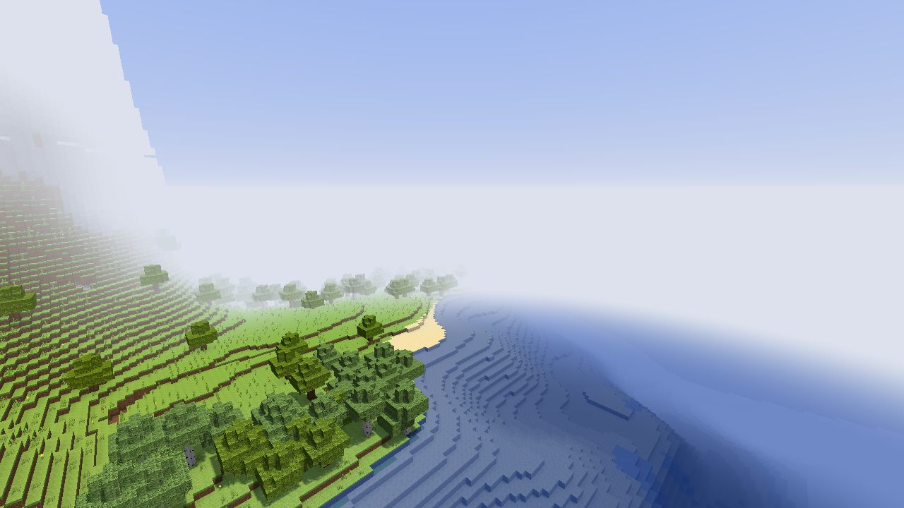
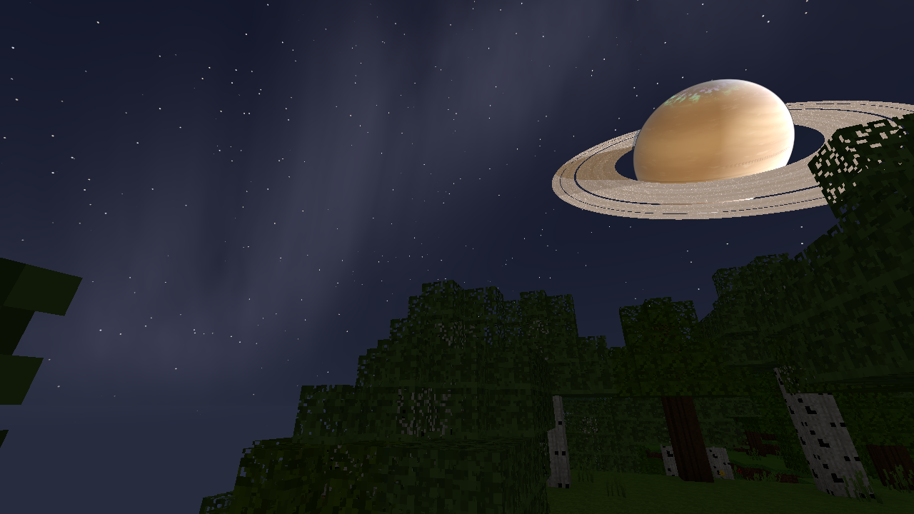
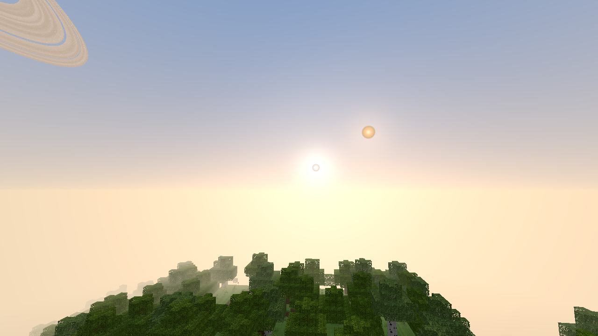
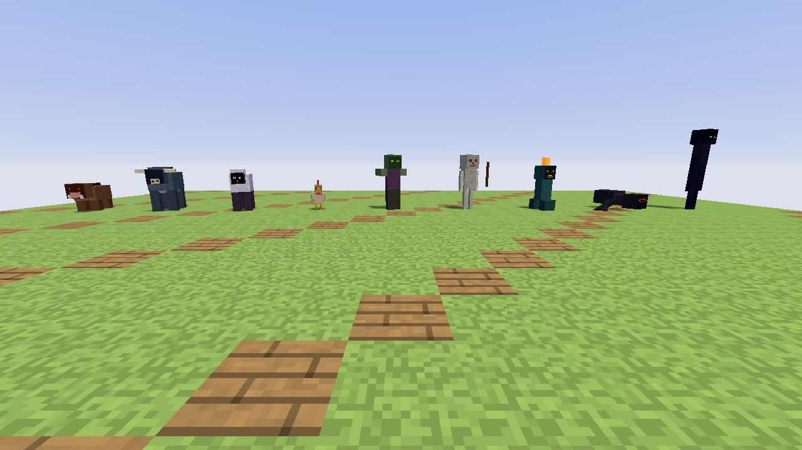

# Saturncraft

A single-player, browser-based voxel survival sandbox written from scratch in
JavaScript + WebGL ([three.js](https://threejs.org)). It reproduces the
observable mechanics of the classic block-survival genre's reference game
(version 1.21) — block behaviour, physics, survival, mobs, drops, spawn rules,
crafting progression — but on a moon with **three suns** and a **ringed gas
giant** hanging in the sky.

Every name, texture, model, sound and UI element is original and generated
procedurally at runtime: there are no image or audio files in the project.
Documented numbers (hardness, tool multipliers, drop chances, spawn weights,
light levels, damage, hunger values, movement speeds) come from the reference
game's public community wiki. In this document **"vanilla"** means that
reference game.

| Day under two suns | Night with the gas giant |
|---|---|
|  |  |
| **Twin sunset (Hearth + Ember)** | **The mob roster** |
|  |  |

## Quick start

**Play online:** https://landerverpoest-code.github.io/saturncraft/ (deployed
by `.github/workflows/pages.yml` on every push to `main`).

```bash
npm install
npm run dev        # http://localhost:5173
npm test           # unit tests (vitest)
npm run build      # production build in dist/
```

Requires a WebGL2 browser (any current Chrome, Edge, Firefox or Safari).
Click the canvas to capture the mouse. The world is saved to IndexedDB every
minute and on *Save & Quit*; *Continue World* on the title screen resumes it.

Handy URL parameters for development: `?autostart=1&seed=123&rd=8`
(`&continue=1` to resume the save). `window.__game` exposes the running game
in the console.

## Controls

| Action | Keys / mouse |
|---|---|
| Move | `W` `A` `S` `D` (or arrow keys) |
| Jump / swim up | `Space` |
| Sneak (stops at ledges) | `Shift` |
| Sprint | `Ctrl` or `R`, or double-tap `W` |
| Look | Mouse |
| Mine / attack | Left mouse button (hold to mine) |
| Place block / use item / eat / draw bow | Right mouse button (hold to eat or draw) |
| Open workbench / furnace / chest, open doors, sleep in a bed | Right-click the block (sneak to place against it instead) |
| Till soil | Right-click grass or dirt with a hoe |
| Put on armour | Right-click with it, or `Shift`+click it in the inventory |
| Pick block into hand | Middle mouse button |
| Select hotbar slot | `1`–`9` or mouse wheel |
| Inventory (2×2 crafting); item catalogue in creative mode | `E` |
| Chat / commands (`/help` lists them) | `T`, or `/` to start a command |
| Fly (creative mode) | Double-tap `Space`; `Space` up, `Shift` down |
| Drop item (stack with `Ctrl`) | `Q` |
| Pause menu / close screen | `Esc` |
| Debug overlay (fps, position, light, suns) | `F3` |
| Camera: first person / behind / in front | `F5` |
| Hide HUD | `F1` |
| Boat: board / steer / get out / break | Right-click it / `W` `S` `A` `D` / `Shift` / three hits |

Inventory screens: left-click picks up / places a stack, right-click splits a
stack or places one item, `Shift`+click moves a stack between sections,
`Shift`+click on a crafting result crafts as many as possible. The recipe book
beside every crafting grid lists the recipes (green = craftable with what you carry);
clicking one lays its ingredients into the grid (`Shift`+click: as many sets as possible).

Commands: `/gamemode survival|creative` (`/gm 0|1`), `/time set day|night|noon|midnight|<ticks>`,
`/time add <ticks>`, `/weather clear|rain|thunder`, `/tp x y z` (`~` = relative), `/give <item> [count]`
(e.g. `/give diamond_sword`, `/give oak planks 64`), `/summon <mob>` (Saturncraft names or the role,
e.g. `zombie`), `/xp <n> [levels]`, `/kill`, `/heal`, `/clear`, `/spawnpoint`, `/seed`.

## Project layout

```
src/
  main.js                  title screen, settings, start/continue
  game.js                  20 TPS fixed-step loop, interpolated rendering, furnaces, autosave
  world/                   ── voxel world ──
    blocks.js items.js     block & item registries (hardness, tools, food, fuel…)
    generator.js           noise terrain, biomes, caves, ores, trees (runs in workers)
    worker.js              Web Worker: generation + initial light, section meshing
    world.js lighting.js   chunk storage, block edits, flood-fill sky/block light
    mesher.js              face-culled section mesher with smooth light + AO
    fluids.js              water / lava flow; gravity blocks live in world.js
    mining.js              break times and block drops
    textures.js            procedural pixel art for every block face
    save.js                IndexedDB persistence (RLE-compressed chunks)
  physics/                 constants.js (vanilla values), body.js (AABB, step-up, fluids)
  player/                  player.js, survival.js (hunger), inventory.js, crafting.js, interaction.js
  mobs/                    mobTypes.js, mob.js (AI), models.js, pathfinding.js,
                           spawnRules.js, spawner.js, drops.js
  entities/                items, falling blocks, arrows, explosions
  sky/                     suns.js (pure orbital model), sky.js (lights, shadows, colours),
                           skyShader.js (atmosphere, suns, planet), gasGiant.js (ring mesh + particles)
  render/                  chunkRenderer.js, terrainMaterial.js, overlays.js, particles.js
  ui/                      hud.js, screens.js, icons.js, input.js, style.css
  audio/                   audio.js (procedural Web Audio effects)
tests/                     vitest suites (95 tests)
```

## The world

* **Chunks** are 16×16 columns, 384 blocks tall (y = −64 … 319), sea level 63.
  Generation and initial lighting run in a pool of Web Workers; light is then
  stitched across chunk borders on the main thread.
* **Meshing** is face-culled per 16³ section (in workers), with vanilla-style
  smooth lighting and ambient occlusion, then merged into two draw calls per
  chunk (opaque + translucent). Player edits are re-meshed synchronously so
  there is no flicker. Textures live in a mip-mapped texture array.
* **Terrain**: continentalness / erosion / ridge noise splines for height,
  3-D density noise for overhangs, temperature and humidity for 11 biomes
  (ocean, frozen ocean, beach, plains, forest, birch forest, taiga, snowy
  plains, desert, stony peaks, snowy peaks), smooth grass/foliage tinting,
  bare rock on steep slopes.
* **Caves**: "cheese" caverns and "spaghetti" tunnels from interpolated 3-D
  noise; lava fills cave air below y = −55; deepstone below y = 0 with a
  dithered transition; bedrock floor.
* **Ores** use the vanilla per-chunk feature table (counts, uniform/triangle
  height distributions, vein sizes, air-exposure discard) — e.g. diamonds peak
  near y = −59, iron has its mountain band, beryl only in mountains.
* **Blocks** break with vanilla hardness, tool multipliers, harvest tiers,
  the ×5 penalties for mining in water or while airborne, and the 5-tick delay
  between breaks. While mining, ten crack stages spread over the block
  (multiplied into its texture, so they follow its lighting), chips fly off
  the hit face and the arm chops continuously. Sand and gravel fall; plants, torches and cacti pop off when
  unsupported. Water spreads 7 blocks every 5 ticks, lava 3 blocks every 30
  ticks, with downhill seeking, infinite sources and lava/water hardening
  (obsidian / cobblestone / stone).

## Physics

The player and every mob run the vanilla movement integration at 20 ticks per
second: acceleration → swept AABB collision (Y first, then the larger
horizontal axis) → gravity 0.08 and drag 0.98 → friction (block slipperiness ×
0.91 on ground, 0.91 in air). Rendering interpolates between ticks.

| Quantity | Value | Measured in tests |
|---|---|---|
| Walk / sprint / sneak speed | 0.1 attribute, ×1.3, ×0.3 | 4.317 / 5.612 / 1.295 m/s |
| Jump | 0.42 b/t initial velocity | apex 1.2522 blocks, 12 ticks airtime |
| Sprint-jump boost | +0.2 in facing direction | |
| Terminal velocity | | 3.92 b/t |
| Step-up height | 0.6 | |
| Player box / eye | 0.6 × 1.8, eye 1.62 (sneak 1.5 / 1.27) | |
| Fall damage | ⌈distance − 3⌉ | 10-block fall = 7 |
| Water / lava | 0.02 accel, ×0.8 / ×0.5 drag, buoyant jumping | |

Survival: 20 health, 20 food, 5 initial saturation; exhaustion from sprinting,
jumping, swimming, attacking, mining and taking damage; regeneration every 80
ticks at ≥ 18 food or every 10 ticks with saturation at full food; starvation
down to half a heart (Normal difficulty). Drowning after 15 s of air (2 damage
per second), lava 4 damage + 15 s of fire, fire 1 damage per second, cactus
contact damage, the 10-tick invulnerability window with damage replacement,
knockback, the attack-cooldown damage curve and critical hits.

## Three suns

The sky has three suns, each defined by its own orbital period, starting phase,
rise azimuth, orbital tilt, declination offset, colour temperature, intensity
and apparent size (`src/sky/suns.js`):

| Sun | Period (ticks) | Phase | Rises at | Tilt | Colour | Intensity |
|---|---|---|---|---|---|---|
| **Hearth** | 24 000 | 0.02 | 90° (east) | 20° | 5600 K, yellow-white | 1.00 |
| **Pale Warden** | 37 200 | 0.60 | 62° | 38° | 11 000 K, blue-white | 0.55 |
| **Ember** | 15 400 | 0.33 | 128° | 52° | 2700 K, red-orange (large disc) | 0.45 |

* **Day** = at least one sun above the horizon; **twilight** = exactly one sun
  up; **night** = all three below. Because the periods are incommensurable the
  pattern never repeats exactly: nights last roughly 1–7 minutes and occupy
  ~15 % of the time.
* **Combined light**: each sun contributes `intensity × smoothstep(elevation)`;
  the combination `1 − Π(1 − fᵢ)` drives the 0…11 sky-darkening value, exactly
  where vanilla uses its single sun. Effective sky light = raw sky light −
  darkening, so a lone Ember or Pale Warden gives a dim (light 9–10) "twilight
  day" where surface monsters still cannot spawn, while a fully dark sky gives
  light 4 like a vanilla night.
* **Mobs use the combined light**: hostile spawning uses the vanilla light test
  with the combined darkening, undead burn only when the combined sunlight
  counts as "day" (darkening < 4) and the brightness at their head exceeds 0.5,
  spiders turn neutral in bright combined light, voidwalkers flee daylight.
* **Rendering**: each sun has its own disc, glare and horizon scattering; where
  suns appear together their glows add and the scene light colour is the
  intensity-weighted blend of the visible suns. Each sun owns one
  shadow-casting directional light (three shadow maps in total); shadow maps
  are refreshed round-robin (brightest sun every 3rd frame, the others every
  6th) and lights below the horizon are switched off.

## Ringed gas giant

The world is a tidally locked moon, so the gas giant hangs almost fixed in the
southern sky with a slow libration.

* Ray-traced sphere in the sky shader with a **banded, animated atmosphere**
  (fbm noise with latitude-dependent differential rotation, polar hoods and a
  drifting storm oval), **soft limb glow** and a **subtle aurora** on the polar
  night side.
* **Rings** are a real mesh (`RingGeometry`) with a procedural density shader
  — broad bands, fine ringlets, a division gap — where **each radius rotates at
  its own Keplerian speed** (ω ∝ r^−1.5), plus 6 000 orbiting ice particles that
  follow the same law. Rings are **translucent** (back-lit side dimmer),
  show **specular glints**, receive the **planet's shadow** and cast their own
  shadow onto the cloud tops; the planet occludes the far side of the rings.
* **Lighting follows the actual sun directions**, so the planet shows phases,
  can be lit by suns that are below your horizon, and fades into the daytime sky.

## Survival content

### Mobs

| Mob | Vanilla role | Health | Speed | Size | Notes |
|---|---|---|---|---|---|
| Bristleback | pig | 10 | 0.25 | 0.9×0.9 | |
| Mooxen | cow | 10 | 0.20 | 0.9×1.4 | |
| Fleecer | sheep | 8 | 0.23 | 0.9×1.3 | |
| Cluckling | chicken | 4 | 0.25 | 0.4×0.7 | slow fall, lays eggs every 5–10 min |
| Shambler | zombie | 20 | 0.23 | 0.6×1.95 | melee 3, armour 2, burns in sunlight |
| Rattler | skeleton | 20 | 0.25 | 0.6×1.99 | bow every 40 ticks, strafes, burns in sunlight |
| Fizzler | creeper | 20 | 0.25 | 0.6×1.7 | 30-tick fuse within 3 blocks, power-3 explosion |
| Skitterer | spider | 16 | 0.30 | 1.4×0.9 | climbs walls, leaps, neutral in bright light |
| Voidwalker | enderman | 40 | 0.30 (+0.15 angry) | 0.6×2.9 | angered by eye contact, teleports, hurt by water, dodges arrows |

Mob movement uses the same physics with vanilla's mob acceleration (speed²),
A* pathfinding over walkable cells, panic when hurt (passives), melee reach
`(2·width)² + target width`, the skeleton's bow logic and the fuse/swell logic.

**Drops** (no Looting): Bristleback 1–3 pork chops; Mooxen 0–2 leather + 1–3
beef; Fleecer 1 wool + 1–2 mutton; Cluckling 0–2 feathers + 1 raw fowl (meat
drops cooked if the mob was burning); Shambler 0–2 rotten flesh + 2.5 % rare
drop on player kills; Rattler 0–2 arrows + 0–2 bones; Fizzler 0–2 blast powder;
Skitterer 0–2 string + 1/3 chance of an eye on player kills; Voidwalker 0–1
void pearl.

**Spawning** follows the vanilla natural-spawn algorithm: each tick one attempt
per chunk within 8 chunks at a random height below the heightmap; packs of up
to 3 groups × up to 4 tries with ±5 jitter; at least 24 blocks from the
player; mob caps of 70 hostile / 10 passive scaled by chunk count / 289;
passive attempts only every 400 ticks plus 10 % chance of a herd when a chunk is
first generated; biome spawn weights (monsters: Skitterer 100, Shambler 100,
Rattler 100, Fizzler 100, Voidwalker 10; animals in grassy biomes: Fleecer 12,
Bristleback 10, Cluckling 10, Mooxen 8). Monsters need block light 0, raw
sky light ≤ rand(32) and combined light ≤ rand(0…7); animals need grass and
light > 8. Hostiles despawn instantly beyond 128 blocks and with 1/800 chance
per tick beyond 32 blocks after 30 s without interaction; animals persist (also
across chunk unloads and saves).

### Items and progression

Logs → planks → sticks / workbench → wooden, stone, iron, golden and diamond
pickaxes, axes, shovels and swords (vanilla speeds, damage, attack speed and
durability) → furnace (200-tick smelting, vanilla fuel values) → ingots, glass,
stone, cooked food; torches, buckets (water/lava pick-up and placement),
bow and arrows, storage blocks, wool, sandstone, stone bricks. Food values
(hunger/saturation) and side effects (hunger from rotten flesh and raw fowl,
poison from eyes) follow the documented table.

## Implemented vs. not yet implemented

**Implemented** (vanilla features)

* Chunked 384-high world, worker generation, biomes, caves, ore distribution, trees, plants
* Mining with hardness/tool tiers/durability, block drops, placing, pick-block
* Sky light + block light with smooth lighting and AO; torches, lava, lit furnace glow
* Gravity blocks, water and lava flow, source creation, obsidian/cobblestone/stone formation
* Player physics, sprinting, sneaking (ledge stop), swimming, step-up, fall damage
* Health, hunger, saturation, exhaustion, regeneration, starvation, drowning, fire, lava, cactus
* Attack cooldown, critical hits, knockback, armour formula for mobs, invulnerability frames
* 9 mobs with AI, pathfinding, drops, natural spawning, caps and despawning
* Explosions (ray-based block destruction with blast resistance, exposure-scaled damage, 1/power drop survival)
* Inventory, hotbar, 2×2 and 3×3 shaped/shapeless crafting with a recipe book, furnace smelting
* Farming: hoes till grass/dirt; tall grass drops seeds (1/8); wheat grows through 8 stages on random ticks (3 per section per tick) with the reference growth-speed formula, needs light ≥ 9; farmland is moistened by water within 4 blocks, dries out, reverts to dirt and can be trampled; bread from 3 wheat
* Grass spreads to nearby dirt in light ≥ 9
* Armour: leather/golden/iron/diamond helmets, chestplates, leggings and boots with the reference defence points, toughness, durability and damage formula (falls, drowning, burning, starvation and poison bypass it); armour slots in the inventory, right-click or shift-click to wear; armour bar
* Experience: orbs from player kills (monsters 5, animals 1–3) and ores (coal 0–2, azurite 2–5, cinnabar 1–5, diamond/beryl 3–7) that drift to the player within 8 blocks; reference level curve, XP bar and level, 7 × level (max 100) dropped on death
* Beds (3 wool + 3 planks): sleeping only when all three suns are down and no monster within 8 blocks; 5 s of sleep skips to the first sunrise; sets the respawn point (lost if the bed is gone)
* Animals follow a player holding their food (cows/sheep wheat, chickens seeds, pigs carrots); feeding two adults makes them breed (a baby that grows up in 20 minutes, 5-minute cooldown, 1–7 XP); feeding babies speeds up growth
* Shears (2 iron) shear sheep for 1–3 wool; sheep regrow it by eating grass
* Carrots: a crop planted on farmland (2–5 per ripe plant), food, and part of the Shambler's rare drop
* Potatoes (2–5 per ripe plant, 2 % poisonous potato; bake them in a furnace) and beetroots (beetroot + seeds; 6 beetroots + bowl = beetroot soup, which gives the bowl back); both grow in village farms, are sold by farmers and feed pigs/chickens
* Fences (oak/spruce/birch) that connect to fences, gates and full blocks, with 1.5-block collision so nothing jumps over; oak fence gates that open and close
* Villages (one per 320 × 320-block region at most, in plains, desert, taiga and snowy plains): a well, four dirt-path roads and houses (log/plank, sandstone or spruce/cobblestone styles, with doors, windows, a bed and a workbench or chest), farms of wheat or carrots and lamp posts; `/locate village` finds the nearest
* Settlers live in the village houses: farmer, librarian, smith, shepherd or butcher (robe colour); they flee Shamblers, stay near home and go inside at night; right-click to trade goods for beryl and beryl for goods (12 uses per offer, restocked every half day, XP for trading)
* Dungeons: mossy cobblestone rooms (5–7 × 4 × 5–7 inside, 14 attempts per chunk, 1–5 openings into caves) with a monster spawner (Shambler 50 %, Rattler/Skitterer 25 % each; active within 16 blocks, 4 spawn attempts every 10–40 s, at most 6 nearby, light ≤ 11) and up to two loot chests; mined spawners give 15–43 XP
* Sugar cane on shores (grows to 3 blocks next to water) → paper → books → bookshelves; clay → bricks; glass panes that connect
* 16 dye colours: bone meal (white), flowers (yellow/red), azurite (blue), cactus in a furnace (green), coal (black) and mixes; dyed wool; sheep come in natural colours (white, black, grays, brown, rare pink), can be dyed and drop/shear their colour
* Pumpkin patches (plains, taiga) and melons (forests): pumpkin + torch = pumpkin lantern (light 15), melons drop 3–7 slices, pumpkin pie
* Howlers (wolves) in packs of 4 in forests and taiga: they hunt Fleecers and Clucklings and the whole pack turns on whoever hurts one; tame with bones (1 in 3), then they sit/stand on right-click, follow you (teleporting when over 12 blocks away), attack what hurts you or what you hit, heal and breed with meat (pups are tame), red collar
* Shamblers hunt Settlers when no player is around
* Bone meal grows crops 2–5 stages and sprouts grass and flowers
* Slabs and stairs in oak, cobblestone, stone brick and sandstone: bottom/top/double slabs (merge by placing), stairs facing away from the player and upside down when placed high; walkable with the 0.6 step-up; they block light like full blocks
* Oak doors (two blocks, 3/16-thick collision box, open/close with right-click), ladders (climb 0.2/tick, fall capped at 0.15, sneak to hold on), torches on walls
* Chests (27 slots, shift-click transfer, contents drop when broken, saved with the world); furnaces and chests face the player when placed
* Bow and arrows (player and Rattler), arrow pick-up
* Death screen, item drop on death, respawn; pause menu with settings
* Procedural sound effects with stereo panning; world saving
* Generative music: every 5–10 minutes a calm piano piece is composed on the spot (major by day, minor at night, low and sparse underground) with reverb; distant rumbles in dark caves; music volume in the pause menu
* Weather: rain spells (12 000–24 000 ticks) after clear spells (12 000–180 000), fading in/out at 0.01 per tick; rain or snow by biome (none in deserts), stopped by roofs; overcast sky, weaker sun light, grey clouds, splashes and rain sound; rain puts out burning players and mobs and undead do not catch fire in it
* Thunderstorms (their own 3 600–15 600-tick spells, only while it rains): darker sky and light, lightning bolts every ~20 s within 64 blocks that flash the sky, crack and rumble, set fire around the strike point and deal 5 damage + burning within 3 blocks; `/weather thunder`, `/summon lightning_bolt`
* Creative mode: flight, instant breaking without drops, no damage (except the void) or hunger, unlimited blocks, item catalogue with search; hostile mobs ignore creative players
* Chat with commands (see Controls)
* Fire: flint and steel (iron ingot + flint, 64 uses) lights fires that animate, crackle and give light 15; fire ages, burns up flammable blocks (planks, logs, leaves, wool, bookshelves, plants with the reference encouragement/flammability odds), spreads through the air up to 4 blocks up, dies out without fuel and is put out by rain; lava sets fire to nearby flammable blocks; standing in fire sets you alight; punch it to put it out
* Saplings (oak, birch, spruce): leaves drop them 1 in 20; planted on grass or dirt they grow in two steps (1 in 7 per random tick in light ≥ 9; bone meal 45 %) into the same trees as world generation, if there is room; natural leaves with no log within 4 blocks decay and drop saplings/sticks/apples, placed leaves stay
* Oak boats (5 planks): placed on water, bob on the surface, accelerate to about 8 blocks/s, steer with A/D, break after three hits and drop themselves; saved with the world
* 19 milestones (the reference game's advancements, with Saturncraft's own names) with a toast when reached and an overview in the pause menu, saved per world
* Third-person cameras (F5, behind and in front, pulled in by walls) with an animated player model holding the selected item
* Animated title screen (stars, ringed giant, three suns, scrolling landscape) with splash texts
* Blocky cloud layer (12×12 cells, 4 thick, y=192, drifting 0.03 blocks/tick), coloured by the suns
* Three dimensions (see "Other dimensions" below): the overworld, **the Cinderdeep** (fiery underworld, 1:8 scale, reached through obsidian Rift portals) and **the Hollow** (void islands with the Void Wyrm boss, reached through a Hollow Gate in an underground Hollow Sanctum); each has its own chunks, saves, containers and mobs, and the save remembers which dimension you are in

**Not yet implemented**

* Enchanting, anvils, shields, potions and status-effect UI (only hunger/poison effects exist); armour is not drawn on the third-person player model
* Taming of animals other than Howlers, cocoa and ink sacs
* Large structures beyond villages, dungeons, sanctums and bastions; villager breeding and job sites; redstone-style circuitry; Hollow outer-island cities
* Double chests and other storage containers, walls, trapdoors, corner-shaped stairs
* Snow layers
* Slimes, witches, drowned, husks/strays as separate variants, baby mobs, mob equipment
* Difficulty levels (fixed at Normal), spectator/adventure modes, multiplayer
* Sprint-swimming/crawling poses, minecarts, elytra

## Other dimensions

### The Cinderdeep (fiery underworld)

* **Getting there:** build an obsidian frame (interior 2–21 wide, 3–21 tall, corners optional; the smallest is 4×5 outside) standing in the x or z plane and light its inside with flint and steel: it fills with violet **Rift** blocks. Stand in the Rift for 4 s (instantly in creative). One block in the Cinderdeep is 8 in the overworld; on arrival the nearest Rift within 16 blocks (Cinderdeep) / 128 blocks (overworld, loaded chunks) is used, otherwise a new 4×5 portal is built on a suitable floor near the target (or on an obsidian ledge carved into the rock). Portals you travel through are linked, so going back returns you to the portal you came from. Breaking the frame collapses the Rift.
* **World:** caverns between a bedrock floor (y 0–4) and ceiling (y 123–127), a lava sea up to y 31, soft red **Cinderstone**, **Mournsand** (slows you to 40 %) and gravel shores, **Glowshard** clusters hanging from the ceilings (light 15, drop Glowshard Dust; 4 dust = 1 block), **Emberquartz Ore** (Ember Quartz), ever-burning fires (fire on Cinderstone never goes out) and **Ember Bastions**: 97-block bridges of **Scorched Bricks** on pillars with a central hub holding an Ember Lord spawner and a loot chest (`/locate bastion`).
* **Rules:** red-orange haze instead of sky, no suns, no weather; water boils away when poured, ice does not melt into water; beds explode (power 5, with fire) when used — in the Hollow too.
* **Mobs:** **Ashwraith** (huge drifting shroud with trailing tendrils; spits exploding fireballs at players it sees within 64 blocks; drops blast powder), **Cinder Brute** (fire-immune melee brawler, 24 HP; gold ingots), **Ember Lord** (hovering, fire-immune, fires volleys of three small fireballs; drops **Ember Rods**, more of them around bastions). All have original box models.

### The Hollow (void dimension)

* **Getting there:** craft an **Eye of the Void** (Void Pearl from Voidwalkers + Ember Powder; 1 Ember Rod = 2 powder). Right-click into the air to throw one: it flies ~12 blocks towards the nearest **Hollow Sanctum** (one per 640×640 region, 75 %; buried at y 10–31; `/locate sanctum`) and usually drops back (1 in 5 shatters). The sanctum is a stone-brick vault with a corridor, a Skitterer spawner, bookshelves, a loot chest and a ring of 12 **Hollow Frames** on a dais over lava (each frame has a 10 % chance to hold an eye already). Right-click every frame with an eye: the 3×3 centre turns into a starry **Hollow Gate**; fall in.
* **World:** a central island of pale **Hollowstone** (~100 blocks radius) floating in a black-violet starry void, outer islands beyond 220 blocks, ten obsidian pillars around the centre each crowned with a **Mending Crystal**, and the bedrock exit fountain in the middle. You arrive on a 5×5 obsidian platform at x 100. Many Voidwalkers.
* **The Void Wyrm:** a flying boss (200 HP, boss bar) that circles the pillars, swoops at the player (10 damage from its head, 5 from its body, plus a fling) and pulls up again; crystals within 48 blocks heal it (2 HP/s, shown as a beam) until they are shot or hit (they explode). Killing it opens the exit gate in the fountain, drops 12 000 XP and a **Wyrm Egg**, and unlocks the *Wyrmslayer* milestone. The exit gate takes you to your overworld spawn point (bed or world spawn).
* Milestones: *Tear in the World*, *Into the Cinderdeep*, *Ember Hunter*, *Eye in the Dark*, *The Hollow*, *Wyrmslayer*.

### Testing

`/dimension <overworld|cinderdeep|hollow>` travels at once (to a safe spot; into the Hollow on the arrival platform). Dying away from the overworld respawns you at home.

Code: `src/world/dimensions/` (registry and scaling, generators, portal logic, sanctums, the game-side `DimensionManager`), `src/sky/dimensionSky.js`, `src/mobs/dimensionMobs.js`, `src/mobs/voidWyrm.js`, `src/entities/fireball.js`, `src/entities/voidEye.js`.

## Deliberate deviations

* **Original names and art** for every mob, item and block that is
  distinctive to the reference game (e.g. Deepstone, Cinnabar, Azurite, Beryl,
  Workbench, Blast Powder, Void Pearl). Monster spawn weights of variants
  that do not exist here are merged into their base mob (husk → Shambler,
  stray → Rattler, zombie villager → Shambler); slime/witch weights are omitted.
* **Three suns instead of one sun + moon**: day/night is irregular. Sky
  darkening is derived from the combined light of the suns (see above) instead
  of the fixed 24 000-tick cycle; there are no moon phases (the gas giant
  shows phases instead) and no sleeping.
* **Hostile mobs can spawn under twilight skies only if the combined light is
  low enough**; with only the dim suns up, the surface stays at light 9–10,
  which is too bright for spawning but not "day" for burning — a state that has
  no vanilla equivalent.
* **Rare Shambler drop**: vanilla picks one of iron ingot / carrot / potato; only
  the ingot exists here, so it drops with 2.5 % × 1/3.
* **Dyes**: black dye comes from coal (the reference uses ink sacs) and brown dye is mixed from red + green (the reference uses cocoa beans), since neither source exists here; lambs take one parent's colour instead of blending.
* **Lighting**: sky light is stored per block and darkened in the shader by the
  combined sun light; the light curve blends vanilla's brightness formula with
  its default gamma. Fog is spherical. Leaves cast full shadows only where
  their texture is opaque. Sun shadows only come from terrain up to 140 blocks
  sunward of the player, so very long twilight shadows of distant hills end
  there.
* **Mob AI** is a simplified goal system (no goal priority selectors; a
  bounded A* of 250 nodes; panicking animals steer directly). Mobs do not seek
  shade from the suns, and there are no doors, wolves or cats to react to.
* **Water physics**: no flowing-water push currents; fluid surfaces are flat
  per block (no sloped corner heights); no bubble columns.
* **Explosions** do not set fire and do not knock items back.
* **Torches** can only be placed on the top of blocks.
* **Furnace** state is stored by block position rather than as a block entity;
  breaking a furnace drops its contents.
* **Render/entity distance**: entities render up to 64 blocks away and only
  cast shadows within 24 blocks; three shadow maps update round-robin.
* **Item stacks** drop as sprites rather than spinning 3-D models.
* **Step-up** (0.6 blocks) is implemented, but without slabs or stairs in the
  block set it rarely comes into play; full blocks always need a jump.
* **Saving** keeps modified chunks, the player, time, furnaces and animals;
  hostile mobs, dropped items and in-flight fluids are not saved.

## Performance

* Target: stable 60 fps at render distance 8 on a mid-range laptop GPU.
* Terrain at render distance 8 is ~1.9 M triangles in total. **Occlusion
  culling** (`src/world/visibility.js`) brings what is drawn down to ~0.3 M from
  the surface and a few thousand inside a sealed cave: every 16³ section records
  which of its faces connect through non-opaque blocks, and a flood fill from the
  camera (which never turns back against a direction it took) trims each
  chunk's draw range and bounding sphere to the sections it reached. A/B renders
  with and without culling are pixel-identical.
* Solid blocks, alpha-tested blocks (leaves, plants, glass, torches) and water
  are three separate meshes per chunk, so the solid pass has no `discard` and
  the GPU can reject hidden fragments before shading them.
* Generation (~15 ms/chunk) and meshing (~1.5 ms/section) run in a worker pool
  (`hardwareConcurrency − 1`, 2–6 workers); main-thread chunk work is budgeted to
  ~6 ms per frame; the simulation tick costs ~0.1–1 ms.
* Shadows: three 1024² maps over a ±44-block area. The brightest sun's map is
  redrawn every 3rd frame and the others every 6th (the suns move ~0.3°/s;
  all three are redrawn right after a block edit). The shadow pass only draws
  sections that contain sky light and lie inside the light's frustum, which
  reaches 140 blocks sunward. The 17-tap shadow lookup is skipped for suns
  below the horizon, faces turned away from a sun, and surfaces without sky
  light (sunlight is scaled by sky light, so none of these change the image).
* The sky dome, rings and ice particles are drawn after the terrain with depth
  testing, so the gas-giant shader only runs on pixels where sky is visible.
* Turn shadows off in the pause menu on weak GPUs; lower the render distance
  for integrated graphics.
* Pixel ratio is capped at 1.25 (`pixelRatioCap` in the settings).

## Tests

`npm test` runs 132 unit tests:

* **physics** — constants, walk/sprint/sneak speeds, jump apex and duration,
  sprint-jump, terminal velocity, fall damage, collision, step-up, ledge
  sneaking, swimming
* **suns** — distinct periods/phases/azimuths, periodicity, rise points,
  daylight fractions, day/twilight/night classification, combined light and
  darkening, colour blending
* **spawning** — table weights and weighted picks, group sizes, caps, spawn and
  despawn radii, monster/animal light tests (Monte-Carlo vs analytic),
  three-sun night/day spawning, sunlight burning probability
* **drops** — mob drop ranges and distributions, player-kill conditions,
  cooked meat, block drops by tool tier, ore count ranges, flint chance
* **visibility** — section face connectivity (air, rock, tunnels, sealed
  pockets, see-through leaves), cut-out mesh layer, camera flood fill
* **mining / survival / crafting / world** — break times against the
  documented table, tool stats, hunger/regeneration/starvation, recipes and
  smelting, deterministic generation, bedrock/water/ore placement, canopy
  continuity across chunk borders, lighting and cross-chunk light, water and
  lava spread distances, infinite sources, obsidian, falling sand, explosion
  damage, save encoding

## Build history (vertical slices)

1. **Playable slice** — worker terrain generation, lighting and meshing,
   vanilla physics, mining/placing, the three-sun sky with shadows and the
   ringed gas giant.
2. **Mobs** — models, AI, pathfinding, spawning rules, drops, combat, explosions.
3. **Remaining mechanics** — hunger and damage sources, inventory, crafting,
   furnace, fluids and gravity blocks, audio, saving, tests and polish.
